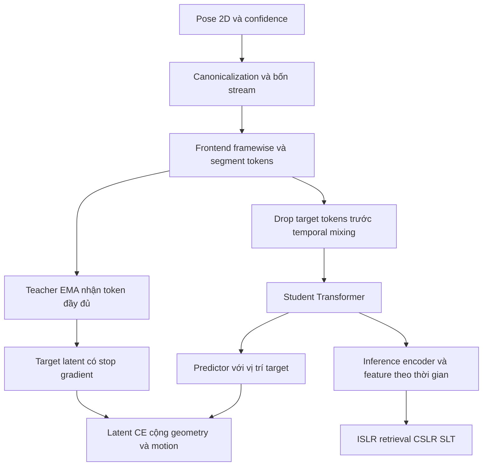

# Hướng dẫn triển khai end to end biểu diễn ngôn ngữ ký hiệu bằng pose và JEPA

**Đối tượng đọc:** AI Agent được giao xây dựng repository, huấn luyện và đánh giá mô hình.

**Phương pháp được chốt:** pose 2D theo pipeline dữ liệu Uni-Sign, frontend theo từng bộ phận, EMA JEPA trong latent space, hai loss phụ hình học và motion, sau đó metric learning có gloss nếu dữ liệu cho phép.

**Mã cấu hình nội bộ:** `pose_jepa_hybrid_v1`. Đây là tên recipe trong project, không phải tên paper đã công bố.

**Ngày kiểm chứng nguồn:** 2026-10-13. Tài liệu độc lập, không yêu cầu Agent đọc lịch sử hội thoại để hiểu phương pháp.

**Trạng thái:** đây là đặc tả triển khai. Chưa có repository mới được triển khai, chưa huấn luyện recipe này và chưa có pretrained checkpoint riêng cho recipe. Những cấu hình do tài liệu đề xuất phải được kiểm nghiệm bằng các baseline và acceptance tests bên dưới.

## Mục lục

1. [Mục tiêu và quyết định đã chốt](#1-mục-tiêu-và-quyết-định-đã-chốt)
2. [Nguồn kế thừa và phạm vi tái sử dụng](#2-nguồn-kế-thừa-và-phạm-vi-tái-sử-dụng)
3. [Repository và checkpoint đã kiểm chứng](#3-repository-và-checkpoint-đã-kiểm-chứng)
4. [Môi trường và cấu trúc repository cần tạo](#4-môi-trường-và-cấu-trúc-repository-cần-tạo)
5. [Dữ liệu và protocol chống contamination](#5-dữ-liệu-và-protocol-chống-contamination)
6. [Schema pose và adapter Uni-Sign](#6-schema-pose-và-adapter-uni-sign)
7. [Chuẩn hóa và biểu diễn các bộ phận](#7-chuẩn-hóa-và-biểu-diễn-các-bộ-phận)
8. [Frontend spatial GCN và token hóa](#8-frontend-spatial-gcn-và-token-hóa)
9. [Encoder predictor và đầu ra downstream](#9-encoder-predictor-và-đầu-ra-downstream)
10. [Masking và định nghĩa information leakage](#10-masking-và-định-nghĩa-information-leakage)
11. [Loss và target](#11-loss-và-target)
12. [Teacher EMA và training loop](#12-teacher-ema-và-training-loop)
13. [Cấu hình mặc định](#13-cấu-hình-mặc-định)
14. [Giai đoạn metric learning có gloss](#14-giai-đoạn-metric-learning-có-gloss)
15. [ISLR và frozen linear probe](#15-islr-và-frozen-linear-probe)
16. [Dictionary retrieval](#16-dictionary-retrieval)
17. [Backbone cho CSLR và SLT](#17-backbone-cho-cslr-và-slt)
18. [Inference export và checkpoint](#18-inference-export-và-checkpoint)
19. [Baseline ablation và model selection](#19-baseline-ablation-và-model-selection)
20. [Các API và lệnh CLI Agent phải xây dựng](#20-các-api-và-lệnh-cli-agent-phải-xây-dựng)
21. [Kiểm thử có ý nghĩa và acceptance criteria](#21-kiểm-thử-có-ý-nghĩa-và-acceptance-criteria)
22. [Milestone triển khai và cách xử lý blocker](#22-milestone-triển-khai-và-cách-xử-lý-blocker)
23. [Mở rộng sau baseline](#23-mở-rộng-sau-baseline)
24. [Reference code cho các phép toán quan trọng](#24-reference-code-cho-các-phép-toán-quan-trọng)
25. [Nguồn tham khảo đầy đủ](#25-nguồn-tham-khảo-đầy-đủ)
26. [Prompt bàn giao cho AI Agent](#26-prompt-bàn-giao-cho-ai-agent)

## 1 Mục tiêu và quyết định đã chốt

### 1.1 Mục tiêu sản phẩm nghiên cứu

Xây dựng một pose encoder dùng lại được cho:

- **ISLR:** isolated sign language recognition.
- **Sign dictionary retrieval:** video ký hiệu làm query, video trong từ điển làm gallery.
- **Sequence backbone:** feature theo thời gian cho CSLR, SLT và các head khác.
- Chuyển sang corpus hoặc người ký chưa thấy, khi protocol thực sự giữ target corpus hoặc signer ngoài training.

Chất lượng representation được đo bằng downstream. Pretraining loss thấp hoặc overfit fixture không phải bằng chứng mô hình tốt.

### 1.2 Các quyết định bắt buộc ở phiên bản đầu

| Thành phần | Quyết định |
|---|---|
| Input | Pose **2D** `x, y, confidence`; không diễn giải confidence thành z |
| Bộ phận | `body`, `left_hand`, `right_hand`, `face`, theo thứ tự cố định này |
| Số điểm | 9, 21, 21, 18; tổng 69 điểm, từ COCO-WholeBody 133 |
| Frontend | GCN theo không gian, độc lập theo part và frame; LayerNorm theo channel |
| Hai tay | Chia sẻ trọng số frontend; giữ part identity; không flip mặc định |
| Hand representation | Local handshape và global wrist anchor, cùng scale của thân |
| Temporal encoder | Transformer 8 blocks, dimension 256, 8 heads, FFN 1024 |
| Token | Một part trong một segment gồm 2 frame; tối đa 256 token khi T=128 |
| SSL | Teacher EMA, student chỉ nhận visible token, predictor tái dựng full token lattice |
| Latent objective | CE giữa phân phối latent teacher có centering và predictor |
| Loss phụ | Confidence-weighted local geometry và first-order motion |
| Export sequence | Ghép 4 part feature; dimension 1024, temporal stride 2 |
| Export clip ở Stage 1 | Mean theo valid token của từng part rồi concatenate 1024; không tạo MLP chưa được train |
| Stage 2 khi có gloss | Supervised contrastive metric learning, có CE phụ và replay SSL |
| RGB | Không nằm trong implementation chính; giữ SignRep RGB làm baseline ngoài hệ thống |

Đây là **adaptation** lấy partition/pose representation từ Uni-Sign, teacher/predictor/centering từ S-JEPA, và ý tưởng giữ tín hiệu sign-specific/motion từ SignRep, MASA, MAMP. Không tuyên bố tái tạo nguyên bản một paper.

### 1.3 Các nhánh bắt buộc và tùy chọn

- **Bắt buộc:** Stage 0 dữ liệu, Stage 1 SSL hybrid, ISLR, frozen retrieval, export sequence, smoke tests và kiểm tra leakage.
- **Bắt buộc trong repo:** các baseline cùng encoder và adapter CSLR/SLT để feature có thể được dùng end to end.
- **Chạy Stage 2:** chỉ khi có gloss train và split hợp lệ. Nếu không có, bỏ Stage 2 và hoàn tất pipeline SSL cùng downstream hiện có; không tạo pseudo-gloss rồi gọi đó là nhãn thật.
- **Không bật trong baseline:** LeJEPA/SIGReg, saliency estimator học được, RGB fusion, 3D lifting, dense multi-layer JEPA, adversarial style discriminator.

Các phần mở rộng được mô tả ở mục 23. Agent hoàn thành recipe chính trước khi thêm chúng.

## 2 Nguồn kế thừa và phạm vi tái sử dụng

Mỗi lựa chọn dưới đây phải được lưu trong `docs/method_provenance.md` của repo mới.

| Nguồn | Kế thừa | Không được suy diễn |
|---|---|---|
| [Uni-Sign, R1](#r1-uni-sign) | Pose schema, partition 69 điểm, local hand/face, tham khảo frontend GCN | Thành tích full pipeline mT5 không tự động thuộc pose encoder mới |
| [S-JEPA, R2](#r2-s-jepa) | EMA teacher, masked latent prediction, predictor, CE/centering/temperature | Recipe action skeleton 3D chưa chứng minh tối ưu cho ký hiệu 2D |
| [SignRep, R3](#r3-signrep) | Sign-specific geometry priors và cách đánh giá frozen retrieval | SignRep nhận RGB; không phải skeleton MAE và không có weights phù hợp trực tiếp với encoder này |
| [MASA, R4](#r4-masa) | Giữ motion objective và context cấp clip | Không coi code skeleton cũ với detector khác là baseline công bằng nếu không kiểm soát preprocessing |
| [MAMP, R5](#r5-mamp) | Motion prediction và đối chứng motion-aware masked modeling | Không đưa confidence vào network body xyz mà không adaptation |
| [SignSeek, R6](#r6-signseek) | Motivation metric learning theo gloss và latent prediction theo articulator | Có gloss supervision; không gọi kết quả đó là JEPA thuần không nhãn |
| [V-JEPA, R7](#r7-v-jepa) | Tham khảo trainer, EMA, masking/predictor bookkeeping | RGB tokenizer/checkpoint không tương thích trực tiếp pose |
| [V-JEPA 2.1, R8](#r8-v-jepa-21) | Tham khảo cho extension dense/context loss | Không bật nguyên recipe nặng này trong baseline đầu |

Frontend LayerNorm, packet tokenization, loss weights, export concat và training stages trong file này là **quyết định triển khai do tài liệu đề xuất**. Agent ghi rõ chúng trong config và ablation, không gán các chi tiết này cho paper gốc.

## 3 Repository và checkpoint đã kiểm chứng

### 3.1 Source code tham khảo

Các revision sau được kiểm tra qua repository metadata ngày 2026-10-13. Khi triển khai, dùng revision được pin, không chỉ `main`.

| Repository | Revision đã kiểm tra | File cần đọc |
|---|---|---|
| [Uni-Sign official](https://github.com/ZechengLi19/Uni-Sign) | `eed438bcb49e30405cd6ccdfcccca330c134e830` | `datasets.py`, `models.py`, `docs/DATASET.md`, `demo/pose_extraction.py`, `demo/rtmlib-main/rtmlib/tools/solution/wholebody.py` |
| [SignRep official](https://github.com/ryanwongsa/SignRep) | `06f40b5d287867b24e0dd2dc380b40b3f2ae8ac2` | `example_usage.py`, `models/final_models/FINAL_hiera_latent_model_head_v25_active.py`, README |
| [MAMP official](https://github.com/maoyunyao/MAMP) | `09e6252a5c7d061c226395d25e6aa47a69e7e58d` | `model_mamp/transformer.py`, `model_mae/transformer.py`, `engine_pretrain.py`, configs |
| [MASA official](https://github.com/sakura2233565548/MASA) | `53bbb3b77bab7e98d33d7fcbd230e3e98c832ed1` | `moco/GCN_Transformer_mask.py`, `moco/st_gcn_encoder/st_gcn_single_frame.py`, `pretrain.py` |
| [V-JEPA official](https://github.com/facebookresearch/jepa) | `51c59d518fc63c08464af6de585f78ac0c7ed4d5` | `app/vjepa/train.py`, `src/models/predictor.py`, `src/masks/multiblock3d.py` |
| [V-JEPA 2 and 2.1 official](https://github.com/facebookresearch/vjepa2) | `204698b45b3712590f06245fbfba32d3be539812` | `app/vjepa_2_1/train.py`, `app/vjepa_2_1/models/predictor.py`, `src/utils/checkpoint_loader.py` |

**Điểm thực tế của Uni-Sign public code:** README trỏ pretraining implementation sang [issue #15](https://github.com/ZechengLi19/Uni-Sign/issues/15) và [community pre_training.py](https://github.com/williams-bert/Uni-Sign/blob/main/pre_training.py). Official `models.py` còn import `stgcn_layers`; file/module này không xuất hiện trong tree được kiểm tra tại revision trên. Agent không mặc định clone là chạy được ngay. Frontend chính ở mục 8 được đặc tả để tự cài đặt và không phụ thuộc import đó. Community fork là nguồn tham khảo, không được ghi nhầm thành official implementation đã xác nhận tương đương.

Tại lần kiểm tra này, chưa xác nhận được public source code và checkpoint chính thức cho **S-JEPA** hoặc **SignSeek**. Dùng paper/project page làm nguồn phương pháp; không tự tạo URL GitHub hoặc tên checkpoint.

### 3.2 Checkpoint và dữ liệu Uni-Sign trên Hugging Face

Repository [ZechengLi19/Uni-Sign](https://huggingface.co/ZechengLi19/Uni-Sign/tree/main), revision đã kiểm tra:

`eab251b7fe7e8521afc0e67be98add670ea40a0d`.

| Filename đã xác nhận tồn tại | Mục đích trong project mới |
|---|---|
| `csl_stage1_weight.pth` | Uni-Sign pose-only pretrained baseline/warm-start experiment riêng, đã có sign-text supervision |
| `csl_stage2_weight.pth` | Baseline RGB-pose; không nạp vào pose encoder mới |
| `wlasl_pose_only_islr.pth` | Baseline Uni-Sign ISLR; đã fine-tune WLASL, không làm frozen zero-shot representation baseline trên WLASL |
| `wlasl_rgb_pose_islr.pth` | Baseline hệ thống RGB-pose ISLR |
| `csl_daily_pose_only_slt.pth` | Baseline SLT CSL-Daily |
| `csl_daily_rgb_pose_slt.pth` | Baseline SLT CSL-Daily có RGB |
| `how2sign_pose_only_slt.pth` | Baseline SLT How2Sign |
| `openasl_pose_only_slt.pth` | Baseline SLT OpenASL |
| `wlasl_pose_format.zip` | Pose WLASL đã chuẩn bị |
| `csl_daily_pose_format.zip` | Pose CSL-Daily đã chuẩn bị |
| `how2sign_pose_format.zip.00` đến `.03` | Các phần archive pose How2Sign |
| `openasl_pose_format.zip.00` đến `.07` | Các phần archive pose OpenASL |

**Chỉ xác nhận tên file và nguồn, chưa tải/nạp các weights này trong quá trình viết guide.** Không giả định layout `state_dict`, tất cả tensor key hoặc độ tương thích đã được kiểm thử.

Tải chọn lọc, không snapshot toàn bộ repo chứa cả nhiều archive dữ liệu:

```python
from huggingface_hub import hf_hub_download

hf_hub_download(
    repo_id="ZechengLi19/Uni-Sign",
    filename="csl_stage1_weight.pth",
    revision="eab251b7fe7e8521afc0e67be98add670ea40a0d",
    local_dir="weights/unisign",
)
```

Agent phải inspect checkpoint trên CPU, xuất `checkpoint_inventory.json`, ghi tensor names/shapes và missing/unexpected keys. Không dùng `strict=False` để che một adaptation không hoạt động. Default model mới dùng LayerNorm, token aggregator và Transformer khác Uni-Sign: **khởi tạo scratch cho Stage 1**. Warm-start là ablation riêng; chỉ nạp các tensor có shape và ý nghĩa đúng, báo coverage theo số parameter và module.

### 3.3 SignRep checkpoint

- [Release v0.0.1](https://github.com/ryanwongsa/SignRep/releases/tag/v0.0.1).
- Asset đã xác nhận qua releases API: [`ckpt.pt`](https://github.com/ryanwongsa/SignRep/releases/download/v0.0.1/ckpt.pt), 222,676,746 bytes tại lần kiểm tra.
- Dùng với model class và preprocessing trong `example_usage.py` của repo đã pin.
- File này dùng làm **RGB baseline**, không dùng initialize pose JEPA.
- Agent kiểm tra key/state layout và chạy feature extraction smoke test sau khi tải. Không gọi source availability là reproduction thành công.

### 3.4 Checkpoint tham khảo khác

| Nguồn | Link do source cung cấp | Trạng thái sử dụng |
|---|---|---|
| MAMP | [Pretrained model share](https://rec.ustc.edu.cn/share/64bde560-5939-11ee-bf1f-5fbb082a1db4) | README có link; chưa kiểm tra tải/nạp. Dành cho action reference, không phải hand-face sign weights |
| MASA | [Pretrained model on four ISLR datasets](https://rec.ustc.edu.cn/share/d8766290-0475-11ef-a181-0b1056e2faed) | README có link; cần kiểm tra detector, datasets đã thấy và protocol trước khi làm baseline |
| V-JEPA 2.1 ViT-B | [Official checkpoint link](https://dl.fbaipublicfiles.com/vjepa2/vjepa2_1_vitb_dist_vitG_384.pt) | URL từ README official; extension teacher RGB/baseline, không bắt buộc |
| mT5-base | [google/mt5-base](https://huggingface.co/google/mt5-base) | Decoder cho SLT hoặc baseline Uni-Sign; không cần trong Stage 1 |

Checkpoint **của recipe mới** phải do Agent huấn luyện, gồm student, teacher, predictor, auxiliary heads, optimizer và center. Không có checkpoint công bố sẵn tương đương recipe này.

### 3.5 Detector checkpoint và khác biệt giữa paper với demo

Uni-Sign paper mô tả RTMPose-x. Public demo hiện dùng `Wholebody` của rtmlib, với config RTMW. `pose_extraction.py` mặc định `mode=lightweight`; không được gọi output này là chính xác cùng extractor recipe paper.

Nếu trích pose mới cho chất lượng thay vì tốc độ, dùng explicit `mode=performance`, `to_openpose=False`, workers=1 ban đầu. Hai URL dưới được đọc từ source `wholebody.py`, không phải weights cho representation:

- Detector: [yolox_m_8xb8-300e_humanart-c2c7a14a.zip](https://download.openmmlab.com/mmpose/v1/projects/rtmposev1/onnx_sdk/yolox_m_8xb8-300e_humanart-c2c7a14a.zip).
- Pose: [rtmw-dw-x-l_simcc-cocktail14_270e-384x288_20231122.zip](https://download.openmmlab.com/mmpose/v1/projects/rtmw/onnx_sdk/rtmw-dw-x-l_simcc-cocktail14_270e-384x288_20231122.zip).

Ghi extractor name, config URL, hash của weights, input size, backend, FPS và joint convention vào manifest. Không trộn cached RTMPose và RTMW output mà mất provenance. Mọi baseline cùng-encoder phải dùng cùng pose cache. Agent tạo extractor streaming để không giữ cả video dài trong RAM; không giả định một inference session dùng chung 16 threads là an toàn/nhanh hơn.

## 4 Môi trường và cấu trúc repository cần tạo

### 4.1 Hai môi trường độc lập

1. **Training:** Python 3.10 hoặc 3.11, PyTorch. Baseline dependency pin có thể dùng `torch==2.5.1`, dựa trên [official previous-version instructions](https://pytorch.org/get-started/previous-versions/). Đây là pin tái lập, không phải khẳng định latest version.
2. **Pose extraction/baseline legacy:** môi trường riêng phù hợp rtmlib/MMPose/Uni-Sign. Không ép các requirements PyTorch 1.8 của MAMP/MASA vào training env mới.

Ví dụ setup training, CUDA 12.1 chỉ dùng nếu phù hợp phần cứng:

```bash
python3.10 -m venv .venv
source .venv/bin/activate
python -m pip install --upgrade pip
python -m pip install torch==2.5.1 --index-url https://download.pytorch.org/whl/cu121
python -m pip install numpy pyyaml einops scipy scikit-learn tqdm tensorboard pytest huggingface_hub safetensors
python -m pip install -e .
```

CPU smoke-test env có thể thay index URL bằng `https://download.pytorch.org/whl/cpu`. Agent xuất lockfile từ môi trường thực chạy và ghi CUDA/driver/GPU, seed, git commit. Không cài torchvision/MMCV/MMPose làm dependency bắt buộc cho pose-only SSL core nếu chúng không được dùng.

### 4.2 File layout phải xây dựng

Danh sách bên dưới là layout yêu cầu, **chưa phải những file đã tồn tại**:

```text
pyproject.toml
README.md
IMPLEMENTATION_STATUS.md
configs/ssl_pose_jepa.yaml
configs/metric_gloss.yaml
configs/islr_frozen.yaml
configs/islr_finetune.yaml
configs/cslr_frozen.yaml
configs/slt_frozen.yaml
configs/ablations/*.yaml
src/signrepr/__init__.py
src/signrepr/cli.py
src/signrepr/config.py
src/signrepr/data/schema.py
src/signrepr/data/import_unisign.py
src/signrepr/data/extract_pose.py
src/signrepr/data/person_tracking.py
src/signrepr/data/normalization.py
src/signrepr/data/pose_dataset.py
src/signrepr/data/collate.py
src/signrepr/data/samplers.py
src/signrepr/data/splits.py
src/signrepr/models/graphs.py
src/signrepr/models/spatial_gcn.py
src/signrepr/models/part_tokenizer.py
src/signrepr/models/position.py
src/signrepr/models/pose_encoder.py
src/signrepr/models/predictor.py
src/signrepr/models/heads.py
src/signrepr/models/ema.py
src/signrepr/masking/part_temporal.py
src/signrepr/losses/latent_ce.py
src/signrepr/losses/geometry.py
src/signrepr/losses/motion.py
src/signrepr/losses/supcon.py
src/signrepr/training/pretrain.py
src/signrepr/training/metric.py
src/signrepr/training/islr.py
src/signrepr/training/cslr.py
src/signrepr/training/slt.py
src/signrepr/training/distributed.py
src/signrepr/training/checkpoints.py
src/signrepr/evaluation/extract.py
src/signrepr/evaluation/retrieval.py
src/signrepr/evaluation/recognition.py
src/signrepr/evaluation/representation.py
src/signrepr/evaluation/temporal.py
src/signrepr/export/api.py
tests/test_schema.py
tests/test_mask_support.py
tests/test_padding_invariance.py
tests/test_ema.py
tests/test_loss_support.py
tests/test_retrieval_protocol.py
tests/test_ctc_lengths.py
tests/test_resume.py
tests/test_distributed_normalization.py
tests/test_end_to_end_smoke.py
docs/method_provenance.md
docs/sources.lock.json
docs/data_protocol.md
docs/model_card.md
```

Dữ liệu/weights/runs là configurable paths, không hard-code đường dẫn workstation hoặc upload corpus vào git. Third-party source dùng submodule hoặc checkout pin riêng; giữ attribution và xác nhận điều kiện tái sử dụng khi vendor code. Core model phải có thể chạy mà không import toàn bộ mT5 hoặc MM stack.

## 5 Dữ liệu và protocol chống contamination

### 5.1 Nguồn ban đầu

- [CSL-News pose](https://huggingface.co/datasets/ZechengLi19/CSL-News_pose), revision `73f339ebe49c75ba497320c3610b87f42fd497ec`: Stage 1 không đọc sentence text vào loss.
- [Uni-Sign prepared pose](https://huggingface.co/ZechengLi19/Uni-Sign/tree/eab251b7fe7e8521afc0e67be98add670ea40a0d): WLASL, CSL-Daily, How2Sign, OpenASL.
- [WLASL official](https://github.com/dxli94/WLASL): giữ official splits và report danh sách video thực có.
- [ASL-Citizen dataset download](https://www.microsoft.com/en-us/download/details.aspx?id=105253) và [official baseline code](https://github.com/microsoft/ASL-citizen-code): ưu tiên retrieval và cross-signer; trích pose bằng cùng profile nếu chưa có cache.
- [NMFs-CSL dataset portal](https://ustc-slr.github.io/datasets/): non-manual/fine-grained evaluation.
- [How2Sign](https://how2sign.github.io/), [OpenASL](https://github.com/chevalierNoir/OpenASL): SLT adapter.
- [YouTube-SL-25](https://arxiv.org/abs/2407.11144): mở rộng SSL sau pilot.

Không tải toàn bộ các corpus ở bước đầu. MVP dùng một corpus pretraining nhỏ được stratify và một official downstream split. Sau smoke/pilot, mở rộng theo manifest. Source availability không bảo đảm quyền truy cập/download cho mọi video; Agent ghi missing resources và tiếp tục với những phần đủ điều kiện.

### 5.2 Hai protocol phải tách

`in_domain_ssl`: có thể dùng **train split** của downstream làm unlabeled pretraining, không val/test.

`cross_corpus_transfer`: pretraining và metric stage không sử dụng target corpus. Retrieval gallery vẫn có thể là official train split của target, nhưng không được dùng gallery để cập nhật model nếu báo frozen transfer.

Không gộp hai protocol. Metric learning trên WLASL train là adaptation có nhãn; kết quả WLASL sau đó không phải zero-shot WLASL.

Ghi thêm `model_selection_scope`. Chọn hyperparameters/checkpoint trên target validation là transfer **có target-validation selection**, không phải target hoàn toàn chưa được dùng trong mọi quyết định. Nếu báo strict unseen-language/corpus, dùng source validation để chọn model và giữ cả target validation ngoài selection. Config baseline dưới chọn `target_validation` để ưu tiên hiệu quả downstream, không tuyên bố strict zero-shot.

### 5.3 Split và dedup

1. Split theo official policy; khi tự tạo split dùng signer hoặc source video/episode để tránh các crop cùng nguồn đi qua train/test.
2. Tạo `source_video_id`, `signer_id` nếu biết; không bịa signer khi metadata thiếu.
3. Kiểm tra video hash, pose near-duplicates, cùng source/time interval và URL/source identity.
4. Loại duplicates khỏi train/pretrain trước khi chạy; giữ audit list.
5. Không dùng val/test gloss để xây vocab training, positive mining, prototypes hoặc class-similarity regularizer.
6. Với ngôn ngữ khác nhau, namespace gloss. Cùng English translation không tự động là cùng sign.

### 5.4 Manifest JSONL

Mỗi dòng phải giống schema này; giá trị dưới là ví dụ giả lập, không phải sample thật:

```json
{
  "sample_id": "example_corpus/train/sample_0001",
  "corpus": "example_corpus",
  "language": "ASL",
  "split": "train",
  "source_video_id": "source_0001",
  "signer_id": null,
  "pose_path": "poses/sample_0001.npz",
  "video_path": null,
  "num_frames": 83,
  "fps": 25.0,
  "timing_source": "video_metadata",
  "coordinate_system": "viewport_normalized",
  "image_width": 1280,
  "image_height": 720,
  "joint_layout": "coco_wholebody_133",
  "extractor_profile": "record_actual_profile_here",
  "extractor_weights_sha256": null,
  "gloss_id": null,
  "gloss_namespace": null,
  "gloss_sequence": null,
  "translation": null,
  "pose_sha256": "record_real_hash_after_conversion"
}
```

Stage 1 dataset object **không trả về** `gloss_id`, `gloss_sequence`, `translation` hoặc label-derived features. Chúng chỉ có trong manifest/protocol riêng khi cần Stage 2/3. Test dùng dataset with labels randomly modified: SSL loss phải không đổi nếu pose/mask/RNG giữ nguyên.

## 6 Schema pose và adapter Uni-Sign

### 6.1 Cache nội bộ

Lưu `.npz` đơn sample hoặc shards có index; không giữ Python list/pickle nhiều người trong training loop.

| Field | Shape/dtype | Quy tắc |
|---|---|---|
| `xy` | `[T,133,2] float32` | Một signer, tọa độ viewport x/W, y/H trong profile mặc định |
| `confidence` | `[T,133] float32` | Raw confidence từ detector, finite, trong [0,1] sau validation |
| `observed` | `[T,133] bool` | Có keypoint quan sát được; khác artificial masking |
| `timestamps_sec` | `[T] float64` | Tăng đơn điệu khi timing known |
| `timing_known` | scalar bool | Motion loss chỉ dùng khi true |
| `frame_indices` | `[T] int64` | Index của frame nguồn, không reset sau subsampling |
| `track_continuity` | `[T-1] bool` | Hai frame liên tiếp còn cùng signer track; false qua switch/discontinuity |
| `person_track_id` | scalar/string metadata | ID track; không biến thành feature signer supervision |

Giữ JSON metadata về detector/layout riêng hoặc trong manifest. Padding chỉ được tạo trong collator, không ghi thành frame thật trong cache.

### 6.2 Đọc Uni-Sign pkl

Public demo ghi dictionary `keypoints` và `scores`. Mỗi frame có thể chứa P_t người, shape `[P_t,133,2]` và `[P_t,133]`; tọa độ đã chia cho `[W,H]`. Agent detect shape thật và validation, không luôn index `[0]` một cách im lặng.

Mặc định:

1. Decode sample cache và validate layout 133.
2. Chọn/track signer trước khi thành `[T,133,2]`.
3. Frame không có detection: giữ vị trí thời gian, `observed=False`, score=0, xy placeholder=0.
4. Score dưới threshold được loại khỏi input hợp lệ nhưng raw score phải giữ để audit.
5. Nếu fps/timestamp không có trong pose pkl, đọc video metadata hoặc metadata corpus. Không suy ra FPS chỉ từ số frame.
6. Nếu timing không biết, Stage 1 vẫn có thể học JEPA/geometry bằng frame order, nhưng **motion weight của sample = 0** và positional time dùng frame-index fallback được đánh dấu. Không báo đó là velocity vật lý đã biết.

Public demo không lưu đầy đủ fps/frame dimensions trong pkl. Adapter phải bổ sung từ metadata thay vì giả định mọi corpus có cùng FPS.

### 6.3 Tracking nhiều người

Baseline tracker là geometric, deterministic:

- Chọn initial signer theo ROI manifest nếu có; nếu không, chọn candidate có upper-body bbox lớn và body confidence tốt trong frame đầu đủ quan sát.
- Frame sau dùng tổng score `0.6*IoU + 0.3*center_continuity + 0.1*body_confidence`, với center distance chuẩn hóa theo bbox size.
- Không có candidate phù hợp: ghi missing frame, không đổi sang người khác chỉ vì họ xuất hiện.
- Ghi track switch, multiple-person rate và sample ambiguous để audit.
- Tạo test hai người giao nhau và test một người tạm biến mất.

Đây là tracker đề xuất, không phải thuật toán paper Uni-Sign. Không cần model re-identification trong baseline.

### 6.4 Joint indices chính xác

**Toàn bộ indices dưới là 0-based.** Paper có thể trình bày 1-based; không copy số paper trực tiếp vào Python slicing.

```python
PART_ORDER = ("body", "left_hand", "right_hand", "face")

PART_INDICES = {
    "body": [0, 3, 4, 5, 6, 7, 8, 9, 10],
    "left_hand": list(range(91, 112)),
    "right_hand": list(range(112, 133)),
    "face": list(range(23, 40, 2)) + list(range(83, 91)) + [53],
}

ROOT_LOCAL_INDEX = {
    "left_hand": 0,
    "right_hand": 0,
    "face": 17,
}
```

Face group có 18 điểm và không tương đương dense face mesh. Không tuyên bố 18 điểm này đủ cho mọi eyebrow/eye/mouthing marker. Dense face hoặc crop RGB là extension được đánh giá riêng.

## 7 Chuẩn hóa và biểu diễn các bộ phận

### 7.1 Coordinate profile được chốt

Default là `viewport_normalized`: u=x/W, v=y/H, phù hợp cache Uni-Sign. Geometry loss học hình học **2D trong ảnh**, không phải metric 3D hoặc góc khớp vật lý.

Nếu dùng `aspect_corrected`, chuyển `(u,v)` thành `(u*W/H,v)` trước các phép dưới, require W,H và ghi profile khác. Không trộn hai profile trong một run. Đây là ablation, không default.

### 7.2 Canonicalization clip-level

Recipe chính dùng reference cố định theo clip, khác bbox-all-body normalization của upstream Uni-Sign:

1. Với frames có cả shoulder global indices 5 và 6 hợp lệ, lấy shoulder midpoint.
2. `origin` = median midpoint theo thời gian.
3. `scale` = median độ dài vector hai shoulder, trong coordinate profile đã chọn.
4. Require scale > 1e-4 và tối thiểu `min(3,real_T)` frame shoulder hợp lệ; clip 1-2 frame require cả clip hợp lệ. Nếu thiếu, đánh dấu `normalization_failed`.
5. `g[t,j]=(xy[t,j]-origin)/scale`.
6. Không normalize từng frame bằng scale thay đổi; không clip mạnh các giá trị hợp lệ. Extreme values phải được audit.

Train có thể bỏ sample normalization failed với count rõ. Evaluation không im lặng bỏ các query khó: trả `has_observation=False` và tính failure/coverage theo protocol.

`origin` và `scale` là preprocessing metadata được cố định **trước masking**. Mục tiêu primary là feature-level part-segment prediction trên các stream đã canonicalize. Tests leakage ở mục 10 giữ các metadata này cố định; không đánh đồng việc dùng reference clip-level với raw-coordinate masking không có side information.

Compute reference một lần trên source sample trước khi lấy training/inference windows; dùng cùng reference cho mọi window của sample. Không normalize từng overlapping window bằng origin/scale khác rồi stitch như thể cùng tọa độ. Đây là pipeline offline; không tuyên bố causal streaming inference từ một reference có dùng full-clip statistics.

### 7.3 Local và global đồng thời

Với tay hoặc mặt:

`local_xy[t,j] = g[t,j] - g[t,root]`.

`anchor[t] = (g[t,root,x], g[t,root,y], confidence[t,root])`.

Body dùng `g[t,j]`, anchor=0. Không center từng tay rồi bỏ anchor. Nếu local root invalid, part-frame invalid; không lấy một root từ frame target khác để fill student input.

Mỗi stream frame gồm local/global 2D coordinates, confidence, joint observed flags và anchor. Input GCN có 3 channel `x,y,score`; observed mask dùng để zero và chặn invalid output. Anchor đi qua MLP riêng trong đúng part, không body-feature injection.

### 7.4 Validity và quality

Default joint valid:

`finite_xy & observed & (raw_confidence >= 0.3)`.

Part-frame valid khi ít nhất 50% selected joints valid; hand/face còn require local root valid. Body require ít nhất 5/9. Token segment valid nếu có ít nhất một real part-frame valid.

Quality:

- `q_frame_part = mean(raw_confidence * joint_valid)` trên tất cả selected joints.
- `q_token = mean(q_frame_part)` trên real frame trong segment; frame invalid đóng góp 0, padding không đóng góp mẫu.
- Invalid token bị loại khỏi attention keys và latent target loss.
- Geometry/motion dùng quality theo **joint**, không lấy mean part thay cho confidence của target joint.

Các threshold là defaults để có implementation xác định. Agent log coverage theo corpus, class và part; không tối ưu metric bằng cách lọc mạnh test samples.

Nếu toàn corpus không có timing đã xác minh, `masked_motion` không phải baseline trainable hợp lệ. Hybrid có thể chạy JEPA/geometry để phát triển code, nhưng báo effective objective chỉ gồm hai term và không gọi đó là full three-term result. Trước real hybrid run, hoàn tất timing audit và report tỷ lệ sample/joint-pair có motion supervision.

### 7.5 Sampling thời gian

- Continuous SSL: random contiguous window tối đa 128 native frames; không reverse thời gian.
- Isolated clips: giữ whole clip khi <=128; khi dài hơn, subsample toàn clip giữ thứ tự và timestamp, không crop ngẫu nhiên có thể mất ký hiệu.
- Test/feature export: giữ full video qua window stitching, không chỉ lấy một crop may mắn.
- Short sequence: zero padding và explicit mask; không lặp frame cuối thành frame thật.
- No temporal reversal, no horizontal flip, no large rotation/shear trong baseline.
- No velocity input trong baseline. Motion chỉ là target loss; điều này tránh derivative input chứa frame bị che.

## 8 Frontend spatial GCN và token hóa

### 8.1 Không tái sử dụng nguyên frontend Uni-Sign

Không đặt temporal convolution, cross-part attention, body-feature injection hoặc BatchNorm thống kê qua các frame trước khi drop masked token. Những phép này có thể đưa target content vào visible token.

Default tự viết frontend spatial GCN có LayerNorm theo last channel từng joint. Có thể xem code Uni-Sign/MASA để hiểu topology, nhưng đó không phải yêu cầu tương thích weights.

### 8.2 Graph được chốt cho baseline

Undirected edges dưới là **graph đề xuất cho project**, không tuyên bố identical adjacency upstream.

```python
BODY_EDGES = [
    (0, 1), (0, 2), (0, 3), (0, 4), (3, 4),
    (3, 5), (5, 7), (4, 6), (6, 8),
]

HAND_EDGES = []
for first in (1, 5, 9, 13, 17):
    HAND_EDGES += [(0, first), (first, first + 1),
                   (first + 1, first + 2), (first + 2, first + 3)]

FACE_EDGES = [(i, i + 1) for i in range(8)]
FACE_EDGES += [(9 + i, 9 + ((i + 1) % 8)) for i in range(8)]
FACE_EDGES += [(17, 4), (17, 11)]
```

Tạo `A_self=I` và `A_neighbor` symmetric từ edges, row-normalize neighbor bằng degree; row cô lập có sum=0. Convention: `A[v,u]` gửi feature từ joint u tới receiver v. Không dùng face graph 68 điểm cho tensor face 18 điểm.

### 8.3 GCN block

Với H shape `[B,T,J,Cin]`:

```text
message[v] = W_self(H[v]) + sum_u A_neighbor[v,u] * W_neighbor(H[u])
output[v]  = GELU(LayerNorm(message[v] + residual_projection(H[v])))
output[v]  = output[v] * joint_valid[v]
```

Ba blocks: `64 -> 64 -> 128 -> 256`, sau input Linear `3 -> 64`.

- LayerNorm normalize channel C, không normalize qua T hoặc J.
- Invalid source joint zero trước message; invalid destination zero sau mỗi block.
- Không có temporal kernel.
- Body và face có frontend riêng; left/right hand dùng **cùng module object**.
- Anchor MLP `3 -> 64 -> 64` trong hand/face; body dùng zero anchor vector.

### 8.4 Aggregation giữ joint identity

Không mean-pool tất cả joints trong baseline. Với part J:

- Flatten ordered joint map `[J,256]` thành vector `J*256`.
- Linear `J*256 -> 256`, LayerNorm, GELU.
- Concatenate anchor 64, Linear `320 -> 256`.
- Không cross-part hoặc cross-frame trước bước tiếp theo.

Aggregation cho hai tay chia sẻ trọng số. Face/body khác J dùng module riêng. Việc flatten/project được chọn để giữ ordered joint information; mean pooling là ablation tiết kiệm parameter.

### 8.5 Segment tokenizer

Segment length `l=2`. Mỗi part trong mỗi segment:

1. Stack hai part-frame feature: `[l,256]`.
2. Zero các part-frame invalid; concatenate `frame_valid[l]` làm input flag.
3. Linear `(l*256+l) -> 256`, LayerNorm.
4. Tạo token lattice `[B,K,4,256]`, K=ceil(T/2).
5. Flatten theo **segment-major**: flat index `n=k*4+part_id`.

Token quality/validity như mục 7.4. Token không đọc frame ngoài segment. Không temporal conv trước masking, kể cả conv kernel 3 mặc dù gọi nó là tokenizer.

### 8.6 Positional encoding

- Learned `part_embedding[4,256]`.
- Sin/cos temporal encoding 256 chiều từ segment midpoint timestamp, tương đối clip start. Có thể dùng standard sinusoidal với position `25*t_sec` khi timing known.
- Timing unknown: dùng original frame-index tương đối, ghi fallback vào metadata; motion loss disabled cho sample.
- Predictor có positional encoding dimension 128 riêng, cùng index/time mapping.
- Position của visible tokens giữ original lattice index sau gather; không renumber context thành contiguous time.

## 9 Encoder predictor và đầu ra downstream

### 9.1 Kiến trúc



C trong sơ đồ là mô tả cấu trúc: teacher có frontend weights EMA riêng, student có frontend weights học bằng gradient; không chia sẻ cùng output tensor giữa hai branch như một shortcut.

### 9.2 Teacher và student

Encoder chứa frontend, tokenization, part embedding và temporal Transformer; teacher là deep copy cấu trúc student sau initialization, có `requires_grad=False` và luôn eval mode.

Transformer encoder: pre-LN, 8 layers, d=256, 8 heads, FFN=1024, GELU, dropout=0 trong Stage 1 baseline. Tự init mỗi layer; không vô tình giữ identical initialization do clone một `TransformerEncoderLayer` mà không reinitialize từng layer.

Linear weights dùng truncated normal std=0.02, bias=0; LayerNorm weight=1/bias=0; learned part/mask embeddings std=0.02. Residual projection chỉ khi đổi channel. Đây là default initialization được chọn để spec đầy đủ; teacher deepcopy sau toàn bộ initialization, không initialize teacher độc lập lần nữa.

Student gather `[B,N_visible_max,256]` với context padding mask. Teacher dùng toàn bộ `[B,K*4,256]`, mask những token quan sát không hợp lệ. Teacher chỉ dùng **natural invalid mask**, không dùng artificial target mask.

Trong batch có sample không còn token valid, forward Transformer chỉ trên subset sample có ít nhất một key hợp lệ rồi scatter zero/status trở lại. Không đưa một row all-key-masked vào attention. Clip có <4 valid tokens có thể không tạo artificial target và không đóng góp SSL, nhưng vẫn có thể được encode ở inference; log train support riêng với inference coverage.

### 9.3 Predictor

- Project context d=256 thành d_pred=128.
- Scatter encoded context về full lattice canonical index.
- Ở artificial target positions M, chèn learned mask embedding theo part.
- Add predictor part/time encoding.
- Transformer 4 layers, 4 heads, FFN=512, GELU, dropout=0.
- Invalid/padding lattice positions không phải keys, không có loss; output của chúng zero.
- Latent output Linear `128 -> 256`.
- Geometry và motion output heads xem mục 11.

Predictor có thể nhận đầy đủ lattice nhưng **không nhận input embedding nguyên vẹn ở M**. Không thêm residual skip từ tokenizer full token vào predictor target queries.

### 9.4 Tensor contract

| Tensor | Shape |
|---|---|
| raw/canonical part coords | `[B,T,J_part,2]` |
| local GCN map | `[B,T,J_part,256]` |
| part frame embedding | `[B,T,4,256]` |
| token lattice | `[B,K,4,256]` |
| flat token valid, artificial target mask | `[B,K*4]` bool |
| packed visible embeddings | `[B,N_visible_max,256]` |
| teacher token feature | `[B,K*4,256]` |
| predictor hidden lattice | `[B,K,4,128]` |
| predictor latent logits | `[B,K*4,256]` |
| sequence feature inference | `[B,K,1024]` |
| clip raw embedding | `[B,1024]` |
| Stage 2 metric embedding | `[B,256]` |

### 9.5 Đầu ra inference không có module chưa train

Tại inference, chạy selected encoder trên **unmasked** natural-valid lattice. Ghép bốn part outputs tại segment k theo PART_ORDER thành 1024-D sequence feature.

Clip embedding Stage 1: mean theo valid token của **từng part** rồi concatenate 1024. Part không có observation toàn clip nhận zero vector và flag false. Chỉ L2-normalize bản dùng cho cosine retrieval; không normalize feature nội bộ teacher thành unit sphere trước CE.

Không tạo `FrameFusion(1024 -> 256)` hoặc attentive pooling mới rồi export weight random chưa có loss huấn luyện. Nếu thêm module đó, phải định nghĩa objective train nó và có ablation. Stage 2 metric head `1024 -> 512 -> 256` sẽ được train rõ ràng bằng SupCon/CE.

Calendar segment length = ceil(real_T/2). Internal missing segments vẫn giữ time index và zero feature nếu không có observation; không xóa chúng rồi làm sai alignment. `lengths` chỉ loại padding ở cuối, còn `observed_time_mask` dùng để pooling/quality.

## 10 Masking và định nghĩa information leakage

### 10.1 Unit bị che

Recipe chính dùng **part-segment feature masking**, không gọi đó là raw joint masking. Một target unit là toàn bộ biểu diễn của một part trong hai frame. Các quan sát khác, kể cả một wrist nằm trong body stream, là context được phép theo định nghĩa này.

Ví dụ che left-hand token không có nghĩa đã che mọi global wrist observation khỏi body. Body có thể giúp suy ra wrist location, nhưng không được chứa learned feature tay trái từ cross-part injection. Geometry target tay ưu tiên local finger configuration, không lấy wrist-at-origin=0 làm một target quan trọng.

Nếu sau này thực hiện raw joint masking, phải mask dependency closure của joint: duplicated coordinates, root-derived descriptors, bone/distance/velocity support và mọi frontend neighborhood. Đó là experiment khác, không bật trong baseline này.

### 10.2 Mask recipe chính

Defaults:

- Target ratio 0.6 trên natural-valid token.
- Part selection weights `[0.15,0.30,0.30,0.25]` cho body/LH/RH/face.
- 50% target budget từ temporal spans cùng part, độ dài 2-8 segments.
- 50% còn lại từ individual part-segment sampling.
- Không dùng label hoặc saliency estimator trong mask generator baseline.
- Giữ ít nhất 20% token valid và tối thiểu 4 visible token toàn clip.
- Ở mỗi time segment có observation, giữ ít nhất 1 visible part nếu thực hiện được.
- Mỗi hand có observation nhiều segment phải còn ít nhất 2 visible segments; không che toàn hand cả clip.
- Nếu constraints khiến không đạt 0.6, dùng attainable mask và log actual ratio; không mask padding để đạt quota.

Mask được chọn trên valid set; `M & C = empty`, `M | C = valid`, positions invalid không thuộc M/C.

### 10.3 Input trước mask được phép xử lý đến đâu

Frontend và segment tokenizer có thể tính toàn bộ student part-token lattice **chỉ vì chúng độc lập theo frame/part/segment, không batch-stat mixing**. Sau đó gather C trước temporal encoder. Không có đường truyền target content tới C qua những phép đã đặc tả.

Teacher frontend phải được tính từ teacher weights riêng dưới no-grad. Teacher input full sequence là đúng thiết kế; điều cấm là teacher content đi vào student predictor ngoài loss.

### 10.4 Leakage test bắt buộc

Ở normalized independent stream input, giữ metadata, quality masks, timestamps và allowed shared context cố định:

1. Perturb coordinates của masked private finger/face nodes ở M.
2. Recompute student frontend, gather C.
3. Visible token embedding và student encoder output phải không đổi trong eval/deterministic mode.
4. Teacher target và geometry/motion targets phải thay đổi khi target đã perturb.
5. Thêm một temporal conv trước mask làm negative-control test phải khiến kiểm tra trên phát hiện đường truyền.

Chọn perturb không thay đổi raw confidence/validity hoặc mask selection. Nếu recompute canonicalization hoặc change shared body wrist observation, đó là phép thử khác vì context đã đổi. Test phải nêu rõ support graph để tránh báo pass một kiểm tra sai định nghĩa.

### 10.5 Padding và attention mask

- Padding/invalid không được là visible content hoặc target.
- LayerNorm theo channel không đọc frame padding khác; teacher/predictor pooling không đọc padding.
- Với `nn.MultiheadAttention`/`Transformer`, boolean key-padding mask **True = bỏ key**.
- Với functional `scaled_dot_product_attention`, boolean mask convention khác; nếu dùng SDPA, viết adapter và unit test polarity, không tái dùng bool mask mù quáng.
- Query padding cần zero output sau attention block; bỏ keys không tự động làm padding query output bằng 0.
- Trường hợp toàn token invalid phải trả status rõ, không forward softmax trên tất cả keys bị chặn gây NaN.

## 11 Loss và target

### 11.1 Objective Stage 1

\[
L = L_{JEPA} + 0.25 L_{geometry} + 0.10 L_{motion}.
\]

Đây là starting weights do guide đề xuất. Log raw loss và weighted loss riêng; xác nhận bằng ablation trước khi kết luận hybrid tốt hơn.

Teacher và student nhìn cùng canonical coordinate system và thời gian. Baseline không thêm noise/flip/time warp. Dữ liệu đa dạng và masks tạo các view khác nhau.

### 11.2 Latent CE với center

Teacher logits `z_i` là final normalized encoder feature dimension 256 tại valid target token i. Predictor logits `p_i` cùng dimension.

\[
q_i=softmax((stopgrad(z_i)-c)/\tau_t),\quad
r_i=softmax(p_i/\tau_s),
\]

\[
L_{JEPA}=\frac{\sum_{i\in M}w_i\left[-\sum_{d=1}^{256}q_{i,d}\log r_{i,d}\right]}{\sum_{i\in M}w_i},\quad w_i=q_{token,i}.
\]

Defaults `tau_s=0.1`, `tau_t=0.06`, center EMA `beta=0.9`. CE chạy float32 với `log_softmax`; không dùng softmax rồi log trên bf16. Đây là phân phối theo chiều feature, không dùng gloss labels hoặc tokenizer phoneme.

Center có shape `[256]`, khởi tạo 0. Sau một successful optimizer update:

\[
c\leftarrow0.9c+0.1\frac{\sum_i w_i z_i}{\sum_i w_i}.
\]

Aggregate numerator/denominator trên mọi rank và microbatch của update. Center dùng logits trước centering, detach. Dùng center cũ cho toàn bộ update; cập nhật center sau backward/optimizer, đúng một lần. Weighted center là adaptation của guide; ghi rõ thay vì nói giống nguyên paper.

Teacher có global context. Không chỉ encode target subset rồi lấy output vì đó làm target mất context đầy đủ.

### 11.3 Geometry heads

Mỗi part có head `MLP(128 -> 256 -> l*J_part*2)` từ predictor hidden target token; hand heads chia sẻ trọng số. Reshape `[B,K,l,J_part,2]`.

- Body target: global canonical g.
- Hand/face target: local_xy.
- Exclude constant local root coordinate khỏi loss của hand/face.
- Chỉ supervise frames thuộc artificial target token và joint gốc hợp lệ.
- Local geometry của hand/face còn require local root ở frame đó hợp lệ; root missing không được thay bằng zero rồi coi local coordinates là target thật.
- Input artificial masking không làm target invalid. Natural missingness có làm target invalid.
- Huber/SmoothL1 beta=0.05 trong normalized image coordinates.
- Tính mean trên 2 coordinate của mỗi joint; weight `raw_confidence` và optional part factor body=0.25, hands=1, face=1.
- Denominator là tổng **weighted valid joint count**, không số frame padding hoặc tất cả J.

Không tái tạo confidence như một coordinate; confidence là reliability/input signal. Không tái tạo 3D joint angle khi chỉ có xy.

### 11.4 Motion heads

Mỗi part có head `MLP(128 -> 256 -> l*J_part*2)`; target là motion của **global canonical g**, để giữ cả global hand trajectory và finger motion.

Với timestamp known và dt positive:

\[
m_{t,j}=(g_{t+1,j}-g_{t,j})\frac{1/25}{t_{t+1}-t_t}.
\]

Đơn vị là normalized displacement trên một reference frame 25 FPS, không gọi là raw delta nếu dt đã khác. Same representation cho tất cả methods của nhóm objective. Huber beta=0.02.

Support:

- Token của **frame t** thuộc M.
- Hai endpoint t,t+1 đều real, observed và joint valid.
- `timing_known=True`, `0 < dt <= 0.2` seconds.
- Không tạo target cho t cuối clip nếu không có t+1 trong input window.
- Weight `confidence[t,j]*confidence[t+1,j]`, cùng part factors.

Không tính motion xuyên padding, unknown timestamps, track switch hoặc discontinuity. Motion chỉ đi vào loss, không vào student input. Nếu t+1 là visible frame, đây là context được phép; nhưng input không được chứa delta đã sử dụng g_t bị che.

### 11.5 Zero valid target

Mỗi term trả numerator, denominator và diagnostics. Nếu global denominator=0, term bằng zero connected vào graph để không phá backward/DDP; không chia cho epsilon rồi tạo một loss không có supervision. Nếu cả ba term không có support, skip toàn update, không đổi optimizer/EMA/center/scheduler/counter.

### 11.6 Anti-collapse và ablation

Baseline dùng EMA, predictor, CE centering và physical auxiliary targets; vẫn phải theo dõi collapse. Không khẳng định center hay geometry bảo đảm representation non-collapsed.

Log std trước projector, effective rank covariance, mean inter-clip cosine, target entropy theo part, geometry/motion residual và validation frozen retrieval. Nếu collapse/partial collapse, trước tiên kiểm tra teacher update/mask support/temperatures. VICReg/SIGReg là ablation ở mục 23, không tự thêm vào run chính rồi vẫn gọi đó là baseline đã chốt.

## 12 Teacher EMA và training loop

### 12.1 Những parameter được EMA

EMA toàn bộ **encoder**: frontend, aggregator, tokenizer, part embedding và temporal blocks. Predictor và geometry/motion heads không nằm trong teacher.

Deepcopy encoder sau student init. Teacher eval mode, no-grad. Mọi parameter teacher FP32; forward có thể autocast nhưng logits/loss/statistics cast FP32.

EMA schedule:

\[
m(s)=1-(1-0.999)\frac{1+\cos(\pi s/S)}{2}
\]

s là successful optimizer-step index, S total optimizer steps. Không tăng EMA một lần mỗi microbatch hoặc dựa trên số epoch có độ dài khác nhau.

**Shared-hand bug phải tránh:** left/right frontend là module alias. Dùng `named_parameters()` đã deduplicate để EMA đúng một lần mỗi tensor; không EMA từng duplicate key trong `state_dict()` làm cùng hand weights bị update hai lần.

### 12.2 Optimizer và mixed precision

- AdamW student encoder + predictor + aux heads.
- LR peak 3e-4, betas (0.9,0.95), weight decay 0.05.
- Bias, LayerNorm, learned position/part/mask embeddings không weight decay.
- Warmup 5,000 successful updates rồi cosine tới 1e-5.
- Gradient clipping norm 1.0 sau unscale.
- Prefer bf16 nếu GPU hỗ trợ; fp16 dùng GradScaler; CPU smoke float32.
- Không nạp teacher vào optimizer.

### 12.3 Gradient accumulation và DDP normalization

Effective batch có K microbatches/rank, R ranks. Denominators của mỗi loss phải tính trên **toàn effective update**:

1. Preload K batches và deterministic masks cho update; có thể tính target validity/quality counts từ pose/mask không cần network forward.
2. Sum denominator trên K và all-reduce across R.
3. Tại mỗi microbatch, loss term cho backward = `R * local_numerator / global_update_denominator`.
4. Không divide thêm cho K nếu đã dùng denominator toàn update. DDP tự average gradients across R.
5. Dùng no_sync cho K-1 microbatches đầu; sync microbatch cuối.
6. Center sufficient statistics tích lũy detach qua K rồi all-reduce, update một lần.

Nếu implementation dùng mean từng microbatch rồi average, phải ghi đó là objective khác khi valid counts khác nhau. Acceptance test phải xác nhận bản được chọn khớp single-process effective-batch result.

Mọi rank tham gia collective ngay cả khi local support=0. Geometry/motion heads có thể nhận zero support; tránh unused-parameter deadlock bằng compute all configured heads với zero-connected terms hoặc cấu hình DDP stage-specific phù hợp. Teacher không wrap như trainable DDP model; đồng bộ init và cùng EMA/center stats giữa ranks.

### 12.4 Một update theo thứ tự

Pseudocode điều khiển; Agent cài API đúng contract ở mục 20, không copy tên chưa tồn tại thành code runnable:

```python
microbatches = preload_effective_update(loader, accumulation_steps)
masks = make_deterministic_masks(microbatches, optimizer_step)
denoms = compute_global_update_denominators(microbatches, masks)
if denoms.all_zero():
    log_skipped_update()
else:
    optimizer.zero_grad(set_to_none=True)
    center_stats = empty_detached_stats()
    for micro_index, (batch, mask) in enumerate(zip(microbatches, masks)):
        with teacher_no_grad_and_eval():
            target = teacher.encode_full(batch)
        context = student.encode_visible(batch, mask.visible)
        prediction = predictor(context, mask, batch.token_metadata)
        terms = criterion(prediction, target, batch, mask, center)
        backward_global_normalized(terms, denoms, world_size)
        center_stats.add(terms.teacher_sum, terms.teacher_weight_sum)
    successful_step = unscale_clip_and_optimizer_step()
    if successful_step:
        update_teacher_ema(student, teacher, momentum(optimizer_step))
        update_center_from_global_stats(center, center_stats)
        scheduler.step()
        optimizer_step += 1
    save_or_validate_if_due(optimizer_step)
```

AMP overflow/NaN skip: tất cả ranks thống nhất skip, không đổi EMA/center/LR counter. Không suy ra successful step chỉ từ return value `optimizer.step()` vì nhiều optimizer trả None cả khi thành công. Viết test overflow và resume.

### 12.5 Reproducibility và resume

Save student, teacher, predictor, aux heads, center, optimizer, scheduler, scaler, step, RNG Python/NumPy/Torch CPU/CUDA, sampler/cursor và config/source/data hashes. Checkpoint write atomic qua temp file rồi rename. Resume không reinitialize teacher hoặc center.

Teacher/online encoder đều có thể đánh giá, nhưng lựa chọn bằng validation và phải ghi rõ. Stage 1 default export **EMA encoder**. Không lấy một lần best test để chọn encoder.

## 13 Cấu hình mặc định

Agent tạo YAML sau và schema validator. Giá trị dưới là starting recipe, không phải các giá trị tối ưu đã được tìm bằng thực nghiệm. `null` hoặc missing resource được xử lý theo milestone, không tạo path giả.

```yaml
run:
  name: pose_jepa_hybrid_v1
  stage: ssl
  seed: 42
  output_dir: runs/pose_jepa_hybrid_v1
  supervision: pose_only_self_supervised
  protocol: cross_corpus_transfer
  model_selection_scope: target_validation

data:
  train_manifest: manifests/ssl_train.jsonl
  validation_manifest: manifests/ssl_validation.jsonl
  downstream_validation_protocol: manifests/validation_protocol.json
  joint_layout: coco_wholebody_133
  part_order: [body, left_hand, right_hand, face]
  coordinate_profile: viewport_normalized
  normalization: clip_median_shoulders
  canonicalization_scope: sample_before_windowing
  confidence_threshold: 0.3
  min_part_valid_fraction: 0.5
  max_frames: 128
  segment_length: 2
  target_fps: null
  time_mode: timestamps_if_known_else_frame_index
  motion_requires_known_timing: true
  max_motion_gap_sec: 0.2
  num_workers: 8
  pin_memory: true
  persistent_workers: true

model:
  input_channels: 3
  spatial_channels: [64, 64, 128, 256]
  graph_partitions: [self, undirected_neighbor]
  spatial_normalization: per_joint_channel_layernorm
  share_hand_frontend: true
  hand_canonical_flip: false
  joint_aggregation: flatten_project
  anchor_dim: 64
  encoder_dim: 256
  encoder_layers: 8
  encoder_heads: 8
  encoder_ffn_dim: 1024
  encoder_pre_norm: true
  dropout: 0.0
  predictor_dim: 128
  predictor_layers: 4
  predictor_heads: 4
  predictor_ffn_dim: 512
  latent_dim: 256
  sequence_dim: 1024
  init_checkpoint: null

mask:
  ratio: 0.6
  part_weights: [0.15, 0.30, 0.30, 0.25]
  span_budget_fraction: 0.5
  min_span_segments: 2
  max_span_segments: 8
  min_visible_fraction: 0.2
  min_visible_tokens: 4
  keep_one_visible_part_per_segment: true
  min_visible_segments_per_hand: 2
  motion_aware: false
  learned_saliency: false

loss:
  latent_weight: 1.0
  student_temperature: 0.1
  teacher_temperature: 0.06
  center_momentum: 0.9
  center_quality_weighted: true
  geometry_weight: 0.25
  geometry_huber_beta: 0.05
  geometry_exclude_local_roots: true
  motion_weight: 0.10
  motion_huber_beta: 0.02
  motion_reference_fps: 25.0
  physical_part_weights: [0.25, 1.0, 1.0, 1.0]
  dense_context_weight: 0.0
  variance_weight: 0.0
  covariance_weight: 0.0

optim:
  optimizer: adamw
  learning_rate: 0.0003
  min_learning_rate: 0.00001
  betas: [0.9, 0.95]
  weight_decay: 0.05
  warmup_steps: 5000
  max_steps: 100000
  per_rank_batch: 8
  gradient_accumulation_steps: 8
  gradient_clip_norm: 1.0
  precision: bf16_if_supported_else_fp32

ema:
  initial_momentum: 0.999
  final_momentum: 1.0
  schedule: cosine_per_successful_optimizer_step
  teacher_eval: true
  export_encoder: ema

evaluation:
  checkpoint_interval_steps: 2000
  frozen_validation_interval_steps: 5000
  retrieval_protocol: gloss_max_single_relevant
  recall_k: [1, 5, 10]
  report_units: fractions_and_percent_display
  report_per_part_quality: true
  window_frames: 128
  window_stride_frames: 64

extensions:
  rgb_support: false
  depth_lifting: false
  sigreg: false
  multi_layer_targets: false
```

Global effective batch = `per_rank_batch * accumulation_steps * world_size`; YAML trên bằng 64 ở 1 GPU và 256 ở 4 GPUs. Không ghi “batch 256” bất kể GPU count. Nếu thay microbatch/accum để phù hợp VRAM, cố giữ effective batch hoặc ghi sự khác biệt.

`smoke` override: T=16, per-rank batch=2, accumulation=1, max_steps=20, encoder 2 layers, predictor 1 layer, float32, `num_workers=0`. `pilot` giữ architecture thật, max_steps=5,000, warmup=500 và subset manifest stratified. Full run mới dùng budget 100,000 sau profiling và pilot. Agent không chạy full job trước acceptance tests.

## 14 Giai đoạn metric learning có gloss

### 14.1 Mục đích và supervision

Stage 1 học structure từ pose không nhãn. Stage 2 làm clip embedding phù hợp dictionary retrieval bằng labelled train clips, không được gọi Stage 2 là SSL thuần.

Khởi tạo online encoder từ **EMA encoder tốt nhất của Stage 1 validation**. Metric head:

`z_raw[1024] -> Linear(1024,512) -> LayerNorm -> GELU -> Linear(512,256) -> L2 normalization`.

Classifier phụ dùng z_raw 1024, Linear tới G glosses của training vocabulary. Không dùng metric projector random của Stage 1 vì Stage 1 không có projector này.

### 14.2 Batch sampler

Default global contrastive batch: P=40 labels, K=2 distinct clips mỗi label, tổng 80. Ưu tiên clips khác signer khi signer metadata biết. Nếu không biết, ghi positives là same-gloss/distinct-clip, không gọi tất cả là verified cross-signer.

- Label key tối thiểu `(language, corpus_namespace, gloss_id)`.
- Chỉ hợp nhất gloss giữa corpus khi có mapping đã kiểm chứng.
- Không hợp nhất hai ngôn ngữ vì chung English translation.
- Khi class có một clip, không nhân bản và gọi là independent signer positive. Loại khỏi sampler metric hoặc dùng view-positive fallback được report riêng.
- DDP sampler tạo global composition thống nhất và shards; global batch không phải mỗi rank tự sample 40 labels trùng nhau.
- **Gradient accumulation không tăng số negatives trong một SupCon forward.** Report contrastive batch size và effective update batch riêng.

### 14.3 Supervised contrastive loss

Với e_i normalized và P(i) là positives cùng verified label, không gồm i:

\[
L_{sup}=-\frac1{|A|}\sum_{i\in A}\frac1{|P(i)|}\sum_{p\in P(i)}
\log\frac{\exp(e_i^T e_p/0.07)}{\sum_{a\ne i}\exp(e_i^T e_a/0.07)}.
\]

A chỉ chứa anchors có ít nhất một positive hợp lệ. Invalid clip embeddings không nằm trong positives/negatives. Diagonal bị loại trước logsumexp. DDP gather phải giữ gradient nếu loss dùng global trainable embeddings; test gradient với single-device reference.

Distributed implementation mặc định: mỗi rank tính SupCon cho **local anchors**, với global gathered keys/positives; backward loss `world_size * local_anchor_loss_sum / global_valid_anchor_count`. Autograd gather xử lý contribution khi embedding local làm key của rank khác. Không tính full global-anchor loss trên mọi rank rồi vẫn nhân world_size theo công thức local-anchor này; đó là scaling khác. Test phải so đúng global reference.

### 14.4 Objective và schedule

Sau head warmup:

\[
L_{stage2}=L_{sup}+0.25 L_{class}+0.25 L_{JEPA}
           +0.05 L_{geometry}+0.02 L_{motion}.
\]

- 1,000 updates đầu freeze encoder và SSL heads, train metric head/classifier; không chạy SSL replay vô ích.
- Tiếp theo joint training tối đa 10,000 updates; encoder LR=2e-5, metric/classifier LR=1e-4, SSL predictor/heads LR=2e-5.
- AdamW, weight decay=0.01; warmup/cosine theo từng phase, checkpoint phase-specific.
- Full unmasked online forward cho SupCon/CE; masked student + teacher forward cho replay.
- Teacher encoder và center tiếp tục update chỉ ở steps có SSL replay thành công.
- Metric head không thuộc Stage 1 teacher. Stage 2 default export **online encoder cùng online metric head** để tránh mismatch.

Nếu đánh giá EMA ở Stage 2, phải EMA cả encoder lẫn metric head và lưu thành cùng bundle; không ghép EMA encoder với online projector một cách không kiểm soát.

### 14.5 Controls bắt buộc

1. Stage 1 frozen retrieval, không Stage 2.
2. Stage 2 SupCon+CE, **không** JEPA/aux replay.
3. Stage 2 hybrid replay theo objective trên.
4. Một encoder từ baseline geometry/motion nhận cùng Stage 2 metric budget.

Nhờ đó có thể tách gains từ labels khỏi gains từ pretraining JEPA. Nếu Stage 2 giúp retrieval nhưng làm hỏng sequence backbone, giữ checkpoint/head theo use case thay vì giấu tradeoff trong một average score.

## 15 ISLR và frozen linear probe

### 15.1 Frozen linear probe

- Freeze selected encoder và mọi normalization parameters/stats; eval mode.
- Input unmasked, clip embedding raw 1024.
- Train Linear(1024,G), không dùng metric MLP hoặc temporal head phức tạp rồi gọi là linear probe.
- AdamW LR=1e-3, weight decay=0.01, tối đa 50 epochs, validation early stopping patience 10.
- Primary report Top-1/Top-5 per-instance và per-class; CE labels chỉ train split.
- Nếu fit feature standardization, fit train only và freeze. Mọi baseline phải cùng policy.

### 15.2 Full fine-tuning

- Khởi tạo encoder Stage 1 hoặc Stage 2; report rõ source checkpoint.
- Classifier Linear(1024,G), same architecture giữa methods.
- Encoder LR=1e-4, classifier LR=1e-3, AdamW wd=0.01, label smoothing=0.1, 5 epochs warmup, cosine, tối đa 100 epochs.
- Whole isolated clip sampling như mục 7.5; default không mixup pose hoặc random crop bỏ sign.
- Chọn best checkpoint bằng val metric đã đăng ký trước. Test chỉ chạy cuối.
- Three seeds 42/43/44 nếu ngân sách cho phép; report mean/std và per-class accuracy.

`Top-5` khi G<5 dùng min(5,G). Per-class là mean accuracy của class với test examples, không weighted mean đổi tên. Mọi failed/invalid sample được xử lý thống nhất và report coverage.

### 15.3 Benchmarks và fine-grained checks

Target portfolio: WLASL2000, ASL-Citizen, NMFs-CSL. Chạy MVP trên một benchmark trước rồi mở rộng; không thay WLASL2000 bằng WLASL100 và tuyên bố cùng benchmark.

Tạo minimal-pair subset dựa trên annotation/người hiểu sign: handshape, location, orientation, hướng/thứ tự motion, non-manual. Không lấy nearest neighbors của chính model làm toàn bộ định nghĩa minimal pairs. Report confusion và relative gains theo subset.

## 16 Dictionary retrieval

### 16.1 Protocol primary được chốt

`gloss_max_single_relevant`:

1. Official target train split = gallery, test split = query.
2. Model frozen; không train classifier, threshold hoặc projection trên target gallery nếu đang report cross-corpus frozen transfer.
3. Mỗi video thành một embedding L2-normalized.
4. Score query với từng gallery video bằng dot product/cosine.
5. Score một gloss = max score trong các gallery videos thuộc gloss đó.
6. Rank glosses; tie-break deterministic bằng gloss key.
7. Tính R@1/5/10, MRR và binary single-relevant DCG `1/log2(rank+1)`.

Rank bắt đầu từ 1. Store internal metrics trong [0,1]; display % nhân 100 và ghi unit. Với một relevant gloss, AP=RR; **không thêm mAP như metric độc lập có vẻ khác**.

Đây là protocol chọn theo hướng SignSeek; không tự gọi mọi DCG là identical SignRep benchmark. Nếu reproduce paper, Agent đối chiếu gallery ranking/cutoff/aggregation trong paper hoặc code và tạo profile có tên riêng. SignRep nearest-video retrieval và gloss-deduplicated ranking có thể khác R@K.

### 16.2 Video gallery protocol phụ

`video_rank_multiple_relevant`: rank gallery videos; mọi video cùng gloss là relevant; R@K any relevant, MRR first relevant, mAP theo tất cả relevant, nDCG nếu normalization được định nghĩa. Không gộp score này với primary gloss protocol.

Không chọn retrieval protocol sau khi nhìn model nào được lợi. Cùng protocol/gallery/pooling cho mọi model của một bảng.

### 16.3 Query/gallery failures

- Giữ fixed evaluable-video manifest dựa trên dữ liệu trước khi chạy model.
- Query không có observation đủ tạo embedding: R@K/MRR/DCG=0; ghi failure, không random rank zero vector.
- Gallery entry model không encode được: loại embedding đó nhưng ghi coverage và các gloss mất gallery.
- Query gloss không có gallery: report toàn bộ queries tính failure và thêm covered-gallery subset với denominator rõ.
- Không bỏ failure riêng của từng model rồi chỉ so accuracy trên phần còn lại.

### 16.4 Pooling và long video

Stage 1 dùng deterministic per-part valid-time mean concat. Stage 2 default dùng metric head trained trên z_raw. Also export raw embedding để so sánh, không chọn trên test.

Full video inference dùng window 128, stride 64, đều chia hết cho segment length 2. Stitch outputs theo **source segment index**:

- Window start luôn aligned segment grid.
- Average contextual features của cùng segment/part khi overlap.
- Stitch key là `(sample_id, segment_index_in_canonical_sequence, part_id)`; không lấy `raw_frame_index//2` khi đã có subsampling hoặc frame offsets. Raw frame indices/timestamps được giữ làm mapping riêng.
- Padding không thêm một observation hoặc tăng denominator.
- Clip pooling sau stitch trên unique segments, không double-count overlap.
- Last window phải cover tail; pad đủ, không repeat frame.

Compute cosine theo chunks; float32, có FAISS option sau exact baseline. Exact brute-force retrieval trên fixture là reference; approximate index không được thay đổi evaluation mà không report recall của index.

## 17 Backbone cho CSLR và SLT

### 17.1 Feature cache chung

Xuất toàn utterance thành `features[K,1024]`, `timestamps[K]`, `part_valid[K,4]`, `observed_time_mask[K]`, real length K, source indices. Dùng full-video stitch, không crop một sentence thành 128 frame rồi giữ target text đầy đủ.

Cache key chứa encoder checkpoint SHA256, preprocessing profile, extractor version, window length/stride và stitch algorithm version. Encoder thay đổi thì cache invalid; không train trên stale features sau fine-tune encoder.

Head attention mask dùng calendar-valid length để loại tail padding, không tự biến internal missingness thành clip bị rút ngắn. `observed_time_mask` là trường riêng để audit/quality. Sample không có representation quan sát được toàn utterance bị xử lý failure theo protocol; train có thể skip với count, test không bỏ khỏi denominator âm thầm.

### 17.2 CSLR frozen backbone

Head baseline cố định:

`1024 -> Linear(256) -> LayerNorm -> GELU -> BiLSTM(2 layers, hidden 256) -> Linear(512,G+1)`.

- Encoder frozen. CTC blank=0, các gloss train có indices >0.
- Log-softmax trên class dimension; chuyển sang `[K,B,G+1]` cho CTCLoss.
- `input_lengths=ceil(real_frames/2)` sau stitching, không số frame gốc.
- Internal missing segments không bị xóa khỏi calendar time; dùng zero feature và flags audit.
- Validate `input_length >= target_length + number_of_adjacent_repeated_glosses`. Không dùng `zero_infinity=True` để che widespread infeasible sequences.
- AdamW head LR=1e-3, wd=0.01, tối đa 100 epochs, early stopping val WER.
- Greedy decoding baseline: merge consecutive duplicates **trước** remove blank. Ví dụ `[A,blank,A]` phải thành `[A,A]`.
- Optional beam/LM chỉ so khi cùng decoder cho mọi model; report riêng.
- Report WER=(S+D+I)/N và S/D/I counts. Không dùng test transcript để tune beam hoặc LM.

Full fine-tune CSLR là nhánh riêng: encoder LR=1e-5, head 1e-3, cache disabled, utterance windows giữ full target alignment. Bắt đầu frozen để đo representation.

### 17.3 SLT frozen backbone

Default decoder: `google/mt5-base`, theo đường mT5 của Uni-Sign nhưng **task-specific SLT adapter**, không gọi là full Uni-Sign reproduction.

1. Encoder pose frozen.
2. Train bridge `Linear(1024, mt5.config.d_model)` và LayerNorm. Đọc d_model từ checkpoint config; mT5-base thông thường 768, không hard-code cho mọi variant.
3. Pass feature embeddings và sequence attention mask vào mT5 encoder qua `inputs_embeds`.
4. Tokenizer target translation; label padding = -100; teacher-forced cross-entropy.
5. Không concatenate target text tokens vào input pose encoder.
6. Fine-tune bridge và mT5 encoder/decoder, encoder pose vẫn frozen ở main experiment.
7. Preserve full utterance feature sequence. Nếu vượt memory, bucket/gradient checkpoint decoder hoặc chunk encoder feature extraction; không truncate sign mà giữ text nguyên vẹn.

Starting head/bridge LR=1e-4, mT5 LR=3e-5, AdamW wd=0.01, warmup 5% steps, tối đa 50 epochs, early stopping val BLEU-4 theo signature cố định. Target max tokens 128 chỉ khi dataset audit cho thấy phù hợp; log truncation và tăng cap khi cần.

Decode baseline beam=4, `max_new_tokens=128`; chọn các giá trị bằng val và giữ fixed giữa methods. Report SacreBLEU signature, BLEU-4, ROUGE-L, ngôn ngữ/tokenization policy; Chinese và English không áp một cách tách từ tùy tiện giống nhau. BLEURT optional cho English, checkpoint/evaluation implementation phải cùng nhau.

### 17.4 Text-to-video retrieval

Không gộp vào dictionary retrieval. Nếu cần, thêm text encoder và paired training rõ ràng như SignCLIP/VL-JEPA-inspired adapter. Recipe chính chưa định nghĩa hoặc tuyên bố giải task này; hoàn tất video-to-video representation trước. Query type và supervision khác phải có config và metric namespace riêng.

## 18 Inference export và checkpoint

### 18.1 Public API cần có

```python
class SignRepresentationModel:
    def encode_sequence(self, pose, metadata):
        """Return sequence features, lengths, timestamps, part_valid, status."""
        raise NotImplementedError

    def encode_clip(self, pose, metadata, embedding="raw"):
        """raw=1024-D; metric=256-D only when trained metric head exists."""
        raise NotImplementedError

    def similarity(self, query_embeddings, gallery_embeddings):
        """Cosine on normalized embeddings with explicit invalid-row status."""
        raise NotImplementedError
```

Đây là API contract để Agent implement, không là implementation hoàn chỉnh. Production modules không được còn `NotImplementedError` khi milestone đã hoàn thành.

### 18.2 Bundle

Inference bundle gồm encoder selected, metric head nếu có, architecture config, joint mapping, normalization/timing profile, learned embeddings, source/checkpoint hashes và training supervision/protocol. Predictor/geometry/motion heads không bắt buộc ở inference bundle.

Training checkpoint vẫn giữ mọi state để resume. Không overwrite training checkpoint bằng stripped inference bundle. Default định dạng model tensor `safetensors` hoặc state dict; optimizer state trong training `.pt` riêng.

### 18.3 Checkpoint metadata tối thiểu

```json
{
  "schema_version": "1.0",
  "method": "pose_jepa_hybrid_v1",
  "stage": "ssl",
  "selected_encoder": "ema",
  "metric_head_trained": false,
  "sequence_dim": 1024,
  "raw_clip_dim": 1024,
  "metric_dim": null,
  "temporal_stride_frames": 2,
  "part_order": ["body", "left_hand", "right_hand", "face"],
  "input_coordinate_profile": "viewport_normalized",
  "supervision": "pose_only_self_supervised",
  "pretrained_external_init": null,
  "data_protocol": "cross_corpus_transfer",
  "optimizer_step": 0,
  "config_sha256": "real_hash",
  "manifest_sha256": "real_hash",
  "code_commit": "real_commit",
  "best_validation_metric": null
}
```

JSON trên minh họa schema. Agent thay placeholder bằng giá trị thật; artifact cuối không có `real_hash`/`real_commit`. Stage 2 metadata phải ghi `gloss_supervised_metric_adaptation`, encoder selection và metric head bundle version đúng.

### 18.4 Runtime behavior

- `.eval()` và inference_mode, no artificial masking.
- Chấp nhận odd/short/long T và internal missingness.
- Return status cho malformed layout, unknown convention, no observation; không silently reorder joints.
- Encoder/heads pin cùng config/version; reject metric request nếu head chưa train.
- Export CPU inference smoke; optional ONNX sau PyTorch parity test. Không cần ONNX để hoàn thành core.
- Đo latency detector, pose model, pooling/head riêng. Cache throughput không phải end-to-end video throughput.

## 19 Baseline ablation và model selection

### 19.1 Cùng encoder và data

| Run ID | Loss | Mục đích |
|---|---|---|
| `supervised_scratch` | ISLR CE từ scratch | Mốc không pretraining |
| `masked_geometry` | Geometry only | Reconstruction baseline cùng input/backbone |
| `masked_motion` | Motion only | Motion prediction baseline |
| `geometry_motion` | Geometry + motion | Physical hybrid control |
| `jepa_only` | Latent CE only | Tác động JEPA thuần |
| `jepa_geometry` | JEPA + geometry | Giữ static handshape |
| `jepa_motion` | JEPA + motion | Giữ dynamics |
| `jepa_hybrid` | JEPA + geometry + motion | Recipe chính |
| `jepa_latent_regression` | EMA latent regression + cùng physical aux | CE-vs-regression control, recipe normalization riêng |

MAE baseline ở đây là masked geometry reconstruction trên **cùng pose**, không phải pixel MAE SignRep. Giữ tokenizer, encoder, predictor width, masks, input profile và downstream head fixed. Reconstruction-only không cần teacher forward; đo cả fixed-update và fixed-wall-clock comparisons, không gọi fixed epochs là compute-matched.

### 19.2 Ablation triển khai ưu tiên

1. Global hand anchors on/off.
2. Flatten aggregation vs mean aggregation.
3. Uniform masks vs part-weighted/span masks.
4. Confidence weights on/off với natural invalid vẫn loại.
5. EMA vs online encoder evaluation cùng checkpoint.
6. Stage 2 metric on/off và SSL replay on/off.
7. Detector profile cached original vs new RTMW, giữ method fixed.

Không chạy tất cả grid ngay. Pilot loại NaN/collapse/leakage, rồi dùng 3-5 candidates có lý do và validation. Source/baseline names phải phản ánh recipe thật; không gọi custom geometry+motion là exact MASA.

### 19.3 Baseline ngoài hệ thống

- SignRep released RGB feature extractor, cùng query/gallery protocol mới để so representation thực dụng.
- Uni-Sign full pipeline ở ISLR/SLT, report model/data/supervision; không dùng chênh lệch để quy nguyên nhân cho JEPA.
- MASA released baseline nếu chạy được và extractor/source-data policy rõ.
- SHuBERT optional benchmark; khác modality, không làm objective-only control.

### 19.4 Selection

Chọn checkpoint bằng validation frozen retrieval trước, theo dõi per-class ISLR và frozen sequence transfer. Nếu người dùng ưu tiên task khác, ghi lại objective selection trước test.

Report cho từng run: raw/weighted loss curves, quality coverage, collapse diagnostics, retrieval R@K/MRR/DCG, ISLR micro/macro, CTC WER, SLT scores khi chạy, parameters, VRAM, total GPU-hours và feature extraction cost.

Không hứa đạt SOTA từ literature. Nếu hybrid kém baseline, giữ baseline tốt hơn cho deliverable và viết kết luận thực nghiệm. Không đổi metric, gallery hoặc filter test để làm proposal thắng.

## 20 Các API và lệnh CLI Agent phải xây dựng

**Mọi lệnh `python -m signrepr.cli ...` dưới đây là contract của repo mới. Chúng chưa có sẵn trong upstream repositories. Agent phải implement và test parser/behavior trước khi hướng dẫn người dùng chạy.**

### 20.1 Module contracts

| API | Input | Output/invariant |
|---|---|---|
| `import_unisign_pose` | pkl + corpus/video metadata | npz chuẩn, manifest, conversion report |
| `validate_manifest` | JSONL + split policy | shape/provenance/dedup/coverage report |
| `canonicalize_sample` | xy,q,observed,timing | four independent part streams, frozen reference metadata |
| `PartTokenizer.forward` | part streams and flags | lattice `[B,K,4,256]`, valid/q/time/index metadata |
| `MaskGenerator` | valid/q + deterministic generator | M,C, full indices, packed indices, actual-ratio stats |
| `PoseEncoder.encode_visible` | batch,C | packed visible output + original indices |
| `PoseEncoder.encode_full` | batch | full encoder output + natural-valid mask |
| `Predictor.forward` | context + index metadata + M | latent/full hidden lattice; no target input content |
| `HybridCriterion` | pred, detached teacher, targets/masks | numerator/denominator per term + center stats |
| `extract_full_sequence` | model + full sample | stitched Kx1024 feature with source time mapping |
| `rank_dictionary` | embeddings, IDs, glosses, protocol | per-query ranks and aggregate metric denominators |
| `checkpoint_manager` | model and training state | atomic save, exact resume, inference stripping |

### 20.2 Fixture và data audit

```bash
python -m signrepr.cli make_fixture --output data/fixture --samples 16 --seed 42
python -m signrepr.cli import_unisign --input data/upstream_pose --metadata manifests/source_metadata.jsonl --output data/pose_cache --manifest manifests/imported.jsonl
python -m signrepr.cli validate_data --manifest manifests/imported.jsonl --report reports/data_audit.json
python -m signrepr.cli build_protocol --config configs/data_protocol.yaml --output manifests
```

Fixture là synthetic pose với timestamps, known masking dependencies, short/odd/missing variants và arbitrary labels cho pipeline test. Fixture không chứng minh sign-language quality.

Default fixture có 4 arbitrary classes, 4 signer IDs và ít nhất 2 distinct clips/class; smoke metric sampler dùng P=min(4,available_classes), K=2. Synthetic signer IDs chỉ phục vụ sampler test, không được report như metadata signer của corpus thật.

### 20.3 Stage 1 smoke pilot full

```bash
python -m signrepr.cli pretrain --config configs/ssl_pose_jepa.yaml --profile smoke
python -m signrepr.cli pretrain --config configs/ssl_pose_jepa.yaml --profile pilot
torchrun --standalone --nproc_per_node=4 -m signrepr.cli pretrain --config configs/ssl_pose_jepa.yaml --profile full
python -m signrepr.cli pretrain --config configs/ssl_pose_jepa.yaml --resume runs/pose_jepa_hybrid_v1/last.pt
```

GPU count 4 trong ví dụ không phải yêu cầu cứng. Agent profiler trước, chọn microbatch phù hợp và record effective batch. File `last.pt` chỉ xuất hiện sau một run thật; CLI lỗi rõ khi path chưa tồn tại.

### 20.4 Feature extraction retrieval và ISLR

```bash
python -m signrepr.cli extract --checkpoint runs/pose_jepa_hybrid_v1/best_validation.pt --manifest manifests/gallery.jsonl --output features/gallery --embedding raw
python -m signrepr.cli extract --checkpoint runs/pose_jepa_hybrid_v1/best_validation.pt --manifest manifests/query.jsonl --output features/query --embedding raw
python -m signrepr.cli retrieval --gallery features/gallery --queries features/query --protocol gloss_max_single_relevant --output reports/retrieval.json
python -m signrepr.cli train_islr --config configs/islr_frozen.yaml --init runs/pose_jepa_hybrid_v1/best_validation.pt
python -m signrepr.cli train_islr --config configs/islr_finetune.yaml --init runs/pose_jepa_hybrid_v1/best_validation.pt
python -m signrepr.cli eval_islr --checkpoint runs/islr/best_validation.pt --manifest manifests/islr_test.jsonl --output reports/islr_test.json
```

### 20.5 Metric stage và sequence backbone

```bash
python -m signrepr.cli train_metric --config configs/metric_gloss.yaml --init runs/pose_jepa_hybrid_v1/best_validation.pt
python -m signrepr.cli extract --checkpoint runs/metric/best_validation.pt --manifest manifests/query.jsonl --output features/query_metric --embedding metric
python -m signrepr.cli train_cslr --config configs/cslr_frozen.yaml --encoder runs/pose_jepa_hybrid_v1/best_validation.pt
python -m signrepr.cli train_slt --config configs/slt_frozen.yaml --encoder runs/pose_jepa_hybrid_v1/best_validation.pt
python -m signrepr.cli export --checkpoint runs/pose_jepa_hybrid_v1/best_validation.pt --output artifacts/pose_encoder
```

User path/corpus chưa được cung cấp không được bịa. Agent vẫn hoàn thành model, fixture, tests, configs và adapters độc lập trước khi ghi blocker dữ liệu cho các real-data runs.

## 21 Kiểm thử có ý nghĩa và acceptance criteria

### 21.1 Correctness gates trước real training

| Gate | Test cần có | Điều kiện pass |
|---|---|---|
| Joint mapping | Annotated array có giá trị bằng joint index | Body/hand/face indices và root đúng; face count=18 |
| Score-vs-depth | Input q thay đổi, xy giữ nguyên | Không có code dùng q như tọa độ z hoặc 3D angle |
| Normalization | Translation/scale trên cùng coordinate profile | Local configuration và global relative anchors có hành vi đúng theo reference |
| Hidden support | Perturb masked private joints | Student visible tokens invariant; teacher/targets phản ứng |
| Temporal leakage | Negative control thêm temporal mixing trước mask | Test phát hiện leak, không false pass |
| Padding | Thêm pad hoặc đổi giá trị pad | Real-token output/loss/clip pool không đổi trong eval với tolerance |
| Natural missing | All missing, one missing part, unknown timing | No NaN; status và loss support đúng |
| Target validity | Artificial M so với raw missing mask | M không bị loại nhầm khỏi supervision |
| Motion support | Padding/switch/unknown fps/dt bất thường | Không có supervised motion qua endpoint invalid |
| Teacher grad | Backward một update | Teacher grad toàn None; student/predictor/head có gradients finite khi có support |
| Shared-hand EMA | Module aliases và m=0.5 trên known scalar | Mỗi tensor EMA đúng một lần, không update hai lần |
| Center | Different per-rank valid counts | Center khớp global weighted reference |
| Accumulation/DDP | Cùng effective batch, counts khác giữa microbatches | Gradients khớp single-process reference trong tolerance |
| Resume | N steps rồi save/resume so với uninterrupted | Step/EMA/center và parameter match trong deterministic smoke |
| Retrieval | Tiny exact gallery có multiple videos/gloss | Ranks, ties, R@K/MRR/DCG/mAP đúng protocol |
| Failed query | Embedding invalid/zero và missing gallery gloss | Failure đúng denominator, không random success |
| CTC | Adjacent repeated glosses, `[A,blank,A]` | Length constraints và decoding đúng |
| SLT | Label padding và full utterance | Pad=-100, mask sequence đúng, no truncation input-target mismatch |

Suggested float32 tolerances: `atol=1e-6, rtol=1e-5` cho deterministic invariants; DDP gradients có thể `atol=2e-5, rtol=2e-4`, phải nêu backend/precision. Không nới tolerance tùy tiện để pass một leakage test.

### 21.2 Learning sanity

- Overfit 8-16 **real** clean train clips cho geometry/motion heads hoặc ISLR head để xác nhận gradient và labels; không dùng test clips.
- SSL smoke 20 steps: losses finite, optimizer/EMA/center thay đổi đúng, no label usage.
- Pilot 5,000 steps: xem representation rank, entropy, frozen retrieval trên validation, coverage của tay/mặt.
- Shuffled-target control hoặc shuffled temporal correspondence phải giảm khả năng học target/transfer; nếu không, điều tra positional/part-only shortcut.
- Có minimal-pair evaluation trước khi bỏ physical auxiliary losses.

Training loss giảm không bắt buộc monotonically trong JEPA moving-target learning. Không đặt acceptance rule chỉ dựa trên CE giảm đều; dùng correctness và downstream.

### 21.3 Deliverables của AI Agent

- Repository runnable với dependency lock, clean imports và CLI `--help`.
- Data converter, schema validator và audit/dedup report.
- Model, teacher/predictor/heads, criterion và deterministic mask generator.
- Smoke log và test report thật, không placeholder `passed`.
- Stage 1 checkpoint và validation report **nếu đủ dữ liệu/GPU để chạy**.
- Frozen retrieval/ISLR results với exact protocol/denominators.
- Metric stage results khi có gloss, report supervision khác biệt.
- Sequence extraction và CSLR/SLT adapter smoke; real-task metrics khi dữ liệu và budget có.
- Inference bundle, model card và runnable example.
- `IMPLEMENTATION_STATUS.md` phân biệt implemented, tested, trained, evaluated và blocked.

Không được claim trained/evaluated vì chỉ code path tồn tại. Khi bị thiếu dữ liệu/GPU, bàn giao phần đã executable/tested cùng command chuẩn cho real run; không điền số liệu giả.

## 22 Milestone triển khai và cách xử lý blocker

### M0 Source audit và scaffold

Đọc file này cùng R1-R6. Pin sources, tạo environment/layout, config validator, `sources.lock.json`. Inspect available data/weights metadata. Không tải checkpoint RGB hoặc mT5 nếu chưa cần module đó.

### M1 Data contract

Implement Uni-Sign adapter, tracker, cache schema, mapping, canonicalization, crop/pad và protocol builder. Pass mapping/missing/timing/split tests. Audit 20 video thật có occlusion và two-hand interaction nếu có.

### M2 Encoder không có mask

Implement graphs, GCN LayerNorm, ordered aggregation, tokenizer, time/part encoding và full encoder. Test shapes, shared hand parameters, odd T và clip/sequence export. Không thêm fusion random chưa train.

### M3 Mask predictor và targets

Implement M/C generator, packing/scatter, predictor, physical targets và latent CE. Pass hidden-support test, teacher-no-grad, padding invariance và all-zero support.

### M4 Trainer

Implement EMA dedup, center statistics, AMP, accumulation/DDP, checkpoint/resume. Pass exact tiny reference tests; run fixture smoke. Chỉ chuyển real training khi correctness gates pass.

### M5 Pilot và objective controls

Profile architecture thật, chạy pilot của `masked_geometry`, `masked_motion`, `jepa_only`, `jepa_hybrid`. Freeze extraction và retrieval scripts trước khi xem test. Chọn candidates bằng validation.

### M6 Downstream và metric

Frozen linear probe, full ISLR, optional Stage 2 metric controls. Test class namespace, sampler và invalid-query handling. Chạy cùng splits và common budgets.

### M7 Sequence backbone

Stitch full utterance, cache correct temporal mapping, CTC và mT5 bridge. Frozen-head experiments trước full fine-tune. Kiểm tra infeasible CTC và sentence truncation.

### M8 Deliverable và model card

Export inference bundle, verify load parity và CPU example. Viết reports, compare strengths/tradeoffs và lưu exact configs/commits/checksums.

**Blocker policy:** Agent tự giải quyết các lựa chọn đã được tài liệu chốt. Chỉ cần ghi câu hỏi thiếu dữ liệu cụ thể khi lựa chọn thực sự phụ thuộc vào dataset/GPU chưa biết; tiếp tục phần độc lập bằng fixture. Không đổi mục tiêu hoặc đổi method vì một upstream import thiếu; dùng frontend tự cài ở mục 8. Không giả định checkpoint/proprietary data có thể truy cập nếu chưa được xác nhận.

## 23 Mở rộng sau baseline

Những extension sau không phải requirements để baseline hoàn thành:

| Extension | Khi nên thử | Control phải giữ |
|---|---|---|
| Dense/context latent loss, R8 | Frozen sequence feature mất local temporal structure | Main JEPA không dense loss, same compute/token/data |
| Multi-layer teacher target, R7/R8/data2vec | Last-layer quá semantic cho fine-grained tasks | Last-layer-only target |
| Confidence/motion-aware masks, R4/R5 | Mask uniform thường che parts không có thông tin | Static part/span mask main |
| Learned articulator selection, R6 | Có evidence nhiều sign phụ thuộc parts khác nhau | Random/static part selection; report label use |
| Joint-level JEPA | Part aggregation mất chi tiết finger | Main part-level recipe; full raw-support leakage tests mới |
| Dense face points | NMF subset cho thấy sparse face không đủ | 18-point face, same quality profile |
| RGB hand/face teacher hoặc fusion | Hai sign không phân biệt được trong pose, detector misses | Pose-only main và RGB-only reference |
| VICReg hoặc LeJEPA/SIGReg | Partial collapse, global metric quality chưa tốt | EMA+center recipe không regularizer |
| 3D lifting, MotionBERT/sign-specific pose work | 2D orientation ambiguous và quality 3D có thể audit | xy-only; depth uncertainty explicit |

LeJEPA không phải chỉ bỏ teacher/stop-grad. Nếu chọn LeJEPA, implement full recipe riêng với SIGReg và đúng latent distribution; không ép latent dùng SIGReg lên unit sphere. RGB/depth extension có checkpoint hoặc data khác phải được report supervision/modality riêng.

## 24 Reference code cho các phép toán quan trọng

Các snippets ở mục này là reference kernels có thể cài vào repo. Chúng không thay thế model/train loop. Agent thêm validation và distributed wrapper theo contract; giữ tests toán học thay vì chỉ test output shape.

### 24.1 EMA có shared parameter alias

```python
import torch

@torch.no_grad()
def update_encoder_ema(student, teacher, momentum: float):
    if not 0.0 <= momentum <= 1.0:
        raise ValueError("EMA momentum must be in [0,1]")
    teacher_params = dict(teacher.named_parameters())
    student_params = dict(student.named_parameters())
    if teacher_params.keys() != student_params.keys():
        raise ValueError("student/teacher parameter topology mismatch")
    # named_parameters deduplicates aliases by default.
    for name, src in student_params.items():
        dst = teacher_params[name]
        if dst.shape != src.shape:
            raise ValueError(f"shape mismatch: {name}")
        dst.mul_(momentum).add_(src.detach().to(dst.dtype), alpha=1-momentum)
    teacher_buffers = dict(teacher.named_buffers())
    for name, src in student.named_buffers():
        if name not in teacher_buffers:
            raise ValueError(f"buffer mismatch: {name}")
        # Main encoder has fixed graph/position buffers, no running BatchNorm.
        teacher_buffers[name].copy_(src)
```

Center không nằm trong encoder buffers; criterion lưu riêng. Nếu một extension thêm running normalization buffers, định nghĩa policy riêng; không tự coi mọi floating buffer là graph constant.

### 24.2 Stable latent CE và numerator denominator

```python
import torch
import torch.nn.functional as F

def latent_ce_terms(pred_logits, target_logits, target_mask, quality,
                    center, student_temperature=0.1, teacher_temperature=0.06):
    # Shapes: logits [B,N,D], mask/quality [B,N], center [D].
    pred = pred_logits.float()
    target = target_logits.detach().float()
    weights = quality.float() * target_mask.to(torch.float32)
    prob_t = F.softmax((target - center.float()) / teacher_temperature, dim=-1)
    log_prob_s = F.log_softmax(pred / student_temperature, dim=-1)
    per_token = -(prob_t * log_prob_s).sum(dim=-1)
    numerator = (per_token * weights).sum()
    denominator = weights.sum().detach()
    teacher_sum = (target * weights.unsqueeze(-1)).sum(dim=(0, 1)).detach()
    return numerator, denominator, teacher_sum
```

Caller bảo đảm teacher logits finite tại padded slots, quality>=0 và target_mask chỉ natural-valid M. No-grad teacher không đủ để bỏ NaN placeholders: `NaN*0` vẫn là NaN. Zero invalid logits/targets trước loss.

### 24.3 Confidence-weighted physical loss

```python
import torch
import torch.nn.functional as F

def physical_huber_terms(pred_xy, target_xy, weights, valid, beta):
    # pred/target [...,2], weights/valid [...] on exactly matched target support.
    target = torch.where(valid[..., None], target_xy, torch.zeros_like(target_xy))
    pred = torch.where(valid[..., None], pred_xy, torch.zeros_like(pred_xy))
    per_joint = F.smooth_l1_loss(pred.float(), target.float(),
                                reduction="none", beta=beta).mean(dim=-1)
    w = weights.float() * valid.to(torch.float32)
    return (per_joint * w).sum(), w.sum().detach()
```

Target motion computed từ original natural observation/timestamps. Geometry `valid` loại local root constant. `weights` chứa part factor và confidence được định nghĩa ở mục 11, không feature magnitude của model.

### 24.4 Global weighted objective trong DDP

```python
def loss_for_backward(local_numerator, global_update_denominator, world_size):
    # denominator already all-reduced and includes all accumulation microbatches.
    if global_update_denominator.item() <= 0:
        return local_numerator * 0.0
    return world_size * local_numerator / global_update_denominator
```

Hàm trên dựa trên DDP default gradient averaging. Không cộng thêm `/gradient_accumulation_steps` nếu denominator đã toàn update. Test với zero-support rank và unequal counts.

### 24.5 Single-relevant gloss retrieval metrics

```python
import numpy as np

def metrics_from_gloss_ranks(ranks, recall_k=(1, 5, 10)):
    # np.inf means failed query or relevant gloss absent from gallery.
    ranks = np.asarray(ranks, dtype=np.float64)
    if ranks.ndim != 1 or ranks.size == 0:
        raise ValueError("ranks must be a nonempty vector")
    finite = np.isfinite(ranks)
    if np.any(ranks[finite] < 1):
        raise ValueError("rank is 1-based")
    reciprocal = np.zeros_like(ranks)
    dcg = np.zeros_like(ranks)
    reciprocal[finite] = 1.0 / ranks[finite]
    dcg[finite] = 1.0 / np.log2(ranks[finite] + 1.0)
    out = {f"R@{k}": float(np.mean(ranks <= k)) for k in recall_k}
    out["MRR"] = float(reciprocal.mean())
    out["DCG_single_relevant"] = float(dcg.mean())
    out["num_queries"] = int(ranks.size)
    out["num_ranked_queries"] = int(finite.sum())
    return out
```

Nếu đổi gallery relevance sang video multi-positive, không dùng DCG này rồi gọi nDCG/mAP. Tạo evaluator riêng với exact ground-truth relevance.

## 25 Nguồn tham khảo đầy đủ

### R1 Uni-Sign

- Li et al., **Uni-Sign Toward Unified Sign Language Understanding at Scale**, ICLR 2025.
- [Paper](https://arxiv.org/abs/2501.15187), [PDF](https://arxiv.org/pdf/2501.15187).
- [Official repo](https://github.com/ZechengLi19/Uni-Sign).
- [Pinned datasets.py](https://github.com/ZechengLi19/Uni-Sign/blob/eed438bcb49e30405cd6ccdfcccca330c134e830/datasets.py).
- [Pinned models.py](https://github.com/ZechengLi19/Uni-Sign/blob/eed438bcb49e30405cd6ccdfcccca330c134e830/models.py).
- [Pinned data instructions](https://github.com/ZechengLi19/Uni-Sign/blob/eed438bcb49e30405cd6ccdfcccca330c134e830/docs/DATASET.md).
- [Pinned pose extraction](https://github.com/ZechengLi19/Uni-Sign/blob/eed438bcb49e30405cd6ccdfcccca330c134e830/demo/pose_extraction.py).
- [Pinned detector configurations](https://github.com/ZechengLi19/Uni-Sign/blob/eed438bcb49e30405cd6ccdfcccca330c134e830/demo/rtmlib-main/rtmlib/tools/solution/wholebody.py).
- [Weights and prepared data snapshot](https://huggingface.co/ZechengLi19/Uni-Sign/tree/eab251b7fe7e8521afc0e67be98add670ea40a0d).
- [Pretraining source availability issue](https://github.com/ZechengLi19/Uni-Sign/issues/15).
- [Community pretraining implementation](https://github.com/williams-bert/Uni-Sign/blob/main/pre_training.py), third-party source, not a verified exact reproduction.
- Community tree revision đã kiểm tra: `a627e8e2ecd02413532771aa35ac4adf8474b702`; [pinned pre_training.py](https://github.com/williams-bert/Uni-Sign/blob/a627e8e2ecd02413532771aa35ac4adf8474b702/pre_training.py).

Read for implementation: paper section 3.2 and appendix A.1; data indexing/normalization and model body-anchor paths in code. Main proposal deliberately changes normalization and pre-mask mixing.

### R2 S-JEPA

- Abdelfattah and Alahi, **S-JEPA A Joint Embedding Predictive Architecture for Skeletal Action Recognition**, ECCV 2024.
- [Paper PDF](https://www.ecva.net/papers/eccv_2024/papers_ECCV/papers/04755.pdf).
- [Project](https://sjepa.github.io/).
- Read sections 3, 4.2, 4.4: target sees full sequence, motion-aware masks, EMA, centering/sharpening, CE and target-vs-view encoder ablations.
- Public source/weights not confirmed in this guide. Implement method core from spec, do not use unrelated speech S-JEPA repository.

### R3 SignRep

- Wong et al., **SignRep Enhancing Self-Supervised Sign Representations**, ICCV 2025.
- [Paper](https://arxiv.org/abs/2503.08529), [PDF and appendix](https://arxiv.org/pdf/2503.08529).
- [Official repository](https://github.com/ryanwongsa/SignRep).
- [Pinned feature extraction example](https://github.com/ryanwongsa/SignRep/blob/06f40b5d287867b24e0dd2dc380b40b3f2ae8ac2/example_usage.py).
- [Release](https://github.com/ryanwongsa/SignRep/releases/tag/v0.0.1), [checkpoint](https://github.com/ryanwongsa/SignRep/releases/download/v0.0.1/ckpt.pt).
- Read sections 3-6 and retrieval evaluation. Main guide uses 2D coordinate priors, not exact 3D angle/distance decoder or RGB adversarial style recipe.

### R4 MASA

- Zhao et al., **MASA Motion-aware Masked Autoencoder with Semantic Alignment for Sign Language Recognition**.
- [Paper](https://arxiv.org/abs/2405.20666), [PDF](https://arxiv.org/pdf/2405.20666).
- [Official source](https://github.com/sakura2233565548/MASA).
- [Pinned masked GCN/Transformer](https://github.com/sakura2233565548/MASA/blob/53bbb3b77bab7e98d33d7fcbd230e3e98c832ed1/moco/GCN_Transformer_mask.py).
- [Pinned framewise GCN](https://github.com/sakura2233565548/MASA/blob/53bbb3b77bab7e98d33d7fcbd230e3e98c832ed1/moco/st_gcn_encoder/st_gcn_single_frame.py).
- [Weights link from README](https://rec.ustc.edu.cn/share/d8766290-0475-11ef-a181-0b1056e2faed).
- Read local motion prediction and global semantic alignment, especially confidence of both motion endpoints.

### R5 MAMP

- Mao et al., **Masked Motion Predictors are Strong 3D Action Representation Learners**, ICCV 2023.
- [Paper](https://arxiv.org/abs/2308.07092), [PDF](https://arxiv.org/pdf/2308.07092).
- [Official source](https://github.com/maoyunyao/MAMP).
- [Pinned model](https://github.com/maoyunyao/MAMP/blob/09e6252a5c7d061c226395d25e6aa47a69e7e58d/model_mamp/transformer.py).
- [Pinned training engine](https://github.com/maoyunyao/MAMP/blob/09e6252a5c7d061c226395d25e6aa47a69e7e58d/engine_pretrain.py).
- [Weights link from README](https://rec.ustc.edu.cn/share/64bde560-5939-11ee-bf1f-5fbb082a1db4).

### R6 SignSeek

- Asasi et al., **SignSeek Learning Transferable Representations for Sign Dictionary Retrieval**, preprint September 2026.
- [Paper](https://arxiv.org/abs/2609.03695), [PDF](https://arxiv.org/pdf/2609.03695).
- [University source](https://openresearch.surrey.ac.uk/esploro/outputs/preprint/SignSeek-Learning-Transferable-Representations-for-Sign/991160273502346).
- Read sections 3.1-3.4 and tables 2/7: gloss supervision, part streams, latent prediction and metric objectives. Public code/checkpoint not confirmed here.
- Stage 2 of this guide is inspired by the metric-learning motivation; it does not implement exact ASGM/MAC or claim reproduce the paper.

### R7 V-JEPA

- Bardes et al., **Revisiting Feature Prediction for Learning Visual Representations from Video**.
- [Paper](https://arxiv.org/abs/2404.08471), [source](https://github.com/facebookresearch/jepa).
- [Pinned trainer](https://github.com/facebookresearch/jepa/blob/51c59d518fc63c08464af6de585f78ac0c7ed4d5/app/vjepa/train.py).
- [Pinned predictor](https://github.com/facebookresearch/jepa/blob/51c59d518fc63c08464af6de585f78ac0c7ed4d5/src/models/predictor.py).
- [Pinned multi-block mask](https://github.com/facebookresearch/jepa/blob/51c59d518fc63c08464af6de585f78ac0c7ed4d5/src/masks/multiblock3d.py).

### R8 V-JEPA 2.1

- Mur-Labadia et al., **V-JEPA 2.1 Unlocking Dense Features in Video Self-Supervised Learning**, 2026.
- [Paper](https://arxiv.org/abs/2603.14482), [source and checkpoint table](https://github.com/facebookresearch/vjepa2).
- [Pinned 2.1 trainer](https://github.com/facebookresearch/vjepa2/blob/204698b45b3712590f06245fbfba32d3be539812/app/vjepa_2_1/train.py).
- [Pinned 2.1 predictor](https://github.com/facebookresearch/vjepa2/blob/204698b45b3712590f06245fbfba32d3be539812/app/vjepa_2_1/models/predictor.py).
- [ViT-B distilled checkpoint from official README](https://dl.fbaipublicfiles.com/vjepa2/vjepa2_1_vitb_dist_vitG_384.pt).
- V-JEPA 2 background: [paper 2506.09985](https://arxiv.org/abs/2506.09985).

### R9 Các paper cần đọc khi mở rộng

| Paper | Link chính | Vai trò |
|---|---|---|
| I-JEPA | [2301.08243](https://arxiv.org/abs/2301.08243) | Context-target design |
| data2vec | [2202.03555](https://arxiv.org/abs/2202.03555) | Contextual teacher target |
| VICReg | [2105.04906](https://arxiv.org/abs/2105.04906) | Global feature regularization |
| LeJEPA | [2511.08544](https://arxiv.org/abs/2511.08544) | Recipe SIGReg riêng, không thay EMA một dòng |
| SignBERT+ | [2305.04868](https://arxiv.org/abs/2305.04868) | Hand-model prior và multi-level masks |
| BEST | [2302.05075](https://arxiv.org/abs/2302.05075) | Discrete pseudo-target control |
| SHuBERT | [ACL 2025 paper](https://aclanthology.org/2025.acl-long.1397/) | Multi-stream representation benchmark |
| GFP | [2509.03609](https://arxiv.org/abs/2509.03609) | Hierarchical latent prediction extension |
| MotionBERT | [2210.06551](https://arxiv.org/abs/2210.06551) | Spatial/temporal architecture và 3D lifting limits |
| Pose applicability for sign | [2104.10166](https://arxiv.org/abs/2104.10166) | Quality audit và limits của pose |
| Improving 3D pose for sign | [2308.09525](https://arxiv.org/abs/2308.09525) | Sign-specific pose estimation |
| RTMPose | [2303.07399](https://arxiv.org/abs/2303.07399) | Detector background, khác representation encoder |
| SignCLIP | [2407.01264](https://arxiv.org/abs/2407.01264) | Text-to-video extension |
| VL-JEPA | [2512.10942](https://arxiv.org/abs/2512.10942) | Vision-language embedding prediction |

### R10 Implementation documentation

- [PyTorch previous versions](https://pytorch.org/get-started/previous-versions/): installation pin.
- [PyTorch MultiheadAttention](https://docs.pytorch.org/docs/stable/generated/torch.nn.MultiheadAttention.html): key padding semantics.
- [PyTorch SDPA](https://docs.pytorch.org/docs/stable/generated/torch.nn.functional.scaled_dot_product_attention.html): boolean mask convention và dropout behavior.
- [PyTorch AMP examples](https://docs.pytorch.org/docs/stable/notes/amp_examples.html): accumulation/unscale/step handling.
- [PyTorch DDP](https://docs.pytorch.org/docs/stable/generated/torch.nn.parallel.DistributedDataParallel.html): synchronization and gradient semantics.
- [Hugging Face download guide](https://huggingface.co/docs/huggingface_hub/guides/download): selected file/revision download.

Stable docs có thể đổi version. Agent dùng docs tương ứng dependency pin khi implementation và ghi version; verify mask polarity bằng test, không chỉ dựa vào trí nhớ.

### R11 Data and decoder resources

- [CSL-News pose snapshot](https://huggingface.co/datasets/ZechengLi19/CSL-News_pose/tree/73f339ebe49c75ba497320c3610b87f42fd497ec).
- [CSL-News RGB](https://huggingface.co/datasets/ZechengLi19/CSL-News).
- [WLASL](https://github.com/dxli94/WLASL), [ASL-Citizen dataset](https://www.microsoft.com/en-us/download/details.aspx?id=105253), [ASL-Citizen baseline code](https://github.com/microsoft/ASL-citizen-code), [NMFs-CSL/SLR500 portal](https://ustc-slr.github.io/datasets/).
- [ASL-Citizen project](https://www.microsoft.com/en-us/research/project/asl-citizen/) và [baseline checkpoint release](https://github.com/microsoft/ASL-citizen-code/releases/tag/checkpoints_v1). Release là nguồn baseline ngoài method chính; cần inspect actual assets khi dùng.
- [CSL-Daily](https://ustc-slr.github.io/datasets/2021_csl_daily/), [How2Sign](https://how2sign.github.io/), [OpenASL](https://github.com/chevalierNoir/OpenASL).
- [mT5-base model](https://huggingface.co/google/mt5-base), [Uni-Sign prepared data/weights](https://huggingface.co/ZechengLi19/Uni-Sign).

Agent đưa actual source revisions/checksums/download status vào `sources.lock.json`. Các share links chưa tải/nạp chỉ có status `linked_by_author_not_loaded`; không gắn `verified_checkpoint`.

## 26 Prompt bàn giao cho AI Agent

Đoạn dưới có thể gửi cùng file này cho Agent thực hiện:

> Đọc toàn bộ `Pose_JEPA_End_to_End_Implementation_Guide.md` và xây dựng repository end to end theo recipe chính `pose_jepa_hybrid_v1`. Mục tiêu là representation tốt cho ISLR, dictionary retrieval và sequence backbone, ưu tiên chất lượng có kiểm chứng. Implement lần lượt M0-M8, giữ rõ provenance, labels/supervision, checkpoint compatibility và data protocol. Frontend phải framewise/part-independent trước masking, teacher EMA nhìn full input, student không nhận target content, loss phụ chỉ dùng target có support đúng. Không dùng confidence làm depth, không giả định weights RGB/Uni-Sign tương thích encoder mới, không để pooling/fusion head chưa train trong inference. Chạy tests về leakage, padding, EMA alias, DDP denominator, resume và retrieval trước real training. Nếu thiếu dữ liệu hoặc GPU, hoàn thành code runnable với fixture và các phần kiểm thử độc lập, ghi blocker chính xác; không bịa metric. Trước khi kết luận recipe chính tốt hơn, chạy controls cùng backbone/data và frozen downstream. Bàn giao code, configs, source lock, test logs, checkpoint thật nếu đã train, evaluation protocol và inference example. Không đổi objective hoặc mở extension ngoài main method trước khi milestone baseline đã hoàn thành.
