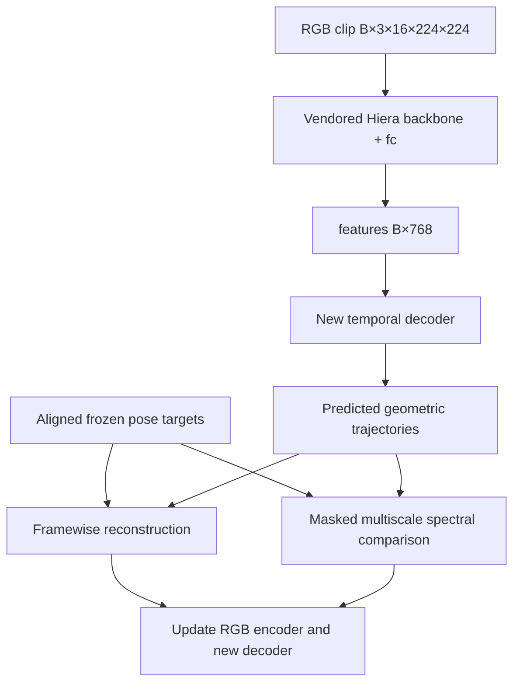

# SignRep Spectral — đặc tả triển khai end-to-end cho AI coding agent

**Phiên bản:** 1.0 — 2026-10-04 UTC / 2026-10-05 Việt Nam.  
**Repository:** <https://github.com/Hieuvu4438/Sign_Representations>.  
**Snapshot đã đọc:** `main` tại commit `2a238fb68413292384baefed5785d6f87e136061`.  
**Namespace triển khai bắt buộc:** `method/signrep_spectral/`.  
**Phương pháp:** dùng spectral reconstruction loss theo thời gian làm auxiliary objective khi học biểu diễn RGB từ geometric priors.  
**Trạng thái:** implementation specification; chưa có implementation hoặc kết quả huấn luyện cho phương pháp này.

Tài liệu này đủ độc lập để đưa trực tiếp cho một AI coding agent. Các tên file mới, API và CLI bên dưới là **hợp đồng cần triển khai**, không phải tuyên bố chúng đã có trong repo. Các đường dẫn được ghi là “đã kiểm tra” thuộc snapshot ở trên. Agent phải đối chiếu checkout thật trước khi sửa code.

## 1. Nhiệm vụ và giới hạn bắt buộc

Triển khai một pipeline chạy được từ video và pose targets → training → checkpoint → RGB-only feature extraction → đánh giá frozen representations. Bản đầu tiên tiếp tục huấn luyện từ checkpoint SignRep đã có, với cùng một baseline huấn luyện nhưng thêm multiscale log-magnitude spectral loss. Hoàn thành cả baseline, kiểm thử, CLI và tài liệu chạy; không chỉ tạo một class loss rồi gọi nhiệm vụ hoàn tất.

### 1.1. Quy tắc về nơi ghi code

1. Tất cả code, configs, tests, scripts, tài liệu implementation và runtime của hướng này nằm trong **một thư mục mới `method/signrep_spectral/`**. Không đặt code trực tiếp ở `method/`.
2. Không sửa `third_party/SignRep/`, các phương pháp `method/frozen_probe/`, `method/stream_reliability/`, `method/research_lab/`, code legacy, dataset, checkpoint hoặc output cũ để tích hợp phương pháp này.
3. Không chỉnh root `README.md`, requirements, environment activation, global import registry hoặc launcher của phương pháp khác. Dùng entry point riêng; không cần đăng ký vào hệ thống chung để chạy MVP.
4. Dùng lại SignRep **đã vendored** trong `third_party/SignRep/`. Không clone SignRep lần nữa, không chạy installer theo README upstream, không mặc định tạo venv hoặc nâng cấp PyTorch.
5. Dùng lại interpreter/checkpoint local đã setup. Các file checkpoint/venv thường không nằm trong Git; GitHub tree không chứng minh chúng tồn tại trên máy agent.
6. Nếu thư mục `method/signrep_spectral/` đã tồn tại khi bắt đầu, kiểm tra nội dung và tiếp tục an toàn; không ghi đè hoặc tạo một bản method thứ hai chỉ để tránh đọc code hiện có.
7. Mọi output dùng run directory mới, tạo exclusive. Không xóa output thất bại; không chạy lại các run ID của hướng khác.
8. Không import hoặc copy implementation của phương pháp khác. Có thể đọc interface upstream và tài liệu vận hành cần thiết; code mới phải độc lập. Dataset manifests dùng như dữ liệu đầu vào phải có provenance, không coi kết quả cũ là bằng chứng cho phương pháp mới.

Nếu chương trình lab hiện hành yêu cầu cập nhật ledger chung, chuẩn bị bản ghi đề xuất trong `method/signrep_spectral/records/` để chủ chương trình tích hợp. Phạm vi implementation này không cho phép tự sửa ledger/state của hướng khác.

### 1.2. Những việc agent được chủ động làm

- Đọc repo, local `AGENTS.md` có phạm vi áp dụng, source third-party cần thiết, paper và documentation chính thức.
- Tra cứu **code có sẵn phù hợp trước khi implement**, đặc biệt FFT/STFT, pose readers và evaluator. Audit code trước khi dùng; tham khảo nguồn không có nghĩa phải thêm dependency.
- Viết code và chạy kiểm thử trong namespace mới; chạy smoke/pilot trong allocation và budget đã cấp cho công việc này.
- Chọn chi tiết kỹ thuật thông thường theo đặc tả, ghi quyết định và lý do. Không hỏi lại về những việc đã được yêu cầu như tạo folder hoặc reuse SignRep.
- Khi thiếu data/schema/GPU, tiếp tục phần độc lập: numerical loss, adapters, CPU fixtures, config validation, export và tài liệu. Báo blocker chính xác thay vì giả tạo target hoặc kết quả.

### 1.3. Những điều không được tự suy diễn

- “Fourier đã thêm thông tin mới vào video”, “đây là Fourier đầu tiên cho sign language”, hoặc “method chắc chắn tốt hơn SignRep”. Đây là giả thuyết cần đánh giá.
- Inference chạy được đồng nghĩa reproduction training hoặc benchmark gốc đã hoàn tất.
- SignRep decoder output có thể dùng làm ground truth cho chính decoder đó.
- Tên `full_*_angles` hoặc output dimension đủ để xác định thứ tự joint, angle triplets và confidence semantics.
- GPU permission của một thí nghiệm/hướng khác tự động cấp cùng tài nguyên cho hướng này.

### 1.4. Prompt bắt đầu dành cho agent

> Hãy triển khai tài liệu này trong checkout Sign_Representations hiện có. Đọc instructions có phạm vi áp dụng và xác minh snapshot/interface trước. SignRep và môi trường đã setup; reuse third_party/SignRep và checkpoint có sẵn, không reinstall. Chỉ ghi implementation mới trong method/signrep_spectral/. Trước code có thể tra cứu paper, official docs và code phù hợp; ghi URL/revision/license khi reuse. Triển khai canonical continuation MVP, baseline lambda_spec=0, numerical/gradient/parity tests, train/export/extract/evaluate CLIs. Không gọi MVP là reproduction SignRep paper. Hoàn thành các phần không bị blocker, chạy kiểm tra thực tế, rồi báo rõ file đã tạo, lệnh đã chạy, kết quả thật, unknowns và next action. Không sửa phương pháp khác và không bịa benchmark/novelty.

## 2. Những gì đã xác minh trong codebase

### 2.1. Source map tại snapshot đã đọc

| Đường dẫn có thật | Điều quan sát được | Hệ quả triển khai |
|---|---|---|
| `third_party/SignRep/example_usage.py` | Constructor `Model`, decoder config, checkpoint root key `model`; input `[B,3,16,224,224]`; inference windows 16 frames, stride 2 | Dùng làm reference constructor và numerical parity |
| `third_party/SignRep/models/final_models/FINAL_hiera_latent_model_head_v25_active.py` | `backbone`, `fc`, `cls_head`, `active_head`; forward trả dict | Adapter phải kiểm tra đúng output; không dựa vào flags không thực sự bỏ decoder |
| `third_party/SignRep/models/head_models/dict_head_v6_FINAL_thoughtful.py` | `ProjectionModel`: Conv1d → GELU → ConvTranspose1d → per-prior MLP | Reuse class này ở trạng thái read-only để tạo decoder mới |
| `third_party/SignRep/models/hiera/hiera_nodec_mae.py` | `forward(x, mask_ratio, mask, eval)`; `eval=False` trả tuple 3 phần; pooled `latent` là mean token khi `num_cls_tokens=0` | Training adapter có thể truyền explicit mask mà không sửa vendor |
| `third_party/SignRep/augmentation/video/base_video_aug.py` | RGB resize trực tiếp 224×224, ImageNet normalization, ToTensor; không có random crop trong transform public này | Dùng preprocessing này làm MVP/parity reference |
| Root `README.md` | Môi trường local được mô tả tại `artifacts/legacy/.venv-signrep/bin/python`; checkpoint ở phần local đã setup | Đây là seed path cần kiểm tra, không phải yêu cầu cài mới |
| `docs/datasets/README.md` | Vị trí video, keypoints và splits của ASL Citizen, MS-ASL, WLASL, How2Sign… | Chỉ là vị trí được tài liệu mô tả; schema, completeness và split phải audit tại máy thật |
| `docs/proposal2/research_lab/` | Rules về namespace, provenance, protocol, resource budget | Nạp tường minh khi sử dụng chương trình lab; instructions trong docs không tự áp dụng cho mọi folder code |

Tại snapshot này, `method/` đã có `frozen_probe`, `research_lab`, `stream_reliability`; chưa có `signrep_spectral`. Cây `third_party/SignRep/` được kiểm tra **không chứa training entry point, criterion pretraining đầy đủ, pose-target builder hoặc style discriminator hoàn chỉnh**. Vì vậy không được viết một import giả như `from signrep.training import Trainer`.

### 2.2. Constructor và output contracts của SignRep public

Constructor cần bám `example_usage.py`:

- `ckpt_dir=None`, `init_weights=False`.
- `backbone_params={"drop_path_rate": 0.1, "num_cls_tokens": 0}`.
- `out_dim=768`.
- `cls_head_name="models.head_models.dict_head_v6_FINAL_thoughtful"`.
- `cls_head_params.latents_params={"hidden_dim":512,"out_dim":384}`.
- `cls_head_params.total_frames=16`.
- Giữ đủ projection heads gốc khi construct/load checkpoint gốc, rồi tạo decoder riêng cho MVP.

| Output gốc | Shape cho T=16 | Ý nghĩa trong implementation này |
|---|---|---|
| `latent` | `[B,768]` | Pooled backbone output trước `fc` |
| `features` | `[B,768]` | `fc(latent)` gồm LayerNorm và Linear; representation mặc định để đánh giá |
| `cls_head.left_pose`, `right_pose` | `[B,16,63]` | Head gốc, semantics target chưa đủ để tái tạo chính xác |
| `cls_head.body_pose` | `[B,16,183]` | Head gốc 61×3 |
| `cls_head.full_left_angles`, `full_right_angles` | `[B,16,82]` | Head gốc 41×2; không tự invent angle order |
| `cls_head.full_body_angles` | `[B,16,44]` | Head gốc 22×2 |
| `cls_head.left_dist`, `right_dist` | `[B,16,165]` | Head gốc 5×11×3; không mặc định đây là scalar Euclidean distance |
| `cls_head.body_dist` | `[B,16,792]` | Head gốc 12×22×3 |
| `cls_active` | `[B,2]` | Raw activity output; source không áp sigmoid trong forward |

**Bẫy phải xử lý:**

1. `Model.__init__` có `try/except` rộng, có thể âm thầm thay `cls_head` bằng `nn.Identity`. Assert `fc`, `active_head`, đúng `ProjectionModel`, đủ keys/dims; thiếu thì raise. Không coi “SKIPPED CLASS HEAD” là thành công.
2. Không dùng `init_weights=True` theo suy đoán: constructor public tham chiếu `_init_weights` nhưng class được đọc không định nghĩa method này. Dùng `False` cho loader gốc; initializer decoder mới phải nằm trong namespace mới.
3. `extract_features=True` trong forward public không thực hiện một nhánh encoder-only đang hoạt động. Không dùng flag này để chứng minh inference đã bỏ decoder.
4. Backbone flag `eval=True` của `hiera_nodec_mae.py` có return contract khác. Adapter mặc định dùng `eval=False`, `mask_ratio=0` khi inference để nhận tuple quen thuộc.
5. Input model là **BCTHW**, không phải BTCHW. Decoder targets vẫn là **BTD**. Test việc permute bằng fixture xác định.

### 2.3. Asset hiện có: seed để preflight, không download lại

- SignRep source revision được repo ghi nhận: `06f40b5d287867b24e0dd2dc380b40b3f2ae8ac2`.
- Checkpoint release `v0.0.1`, file local được setup mô tả tại `artifacts/legacy/checkpoints/signrep/ckpt.pt`.
- SHA-256 được repo ghi nhận: `f8be8ca44aec4d7066175dccc681338f376ec86de6ba72bc79223a6bbd3c766b`.
- Checkpoint đọc với `map_location="cpu"`, `weights_only=True`, root key `model`, `strict=True` cho **model gốc trước adaptation**.

Không tự động ép source subrepo phải có `.git`: GitHub checkout của repo mẹ có thể chỉ có vendored files. Nếu `.git` con không tồn tại, hash các file nguồn sử dụng và ghi parent commit/provenance. Nếu source/checkpoint khác seed trên, báo sự khác biệt và kiểm tra cấu hình thật; không overwrite/download để “sửa”.

## 3. Chốt phương pháp và cách gọi kết quả

### 3.1. Main hypothesis

RGB encoder được yêu cầu tái tạo geometric trajectories và phổ cục bộ của cùng trajectories. Loss phổ nhấn mạnh cấu trúc biến thiên, nhịp và chuyển động trong cửa sổ; framewise loss giữ tín hiệu vị trí, hướng và thứ tự mà magnitude spectrum có thể làm mất. Decoder và pose teacher chỉ phục vụ training.

Phép biến đổi Fourier không tạo thêm observation information. Contribution khả dĩ nằm ở objective, priors, missingness/reliability và hiệu quả transfer, phải được kiểm tra bằng các đối chứng ở mục 12.

### 3.2. Hai chế độ cần phân biệt

| Chế độ | Phạm vi | Có bắt buộc cho MVP? |
|---|---|---|
| `canonical_continuation_v1` | Warm-start RGB `backbone+fc` từ checkpoint SignRep; decoder mới; canonical targets được định nghĩa ở đây; framewise loss + spectral auxiliary | **Có, đây là default phải hoàn thành end-to-end** |
| `native_signrep_extension` | Giữ đầy đủ target conventions và objective SignRep gốc, thêm spectral loss trên predictions hiện có | Không; chỉ bật khi tìm được source/target schema/criterion đủ và đã kiểm tra |

MVP dùng decoder mới vì không đủ thông tin để chứng minh canonical target bằng target gốc. Không load pretrained head vào target mới chỉ vì cùng 63 dimensions. Cả baseline và spectral arm dùng **cùng decoder mới, cùng initialization, cùng dữ liệu**; khác biệt chính chỉ là auxiliary objective.

Kết quả MVP phải gọi là **“SignRep-initialized canonical continuation + spectral auxiliary”**. Công thức MVP là `L_base_v1 + lambda_spec * L_spec`, không gắn nhãn `L_SignRep_original` cho một criterion tự dựng.

SignRep paper có reconstruction và các regularizers; nguồn public được đọc chưa cung cấp trainer tương ứng. MVP không tự thay adversarial style objective bằng gradient reversal rồi gọi là cùng phương pháp. Style, activity, full-body/angle/distance heads gốc là phần native extension sau này. [R1, R2]

### 3.3. Kiến trúc MVP



Inference: `RGB → backbone → fc → features/latent`. Không chạy pose estimator, decoder mới hoặc FFT. Default pooling khi đánh giá là uniform temporal pooling; activity-weighted retrieval là protocol riêng, không mặc định dùng head activity cũ sau continuation.

## 4. Discovery, reuse và preflight trước implementation

### 4.1. Thứ tự khảo sát

1. `git status --short`, xác định repo root/commit; đọc root/ancestor `AGENTS.md` thực sự tồn tại và instructions của direction nếu có.
2. Đọc source map ở mục 2 tại checkout thật, kiểm tra signature và shapes. Không reset checkout để khớp snapshot tài liệu.
3. Nạp bộ lab nếu công việc đang dùng nó: proposal rules, lab README/AGENTS và tài liệu phase implement/evaluation. Đọc state để tránh trùng IDs và chiếm allocation của hướng khác; không sửa state cũ.
4. Xác minh interpreter, checkpoint, local video/pose files và official split metadata. Không chạy setup installer.
5. Tra cứu source cần bổ sung: official PyTorch FFT docs trước; pose file schema/model API; evaluator chính thức. Nếu tìm được native SignRep target/training code mới public, ghi phiên bản và audit; không âm thầm đổi default method.
6. Tạo `records/discovery.md`, `records/source_reuse.md`, `records/interface_contract.json` trong namespace mới.

### 4.2. Policy dùng code public

Với mỗi source thực sự reuse, ghi `URL`, repository commit/tag nếu có, ngày truy cập, license/header, phần nào reuse, thay đổi, target tensor conventions và test parity. Giữ attribution khi copy code. Không download/execute một repo lạ chỉ vì tiêu đề có “spectral”.

MVP ưu tiên `torch.Tensor.unfold + torch.fft.rfft`; không cần thêm librosa/torchaudio hay thư viện FFT khác. Loss ảnh Focal Frequency Loss hoặc code audio STFT có thể làm reference, nhưng conventions ảnh/audio không tự khớp `[B,T,D]` pose signals. Nếu không reuse code ngoài, ghi rõ đã chọn native PyTorch và lý do.

### 4.3. Preflight report phải có

| Nhóm | Fields bắt buộc |
|---|---|
| Runtime | Python executable/version, torch/numpy/OpenCV/pose backend versions, CUDA availability thực tế, device được cấp |
| Source | Parent commit, hashes của source files dùng, dirty diff hiện có; không gộp thay đổi người dùng vào diff của agent |
| Checkpoint | Absolute resolved path, size, SHA-256, root keys, strict load result, architecture dims |
| Data | Chosen dataset/split roots, existence, raw pose schema/backend, timestamp policy, label access policy |
| Method | Mode, decoder initialization, mask ratio, channels, centering/window/normalization/reduction version |
| Resources | Allocation hiện hành, max updates/time, RAM/VRAM/disk caps, output location |

Local asset paths có thể trỏ vào runtime đã setup; việc **dùng interpreter và đọc tensor checkpoint** không phải reuse code legacy. Không đọc/copy code/phương pháp legacy để triển khai loss, trainer hoặc evaluator này. Paths máy nghiên cứu trong docs không được hardcode làm root của source mới.

Không có máy/data/checkpoint trong session agent: `machine_verification=unknown/blocked`, vẫn implement CPU synthetic path. Không tạo fake “real-data PASS”.

## 5. Cấu trúc folder và module contracts

Tạo package `method/signrep_spectral/` với `__init__.py`; Python có thể chạy module từ repo root qua namespace `method` mà không thêm `method/__init__.py`. `__init__.py` của method không import nặng hoặc mutate `sys.path`.

| File/thư mục mới | Trách nhiệm |
|---|---|
| `AGENTS.md`, `README.md`, `.gitignore` | Instructions namespace, hướng dẫn chạy, ignore runtime/caches/weights/local configs |
| `cli.py`, `config.py` | Subcommands; typed/strict config validation, resolved config |
| `vendor.py` | Một nơi duy nhất kiểm soát import vendored SignRep; constructor/checkpoint audit |
| `model.py` | RGB encoder adapter, decoder mới, forward training/extraction |
| `data/manifest.py`, `data/video.py`, `data/dataset.py` | Manifest/split validation, decode/PTS, sampling/collation |
| `data/pose_reader.py`, `data/priors.py`, `data/scaler.py` | Raw pose adapter, canonical targets, train-only scaler |
| `losses/spectral.py`, `losses/geometric.py`, `losses/temporal.py`, `losses/regularizers.py` | Explicit loss implementations và sufficient statistics |
| `engine/train.py`, `engine/checkpoint.py`, `engine/extract.py` | Optimization, resume/export, feature cache |
| `evaluation/retrieval.py`, `evaluation/probe.py`, `evaluation/statistics.py` | Fixed gallery scoring, frozen linear probe, uncertainty |
| `configs/*.json` | MVP/baseline/control templates; không chứa kết quả |
| `tests/` | Numerical, masking, gradient, real-interface, isolation, evaluator fixtures |
| `records/` | Discovery, decisions, protocol versions, nguồn, blockers |
| `runtime/` | Targets, scaler artifacts, runs, checkpoints, feature caches; Git-ignored |

Không bắt buộc tạo file trống cho mọi ô; có thể gộp các module nhỏ nhưng giữ trách nhiệm/API rõ. Không thiết kế framework plugin tổng quát ngoài scope.

`.gitignore` tại folder mới phải loại `runtime/`, `__pycache__/`, `.pytest_cache/`, local configs chứa paths, weights/caches/logs lớn. Metadata nhỏ cần reproduce được lưu có chủ đích. Không sửa `.gitignore` root.

### 5.1. APIs phải implement

```text
load_vendor_model(config, device) -> (base_model, load_audit)
build_canonical_targets(raw_pose, frame_metadata, schema) -> TargetBundle
fit_scaler(training_target_manifest, config) -> ScalerArtifact
make_clip_sample(video_record, start_frame, length=16) -> ClipSample
encoder.encode(rgb, mask_ratio=0.0, mask=None) -> {"features", "latent"}
training_model(rgb, mask=None) -> {"features", "latent", "priors"}
spectral_loss_stats(pred, target, valid, config) -> list[LossStat]
geometric_loss_stats(pred, target, observed, config) -> list[LossStat]
reduce_loss_stats(stats, distributed_context) -> (backprop_loss, logging_values)
save_checkpoint(...)
export_encoder(checkpoint, output_path)
extract_video_features(encoder, video, config) -> FeatureArtifact
evaluate_retrieval(feature_manifest, gallery_manifest, query_manifest, protocol)
```

`LossStat` có `name`, differentiable `numerator`, detached/nonlearnable `count`, fixed coefficient. Không trả scalar mean không kèm support count rồi average các batch có coverage khác nhau.

## 6. Dữ liệu, pose targets và temporal alignment

### 6.1. Dataset khởi đầu và splits

MVP ưu tiên **ASL Citizen train** trên máy hiện có vì dataset document ghi cả video/keypoints/splits. Đây là lựa chọn tính khả thi, chưa phải claim dataset này tối ưu. Nếu schema/data không usable, chọn một corpus train đã xác minh khác và tạo protocol version mới trước measurement; không chọn bằng kết quả test.

Manifest training canonical JSONL tối thiểu:

```json
{"sample_id":"unique-id","dataset":"ASL_Citizen","official_split":"train","source_root":"/verified/video/root","relative_path":"clip.mp4","pose_path":"/verified/pose/clip.npz","parent_video_id":"verified-source-id","signer_id":null,"label_id":null}
```

- Labels có thể nằm trong metadata để kiểm tra split, nhưng **training dataset không trả class/text label cho objective**. Không dùng captions/gloss để tạo priors.
- Mỗi video/session/source parent chỉ thuộc split đã khóa. Chia split trước khi tạo overlapping windows; không random split windows.
- Signer ID không biết thì giữ null và công bố unknown; không suy identity từ filename.
- Reject duplicate sample IDs, path không tồn tại, split không cho phép, decode lỗi hoặc schema chưa xác định; lưu exclusion reason cho từng record.
- Baseline và spectral/control arms dùng cùng eligible manifest, sampled clips và target artifacts.
- Không overwrite official split CSV/JSON; tạo adapter/manifest mới trong method.
- Pretraining membership của checkpoint SignRep có thể không xác minh đầy đủ. Ghi overlap known/unknown; không gọi evaluation “zero-shot unseen-pretraining data” khi chưa chứng minh.

### 6.2. Raw pose contract cần có trước khi dựng priors

Đây là schema nội bộ mới. Adapter phải chuyển **pose thực đã có** sang nó, hoặc chạy một frozen local pose backend khi cần. Không giả định keypoint pickle/NPZ local đã tương thích.

| Field | Shape/type | Contract |
|---|---|---|
| `hand_landmarks` | `[F,2,21,3]` float32 | Hand axis theo anatomical `[left,right]`; topology và tọa độ được schema mô tả |
| `hand_present` | `[F,2]` bool | Detection/tracking availability thực, không suy từ coordinate bằng 0 |
| `joint_observed` | `[F,2,21]` bool | Finite/source-supported observations; không invent per-joint confidence |
| `joint_confidence` | optional `[F,2,21]` | Chỉ có nếu backend có score với semantics đã xác minh |
| `track_valid` | `[F,2]` bool | Đúng hand identity, không ambiguous crossing/swap theo policy đã khóa |
| `frame_indices` | `[F]` int64 | Decoded display-order ordinal, zero-based |
| `timestamps_sec` | `[F]` float64 | PTS/playback clock được chọn tường minh, cùng decoded RGB |
| `image_width`, `image_height` | scalar hoặc `[F]` | Original frame dimensions; video đổi kích thước phải được xử lý rõ |
| `pose_schema_id`, `coordinate_system`, `backend_id` | strings | Versioned; hash model/config nếu pose được tạo mới |

Default canonical backend format là **MediaPipe-style 21-joint hand image landmarks**. Trong format này, x theo width, y theo height, z có wrist-relative image scale; không gọi chúng là metric global 3D. MediaPipe handedness score mô tả phân loại tay, không phải confidence hình học của từng joint. Pose/body visibility cũng không tự thay được hand keypoint confidence. [R7, R8]

Nếu input có world 3D/keypoints của pose teacher gốc, thêm adapter riêng với coordinate contract khác; không trộn image z với metric world coordinates. Nếu dùng MediaPipe fallback, dùng API/version đang cài, official example, task asset local; nêu rõ teacher khác paper. Không assume package có `mp.solutions` hoặc model task asset đã có chỉ vì import được.

Pose backend phải chạy local/offline đối với dữ liệu. Teacher weights frozen; teacher output/cache detached. Không chạy pose estimator dưới `inference_mode` rồi đưa tensor inference vào autograd nếu chưa chuyển về tensor thường an toàn; simplest là cache NumPy arrays và load lại thành tensors thường.

### 6.3. Canonical targets `hand_image_canonical_v1`

Đây là **target conventions mới do phương pháp này định nghĩa**, không phải khẳng định thứ tự/normalization exact của SignRep tác giả.

Cho một clip 16 decoded frames, hand h, joint j, raw normalized image landmark `(x,y,z)`:

\[
u_{t,h,j}=(x_{t,h,j},\;y_{t,h,j}H/W,\;z_{t,h,j}).
\]

Y được quy đổi về width units để chênh lệch x/y cùng scale; z được sử dụng theo raw schema đã nêu. Không rotate canonical hand axes trong MVP. Nếu ảnh đã mirror trước pose extraction, schema phải chỉ rõ anatomical hand mapping; không tự sửa handedness bằng heuristic chưa kiểm chứng.

Scale của mỗi hand được tính **một lần cho clip**, từ quan sát hợp lệ của wrist 0 và middle-finger MCP 9:

\[
s_h=\operatorname{median}_{t\in\mathcal V_h}
\|u^{xy}_{t,h,9}-u^{xy}_{t,h,0}\|_2.
\]

Yêu cầu ít nhất 4 frames scale hợp lệ, `s_h >= 1e-4` width units; otherwise hand targets cả clip không usable. Các con số này là policy của MVP, cần log và chỉ thay bằng config/protocol version. Scale chỉ dựa teacher, không dựa predictions. Scale theo clip tránh đưa jitter scale từng frame vào spectrum; vẫn cần ablation nếu triển khai nghiên cứu lớn.

Targets decoder mới:

1. `left_pose`, `right_pose`, mỗi head `[B,16,63]`: flatten `(u_j - u_0) / s_h` theo **joint-major xyz**. Wrist joint 0 là zero theo định nghĩa. Missing joint/wrist/scale → observed mask false; không thay missing bằng zero rồi coi observed.
2. `wrist_image_xy`, head `[B,16,4]`: `[left_x, left_y*H/W, right_x, right_y*H/W]`, trong **cùng original image space**. Không dùng z hai tay để tính relative depth vì hand z không có chung global origin.

Wrist image trajectory giữ gross hand translation mà wrist-relative handshape bỏ đi. Nó có thể bị camera motion/body motion ảnh hưởng; đây là limitation và lý do để xem xét body-relative wrists trong extension. MVP không cần body/face targets để chạy.

Spectral groups mặc định:

| Group | Decoder source | Selected dimensions |
|---|---|---|
| `left_hand_motion` | `left_pose` | Joints 1…20, xyz: indices 3…62, D=60 |
| `right_hand_motion` | `right_pose` | Joints 1…20, xyz: indices 3…62, D=60 |
| `wrist_translation` | `wrist_image_xy` | All 4 dimensions |

Không spectral supervise wrist-relative joint 0 luôn bằng 0 hoặc `cls_active` clip-static. Group weights mặc định bằng nhau; không concatenate 124 channels rồi để nhóm nhiều chiều tự lấn át wrist group.

### 6.4. Missingness/reliability — default và extension

**MVP default: strict-window, không interpolation.** Geometric reconstruction dùng mọi observed element hợp lệ. Spectral loss chỉ dùng window-channel pair mà **toàn bộ N frames hợp lệ**. Điều này cố ý đơn giản, không bịa tần số từ keypoints thiếu. Phải báo tỷ lệ support còn lại; nếu quá ít, method có thể không feasible và phải sửa policy bằng một phiên bản mới.

- Khi confidence hình học thực tồn tại, default `observed = present & track_valid & finite & confidence > 0.5`; score type/version phải có trong schema.
- Không có per-joint confidence: dùng availability/finite/track mask; report `confidence_mode=availability_only`. Không gán 1.0 như thể đã đo độ tin cậy chính xác.
- Pose coordinate bằng 0 vẫn có thể là quan sát thật. Availability phải tách riêng.
- Trong storage tensor có thể thay invalid payload bằng 0 để finite, nhưng mask false. **Loại invalid window trước FFT**, không FFT zero-filled windows rồi coi phổ valid.
- Không nhân trajectory với confidence biến thiên trước FFT: đó là amplitude modulation ngoài chuyển động thật.
- Theo dõi tay swap/ambiguous assignment; reject các đoạn chưa chắc thay vì để một spectrum chứa trajectory nhảy từ tay trái sang tay phải.

**Extension không thuộc MVP:** nội suy gap nội bộ tối đa 2 frames có hai endpoint observed, cùng track, uniform timestamps; không extrapolate đầu/cuối, không nối track swap; `observed` gốc vẫn false cho geometric loss, tạo `spectral_usable` riêng và lưu `interpolated`. Angular targets phải nội suy theo biểu diễn circular rồi renormalize phù hợp. Giảm trọng số hoặc reject window có tỷ lệ nội suy vượt policy. Cả baseline/control dùng cùng target processing khi so sánh extension. Không bật imputation âm thầm vì strict coverage thấp.

### 6.5. Video/target alignment và lấy mẫu

1. Decode RGB theo display order; lưu frame ordinals và PTS từ decoder đã xác minh. Không assume `frame/FPS` bằng annotation clock của mọi file.
2. Pose target phải join đúng frame ordinal/PTS của RGB. Nếu pose cache sinh từ version crop/resample khác, không “truncate về min length” để che mismatch.
3. Clip training là **16 consecutive actual frames**, không padding, không uniform resample toàn video về 16 frames. Video ít hơn 16 frames bị exclude với reason. Window cuối incomplete bị drop, không repeat-last theo một adapter khác.
4. MVP dùng native frame cadence. Require selected PTS strictly increasing và khoảng dt gần đều: `max(abs(dt-median_dt))/median_dt <= 0.05`, median_dt > 0. Đây là tolerance policy, không phải chứng nhận clock tuyệt đối. Fail → clip không eligible theo policy chung mọi arm; ghi reason. Không tự sort/deduplicate/resample các frame lỗi.
5. Sampling uniform theo eligible video, rồi uniform start frame hợp lệ của video; không mặc định uniform tất cả overlapping windows khiến video dài dominate. Lưu seed/epoch/sampler schedule để các arms replay cùng samples.
6. MVP RGB augmentation chỉ deterministic resize/normalize như upstream; masking nằm ở backbone. Random spatial transforms, mirroring, temporal speed/crop augmentation chưa bật.
7. Nếu bổ sung augmentation, áp đúng cùng transform/frame selection lên RGB và geometric targets. Không lật RGB mà giữ handedness/coordinates cũ.
8. Native FPS có thể khác giữa clips; spectral target/prediction được so trong cùng clip/grid. Báo frequency theo **cycles/sample**; chỉ quy sang Hz của clip khi clock hợp lệ. Không gọi các bins của mọi clip là cùng physical Hz.

Đối với một clip 16 frames và N=16, chỉ có một spectral window. Đây là multiscale short-window objective, chưa thể chứng minh nó học long-range signing rhythm.

### 6.6. Train-only scaling

Fit scalar mean/std **theo từng canonical output channel** từ train observed targets, dùng streaming moments float64; không dùng val/test. Define `scale_d=max(std_d,0.05)`; count <2 → scale=1 và flag unsupported. Save channel order, counts, mean/std/floor, schema và manifest hashes.

Loss dùng `a=(P-mu)/scale`, `ahat=(Phat-mu)/scale`, cùng scaler cố định cho mọi arm. Scaler không learnable. Wrist-relative constant channels vẫn được geometric supervise nhưng không đi vào spectral groups. Không normalize prediction bằng std riêng của nó: làm vậy có thể xóa sai số biên độ cần học.

Fit target conventions/clip scales **trước** scaler; không fit trên target của một pipeline khác. Default scaler sampling: một 16-frame clip/eligible train video; hash SHA-256 ổn định của `sample_id` và `scaler_seed=1700`, chuyển digest thành integer, modulo độ dài **sorted list các starts hợp lệ**, rồi lấy start tại index đó. Lưu exact IDs/starts/PTS. Không dùng Python built-in hash vì process-randomized. Đây là train-only sample of windows, không giả như mọi train frame đã được fit. Nếu đổi số windows/video hoặc caps, version sampling policy và ghi IDs.

### 6.7. Cache và provenance

Cache raw per-video pose và frame metadata có thể reuse; canonical scale/window targets được tạo sau khi chọn clip. Không cache một clip-scale target rồi dùng cho một temporal crop khác mà không recompute.

Cache key phải bind video content/version, pose file/backend/model hash, pose schema, ordinal/PTS/crop contract, target builder version và config. Scaler bind eligible training target manifest. Store arrays bằng NPZ/format không cần arbitrary pickle execution nếu có thể. Reader legacy pickle cần trusted local origin, schema validation, read-only; không thêm unsafe loader chung.

Không cache predicted spectrum giữa optimizer steps. Teacher target spectrum chỉ cache nếu clip boundaries/scaler/masks/windows hoàn toàn cố định; MVP tính online từ detached cached geometry để tránh stale cache.

## 7. Spectral loss: định nghĩa chính xác

### 7.1. Tensor contracts

Cho từng spectral group g:

- `pred`, `target`: floating tensors `[B,T,D_g]`, đã dùng cùng fixed train scaler.
- `valid`: bool `[B,T,D_g]`, lấy từ teacher reliability; không dựa vào prediction.
- T=16 cho MVP; groups D=60,60,4.
- Target và valid detached; prediction có autograd graph.
- Target được khai báo valid nhưng NaN/Inf là lỗi dữ liệu: raise. Prediction NaN/Inf ở bất kỳ vị trí là numerical failure: raise, không giấu bằng `nan_to_num`.

### 7.2. Clip centering, có tính missingness

Center **chỉ trong spectral branch**, theo mean các observed times của cùng channel:

\[
c_{bd}=\sum_t V_{btd},\quad
\mu_{bd}=\frac{\sum_t V_{btd}a_{btd}}{\max(c_{bd},1)},\quad
\hat\mu_{bd}=\frac{\sum_t V_{btd}\hat a_{btd}}{\max(c_{bd},1)}.
\]

\[
q_{btd}=a_{btd}-\mu_{bd},\qquad
\hat q_{btd}=\hat a_{btd}-\hat\mu_{bd}.
\]

Target sums dùng `where(valid,target,0)` để invalid NaN payload không lây vào mean. Prediction dùng **cùng target validity mask** để tính mean; không tự mask prediction sai. Mean theo clip, không per-window; changing centering policy là method version mới.

Geometric loss vẫn sử dụng scaled **uncentered** `a, ahat`; do đó vị trí/static geometry không bị bỏ khỏi tổng objective. Constant shift của prediction có thể invisible với spectral branch nhưng geometric branch phải phạt nó.

### 7.3. Windows và Fourier conventions

MVP cố định hai scales:

| N = window length = n_fft | Hop H | Window starts với T=16 | M | K = N/2+1 | Periodic Hann sum |
|---|---|---|---|---|---|
| 8 | 4 | 0,4,8 | 3 | 5 | 4 |
| 16 | 8 | 0 | 1 | 9 | 8 |

- `w = torch.hann_window(N, periodic=True)`.
- Không center padding, không reflect padding, không zero-padding n_fft dài hơn N, không repeat tail.
- `torch.fft.rfft(..., n=N, dim=-1, norm="backward")` rồi chia **`w.sum()`**.
- Đây là window-sum/coherent-gain normalization. Không đồng thời bật `norm="ortho"` hoặc `torch.stft(normalized=True)` rồi vẫn chia như trên.
- Dùng one-sided bins gồm DC và Nyquist. MVP weights mỗi bin bằng nhau, không doubling interior bins, không tự loại high frequencies. Đây là log-amplitude objective, không phải integrated energy estimator.
- Frequency axis `f_k=k/N` cycles/sample. Zero-padding chỉ đổi grid, không tạo physical resolution; không dùng trong MVP.

Với window-channel pair u=(b,m,d), chỉ usable nếu:

\[
R^{(N)}_{bmd}=\bigwedge_{n=0}^{N-1}V_{b,mH+n,d}=1.
\]

Select usable rows trước FFT; mỗi row `[N]`. Phổ đã normalize:

\[
S^{(N)}_{bmdk}=\frac{1}{\sum_n w_n}
\sum_{n=0}^{N-1}w_n q_{b,mH+n,d}e^{-i2\pi kn/N},
\]

và tương tự cho prediction. Default không confidence weighting sau strict filter; thêm reliability weights là ablation riêng cần đăng ký.

### 7.4. Log-magnitude loss và reduction

\[
A=\log(1+|S|),\qquad \hat A=\log(1+|\hat S|).
\]

`log1p(abs(complex))` ổn định tại zero; không cần thêm arbitrary epsilon vào biểu thức này. `abs` tại zero có subgradient; gradient check phải tránh điểm không trơn. Spectral loss đơn lẻ có thể không đẩy một prediction hoàn toàn zero thoát khỏi zero; đây là một lý do giữ geometric loss và decoder initialization không suy biến.

Cho mỗi term (g,N):

\[
n_{g,N}=K_N\sum_{b,m,d}R^{(N)}_{bmd},\qquad
s_{g,N}=\sum_{R=1,k}|\hat A-A|.
\]

\[
\ell_{g,N}=\begin{cases}s_{g,N}/n_{g,N},&n_{g,N}>0,\\0,&n_{g,N}=0.\end{cases}
\qquad
L_{spec}=\frac{1}{3\times2}\sum_{g}\sum_{N\in\{8,16\}}\ell_{g,N}.
\]

Denominator 6 **cố định theo configured groups/scales**, kể cả term empty. Không tự renormalize chỉ theo active terms của từng batch; điều đó đổi trọng số theo missingness. Empty term trả differentiable zero `pred.sum()*0`. Log numerator/count/valid window fractions của từng term; batch nhiều missingness có thể nhận spectral gradient yếu hơn, cần báo cáo.

Epoch metrics aggregate sufficient statistics qua batches rồi tính mean; không average batch means thiếu support weighting. Batch objective vẫn là mean theo support của batch như trên, do sampling đã khóa.

### 7.5. Reference pseudocode cho numerical core

Đoạn này là contract cho một **group/scale**, không thay thế trainer, shape validation hoặc distributed reduction. Core cho phép float64 để gradcheck; production caller chuyển prediction/target sang float32 khi tắt autocast. Không detach prediction.

```python
def spectral_term_stats(pred, target, valid, n, hop):
    # pred,target: [B,T,D]; valid: bool [B,T,D]
    validate_shapes_dtype_device(pred, target, valid)
    if not torch.isfinite(pred).all():
        raise FloatingPointError("Non-finite prediction")
    target = target.detach()
    valid = valid.detach()
    if (valid & ~torch.isfinite(target)).any():
        raise ValueError("Declared-valid target is non-finite")
    if pred.shape[1] < n:
        raise ValueError("No implicit padding or silent scale dropping")

    safe_target = torch.where(valid, target, torch.zeros_like(target))
    counts = valid.sum(dim=1, keepdim=True).clamp_min(1)
    target_mean = safe_target.sum(dim=1, keepdim=True) / counts
    pred_mean = torch.where(valid, pred, torch.zeros_like(pred)).sum(
        dim=1, keepdim=True
    ) / counts
    q = safe_target - target_mean
    qhat = pred - pred_mean

    # Tensor.unfold appends N at the END: [B,M,D,N], not [B,M,N,D].
    target_windows = q.unfold(1, n, hop)
    pred_windows = qhat.unfold(1, n, hop)
    row_valid = valid.unfold(1, n, hop).all(dim=-1)  # [B,M,D]
    target_rows = target_windows[row_valid]         # [U,N]
    pred_rows = pred_windows[row_valid]             # [U,N]
    if pred_rows.shape[0] == 0:
        return LossStat(numerator=pred.sum() * 0.0, count=0)

    window = torch.hann_window(
        n, periodic=True, device=pred.device, dtype=pred.dtype
    )
    norm = window.sum()
    target_s = torch.fft.rfft(
        target_rows * window, n=n, dim=-1, norm="backward"
    ) / norm
    pred_s = torch.fft.rfft(
        pred_rows * window, n=n, dim=-1, norm="backward"
    ) / norm
    error = (torch.log1p(pred_s.abs()) -
             torch.log1p(target_s.abs())).abs()     # [U,K]
    return LossStat(numerator=error.sum(), count=error.numel())
```

Nếu dùng `torch.stft` thay numerical core, flatten input thành `[B*D,T]`, `n_fft=win_length=N`, explicit Hann, hop, `center=False`, `return_complex=True`, `normalized=False`, `onesided=True`, chia window.sum và restore axes/masks chính xác. Bắt buộc parity với reference; `torch.stft` không trực tiếp nhận `[B,T,D]`. [R3–R6]

### 7.6. Precision và distributed correctness

- Encoder/decoder có thể AMP khi được bật; spectral centering/FFT/log/mean và geometric reductions production chạy FP32 với autocast disabled. Không chạy FFT half rồi đợi lỗi/overflow mới cast.
- Scaler/target/valid không nhận gradient. `float()` trên prediction vẫn giữ graph.
- MVP single-process/single-device là đủ. Nếu CLI nhận DDP config nhưng chưa implement/test, reject rõ ràng; không silent fallback sang distributed mean sai.
- Nếu implement DDP, với W ranks và một term có local numerator s_r, global count `n=sum_r n_r`, loss để backward tại rank r là `W*s_r/max(n,1)`. DDP average gradients sẽ khớp global mean. All-reduce counts detached; logging numerator cũng detached/all-reduce riêng. Không all-reduce tensor loss bằng API không hỗ trợ autograd rồi tưởng graph còn đúng.
- Khi global count=0, mọi rank trả graph-connected zero và cùng collective sequence. Không để rank bỏ collective vì local empty, gây deadlock.
- Gradient accumulation MVP average microbatch objectives; nó **không mặc định tương đương một giant batch** nếu support counts khác. Ghi convention; var/cov theo microbatch cũng không bằng effective accumulated batch. Exact global-count accumulation là extension riêng phải test nếu claim equivalence.

## 8. Baseline objective và temporal controls

### 8.1. Default base loss

Cho ba decoder heads h=`left_pose,right_pose,wrist_image_xy`, standardized uncentered targets và observed masks:

\[
L_{geom}=\frac13\sum_h
\operatorname{maskedmean}\big(\operatorname{SmoothL1}_{\beta=1}
(\hat a_h,a_h),V_h\big).
\]

Empty head contributes zero với denominator 3 cố định; mỗi head có numerator/count. Khi config có head weights khác 1, normalize bằng tổng **configured** weights cố định, không tổng weights của active heads. Target NaN invalid phải sanitized trước elementwise criterion, không dùng `NaN*0`. Predicted geometry giữ canonical output units; scaler được áp trong loss, không thay đổi decoder output semantics.

Default MVP:

\[
L_{base\_v1}=L_{geom},\qquad
L_{total}=L_{base\_v1}+\lambda_{spec}(u)L_{spec}.
\]

Optional variance/covariance disabled mặc định để giữ first comparison đơn giản. Nếu bật, triển khai một **explicit regularizer version**, giống nhau trong baseline/spectral arms:

\[
L_{var}=\frac1D\sum_j\max(0,1-\sqrt{\operatorname{var}_{B,\,unbiased}(z_j)+10^{-4}}),
\]

\[
C=\frac{(z-\bar z)^T(z-\bar z)}{B-1},\qquad
L_{cov}=\frac1D\sum_{j\ne k}C_{jk}^2,
\]

với `z=features`, D=768, B≥2. Đây là normalization/version do implementation định nghĩa, không tuyên bố exact original SignRep loss. Batch<2 khi weights nonzero → config/runtime error; không silently zero regularizer. `w_var,w_cov` là hyperparameters phải khóa; không có default “paper reproduction weights” được xác minh.

### 8.2. Spectral weight schedule

- Config có `lambda_spec`, default template 0.1 **chỉ là giá trị khởi đầu**, chưa được chứng minh tối ưu.
- Warmup optional: `lambda(u)=lambda_spec*min(1,u/warmup_updates)` với u là số optimizer updates thành công đã hoàn tất; nếu warmup=0 thì dùng full lambda ngay. Save u để resume đúng.
- `lambda_spec=0` hoặc schedule hiện tại bằng 0: **không gọi spectral core**, không compute spectra chỉ để rồi nhân zero. Giữ RNG/encoder/data/optimizer path giống baseline, không thêm conditional normalization khác.
- Log unweighted/weighted loss và gradient norms để phát hiện domination; không tự thay lambda trong training dựa kết quả test hoặc batch loss scale.

### 8.3. Velocity/acceleration controls

Dùng cùng canonical/scaled channels và teacher masks, không thêm kiến trúc riêng:

\[
v_t=a_{t+1}-a_t,\quad V^v_t=V_{t+1}\land V_t,
\]

\[
b_t=a_{t+2}-2a_{t+1}+a_t,\quad
V^b_t=V_{t+2}\land V_{t+1}\land V_t.
\]

Control loss masked L1 với reduction bằng group means như spectral groups. Đây là per-frame differences trong native cadence; không gọi là physical velocity/acceleration nếu không chia dt và chưa audit units. Không differentiate interpolated/missing trajectories trong strict MVP.

### 8.4. Windowed time-domain control

Tạo `window_time_l1`: cùng centering, groups, windows, Hann/window-sum normalization và strict valid rows, nhưng tính L1 giữa **windowed time samples** thay vì log spectra. Normalize/reduction explicit; tune auxiliary strength với cùng search budget để kiểm tra lợi ích locality/window weighting thay vì chỉ có thêm một loss.

Có thể thêm một software-only Parseval fixture: unitary **full complex FFT L2** bằng centered/windowed time L2 với đúng normalization; one-sided energy phải trọng số interior bins 2, DC/Nyquist 1. Không đánh giá một FFT L2 vô trọng số như một discovery khác time L2. Control này không phải thay thế log-magnitude method, mà kiểm tra lập luận khoa học/numerical conventions.

## 9. Model adapter, imports và trainable parameters

### 9.1. Vendor import boundary

Upstream có absolute imports `models.*` và `augmentation.*`, dễ collision với code khác. Không đặt module top-level tên `models` cho method mới và không sửa các imports vendor.

`vendor.py` phải:

1. Resolve `repo_root/third_party/SignRep` từ config/repo-relative path, không hardcode `/home/haipd`.
2. Trước import, kiểm tra `sys.modules`/module origin nếu đã có `models` hoặc `augmentation`. Nếu thuộc package khác, raise với chỉ dẫn chạy CLI process riêng; không xóa/replace modules của phương pháp khác.
3. Tạm thêm đúng vendor path khi load, kiểm tra `__file__`/namespace `__path__` của imported modules nằm trong vendor path. Với namespace packages, `__file__` có thể None; dùng `__path__`.
4. Không chèn path khi import `method.signrep_spectral` hoặc đổi cwd/environment của parent process. Scope path change tại loader, restore `sys.path` sau load. Dedicated CLI process dùng riêng SignRep modules là entry point mặc định.
5. Dynamic imports còn lại phải có audit; nếu restore path làm một lazy import cần vendor không chạy được, giữ trong controlled vendor context khi gọi, không dùng global monkeypatch.
6. Không execute toàn bộ `example_usage.py` để lấy config. Lưu constructor literal đã kiểm tra hoặc parse AST chỉ literals/integer products; fail nếu cấu trúc đổi.

### 9.2. Warm-start và decoder mới

Load **toàn bộ model gốc strict** để xác minh checkpoint và làm parity trước adaptation. Sau đó:

- Encoder sử dụng chính `base_model.backbone` và `base_model.fc`.
- New decoder dùng upstream `ProjectionModel` với hidden=512, output latent=384, total_frames=16, và **3 heads mới** dimensions 63,63,4.
- Initialize decoder mới theo seed tường minh: Conv/ConvTranspose/Linear Xavier uniform, bias zero; initializer nằm trong method. Không reinitialize backbone/fc đã load.
- Original `cls_head` và `active_head` không tham gia objective, không forward trong pipeline mới và `requires_grad=False`; loại khỏi optimizer. Không coi original activity head còn calibrated sau khi encoder thay đổi.
- Freeze/no-grad targets; training **không freeze encoder**. Decoder-only warmup nếu muốn là ablation riêng; default update encoder+fc+new decoder ngay.
- Save hash/file state decoder initialization và initial encoder state. Các arms cùng seed phải bắt đầu bitwise cùng trainable state; đừng xây hai model lần lượt với RNG đã bị tiêu thụ khác nhau.

Có thể giữ base model reference cho strict compatibility checks, nhưng tránh register cùng backbone hai lần trong wrapper state dict. Xác định state-key schema rõ và test load/export. Không bắt optimizer chứa weights unused của original heads.

### 9.3. Forward contract

```python
latent, maps, cls_tokens = base_model.backbone(
    rgb, mask_ratio=train_mask_ratio if training else 0.0,
    mask=explicit_mask, eval=False,
)
features = base_model.fc(latent)
priors = new_decoder(features)  # only in training/reconstruction diagnostics
```

Assert shapes `latent/features=[B,768]`, priors `[B,16,D_head]`; geometry predictions đều float finite. Decoder internal `latent`/`post_latent` không phải supervised priors. Spectral loss không FFT vector `features` theo feature-channel index.

Explicit mask phải theo đúng Hiera mask-unit layout và polarity do source xác minh. Không tự tạo mask `[B,T]`. Có thể dùng `get_random_mask` gốc để tạo mask một lần rồi truyền explicit; log mask hash cho parity. Mask ratio 0.6 trong template là policy mới, không tuyên bố bằng setting SignRep paper.

Inference wrapper chỉ gọi backbone/fc và trả `features,latent`; unit/integration test hook phải chứng minh new decoder, original decoder, original activity head và teacher không được gọi.

## 10. Trainer, configuration, checkpoint và resume

### 10.1. Training loop

MVP single device, eager PyTorch; không cần compile/FSDP/flash implementation mới.

1. Preflight/config validation → manifest/target schema/scaler validation → initialize from existing checkpoint → save initial-state audit.
2. Deterministic DataLoader: worker init seed, seeded sampling schedule, fixed eligible IDs; no label leakage.
3. Model train mode; set mask config; get aligned RGB/targets/masks của cùng 16 frames.
4. Forward encoder/new decoder với autograd; compute geometric stats, optional regularizer.
5. Nếu effective lambda >0, compute spectral stats FP32 và cộng loss; nếu zero, bỏ branch hoàn toàn.
6. Zero grad, backward, AMP unscale nếu dùng, kiểm tra finite grads, clip norm, optimizer step. Scheduler và successful update counter chỉ tăng khi optimizer step thực sự chạy; GradScaler overflow skip không được tính như update.
7. Log support counts, unweighted/weighted losses, LR, norms, sample/frame/mask metadata, timings, peak memory.
8. Save checkpoint định kỳ và khi kết thúc/budget stop. Dev selection theo protocol đã khóa; test không được trainer đọc để chọn checkpoint.

Mọi geometric heads cùng empty trong batch → skip update/scheduler, log reason. Có 10 batch liên tiếp như vậy → dừng có diagnostic; không infinite retry/re-sample đến khi có batch đẹp. Empty spectral terms với geometric support >0 vẫn train geometric bình thường; report spectral coverage.

### 10.2. Optimizer và policy mặc định

Các values sau là **initial engineering defaults**, không phải kết quả HPO/paper settings:

- AdamW: `lr_encoder=1e-5`, `lr_decoder=1e-4`, `betas=(0.9,0.95)`, `weight_decay=0.05`, `eps=1e-8`.
- `backbone+fc` cùng encoder LR; biases/norm parameters không weight decay theo explicit name/module policy, validate each parameter xuất hiện đúng một group.
- Grad clip norm=1.0; optimizer trainable parameters only.
- MVP smoke FP32, batch_size=2, num_workers=0, max_updates=2, deterministic seed, no HPO.
- Pilot batch size/updates/schedule phải chọn theo memory/cost measured; không hardcode GPU capacity. Baseline/spectral/control giữ schedule và successful updates giống nhau.
- `amp=false` default cho parity/smoke; AMP là engineering optimization sau numerical check, giữ cùng precision policy giữa arms.
- Scheduler pilot cosine với warmup đã khóa hoặc constant trong smoke; không thay schedule giữa arms.

### 10.3. Config template cần tạo

Tạo JSON config để không thêm dependency config framework. Validate unknown keys, enums, types, paths và cross-field constraints; resolved config lưu với SHA-256. Template sau dùng placeholders `null` cho inputs chưa xác minh; CLI phải báo missing fields, không tự chọn dataset/checkpoint khác.

```json
{
  "schema_version": "signrep_spectral_config_v1",
  "mode": "canonical_continuation_v1",
  "paths": {
    "vendor_root": "third_party/SignRep",
    "checkpoint": "artifacts/legacy/checkpoints/signrep/ckpt.pt",
    "train_manifest": null,
    "target_manifest": null,
    "scaler": null
  },
  "checkpoint_sha256": "f8be8ca44aec4d7066175dccc681338f376ec86de6ba72bc79223a6bbd3c766b",
  "data": {
    "dataset": "ASL_Citizen",
    "train_split": "train",
    "clip_length": 16,
    "sampling": "uniform_video_then_start",
    "short_clip_policy": "exclude",
    "tail_policy": "drop_incomplete",
    "clock_policy": "verified_playback_pts",
    "max_relative_dt_deviation": 0.05,
    "augmentation": "upstream_resize224_imagenet_rgb"
  },
  "targets": {
    "schema": "hand_image_canonical_v1",
    "hand_order": ["left", "right"],
    "scale_joint_pair": [0, 9],
    "scale_min_observations": 4,
    "scale_floor": 0.0001,
    "confidence_threshold": 0.5,
    "missing_policy": "strict_window",
    "interpolate": false,
    "scaler_std_floor": 0.05,
    "scaler_seed": 1700,
    "scaler_windows_per_video": 1
  },
  "model": {
    "out_dim": 768,
    "total_frames": 16,
    "mask_ratio": 0.6,
    "decoder_hidden_dim": 512,
    "decoder_latent_dim": 384,
    "decoder_initialization": "xavier_uniform_zero_bias_v1",
    "heads": {"left_pose": 63, "right_pose": 63, "wrist_image_xy": 4}
  },
  "loss": {
    "smooth_l1_beta": 1.0,
    "geometric_head_weights": [1.0, 1.0, 1.0],
    "var_weight": 0.0,
    "cov_weight": 0.0,
    "auxiliary": "spectral_logmag_l1",
    "lambda_spec": 0.1,
    "spec_warmup_updates": 100,
    "groups": ["left_hand_motion", "right_hand_motion", "wrist_translation"],
    "windows": [{"n": 8, "hop": 4}, {"n": 16, "hop": 8}],
    "window": "hann_periodic",
    "fft_norm": "backward",
    "amplitude_normalization": "window_sum",
    "centering": "clip_observed_mean",
    "reduction": "fixed_group_scale_mean_v1",
    "include_dc": true,
    "zero_padding": false
  },
  "train": {
    "seed": 1701,
    "device": "cpu",
    "batch_size": 2,
    "num_workers": 0,
    "amp": false,
    "gradient_accumulation": 1,
    "lr_encoder": 0.00001,
    "lr_decoder": 0.0001,
    "weight_decay": 0.05,
    "grad_clip_norm": 1.0,
    "max_updates": 2,
    "scheduler": "constant",
    "save_every_updates": 1,
    "resume": null,
    "ddp": false
  },
  "evaluation": {
    "feature_key": "features",
    "window_length": 16,
    "stride": 2,
    "pooling": "uniform_window_mean_then_l2",
    "gallery_manifest": null,
    "query_manifest": null
  },
  "budget": {"max_wall_seconds": 900, "max_output_bytes": null, "max_peak_memory_bytes": null}
}
```

`max_updates=2` và warmup=100 là template smoke; **gradient test/integration smoke cho spectral phải override warmup=0** để loss thực sự active. Pilot config riêng với updates/batch/budget đã xác minh; không gọi smoke này là nghiên cứu có hiệu quả.

Tạo `baseline_geom.json`, `spectral_mvp.json`, `velocity_control.json`, `acceleration_control.json`, `window_time_control.json`. Control có field `lambda_aux` và enum auxiliary riêng, validate `lambda_spec=0` khi không dùng spectral; không reuse tên lambda_spec cho tất cả losses một cách gây nhầm. Baseline auxiliary=`none`, lambda_spec=0; các matched fields còn lại giống nhau.

### 10.4. Checkpoint schema mới

```python
{
    "schema_version": "signrep_spectral_checkpoint_v1",
    "mode": "canonical_continuation_v1",
    "encoder_state": {"backbone": ..., "fc": ...},
    "decoder_state": ...,
    "optimizer": ...,
    "scheduler": ...,
    "grad_scaler": ...,
    "successful_updates": ...,
    "epoch": ...,
    "sampler_state": ...,
    "rng": {"python": ..., "numpy": ..., "torch_cpu": ..., "torch_cuda": ...},
    "resolved_config": ...,
    "provenance": ...,
    "target_schema": ...,
    "scaler_hash": ...,
    "initial_state_hash": ...
}
```

Checkpoint write atomic temp-file → rename trong owned run directory; disk cap phải tính cả temporary overlap. Không overwrite checkpoint gốc. Nếu cùng output checkpoint path đã tồn tại, version hoặc explicit owned resume, không replace ngoài policy.

Load encoder/decoder states `strict=True` theo schema mới. Không `strict=False` để che n_fft/T/head schema sai. Resume bind source/config/manifest/scaler/checkpoint hashes; chỉ cho phép operational changes an toàn như tăng logging verbosity, theo allowlist. Changing objective/lambda/data/masks là run mới, không continuation giả cùng experiment.

MVP guarantee resume chính xác **tại optimizer boundary với num_workers=0 và sampler state đã lưu**. Nếu checkpoint giữa accumulation hoặc multi-worker prefetched samples không supported, reject/disclose; không claim bitwise mid-batch resume. Test uninterrupted vs save/resume trên synthetic fixed sequence. RNG state serialization phải compatible safe local loader; không hạ `weights_only` một cách mù quáng cho checkpoint chưa trusted.

## 11. CLI end-to-end và outputs

### 11.1. Entry point

Chạy mọi lệnh từ repo root:

```bash
python -m method.signrep_spectral.cli --help
```

Sau preflight, dùng Python của môi trường SignRep hiện có; ví dụ seed path từ repo, **chỉ sau khi xác minh nó tồn tại**:

```bash
SIGNREP_PY="$(pwd)/artifacts/legacy/.venv-signrep/bin/python"
"$SIGNREP_PY" -m method.signrep_spectral.cli --help
```

Không tự chạy `setup_runtime.py` hoặc pip install vì một path cũ không tìm thấy; kiểm tra interpreter thực được người dùng setup và ghi local config. Đặt `PYTHONDONTWRITEBYTECODE=1` khi chạy các lệnh để không tạo pycache vendor. Không đổi CUDA visibility hay kill process của người khác.

### 11.2. Subcommands phải có

| Subcommand | Inputs và trách nhiệm | Outputs trong owned directory |
|---|---|---|
| `preflight` | Config, source, interpreter, existing checkpoint; CPU default, không train | `preflight.json`, `interface_contract.json`, source/checkpoint hashes |
| `audit-data` | Configured official split/video/pose metadata; bounded sample rồi full eligibility theo protocol | Canonical manifest, schema audit, eligible/excluded IDs/reasons, alignment/coverage summaries |
| `build-targets` | Eligible manifest và raw pose adapter; reuse pose nếu schema usable; chạy teacher local chỉ khi cần | Target/raw-pose artifact manifest, arrays, metadata, hashes, failures |
| `fit-scaler` | Train-only target manifest và deterministic clip-sampling policy | Scaler NPZ/JSON, fitted clip IDs/starts, counts/hash |
| `train` | Resolved config + manifests/scaler; smoke/pilot/full config riêng | Initial-state audit, JSONL train logs, checkpoints, status/cost manifest |
| `export` | New training checkpoint, explicit output | RGB-only `encoder.pt`, metadata, load/parity report |
| `extract` | Exported encoder và video manifest; reference mode nhận checkpoint SignRep gốc | Window features/latents, ordinals/PTS, pooled features, feature manifest |
| `evaluate-retrieval` | Feature/gallery/query manifests và frozen protocol | Per-query predictions, metrics, support/exclusion counts, uncertainty |
| `evaluate-probe` | Frozen feature manifests, train/dev/test split policy và probe config | Probe states, predictions, metrics, training/label budget |
| `verify` | Owned artifact/checkpoint/feature manifests | Hash/schema/completeness audit; không tạo task score mới |

Mỗi subcommand có `--config`, `--run-dir` khi tạo run artifacts, `--help`; validate trước writes/compute. `export` thêm `--checkpoint`, `--output`; `extract` thêm `--encoder` hoặc mutually exclusive `--reference-checkpoint`, `--manifest`; evaluators thêm explicit manifests/protocol. Thiếu inputs phải exit nonzero với field thiếu, không fake data fallback.

### 11.3. Chuỗi chạy mẫu sau khi agent implement

Các đường dẫn JSON mới phải được agent tạo trước. `method/signrep_spectral/configs/local_paths.json` là local override Git-ignored, bind với config bằng `--paths-config`; không sửa committed template theo mỗi máy. Chọn run ID mới cho mỗi lần thực thi; block dưới dùng IDs minh họa, **không phải lệnh đã chạy**.

```bash
"$SIGNREP_PY" -m method.signrep_spectral.cli preflight \
  --config method/signrep_spectral/configs/spectral_mvp.json \
  --paths-config method/signrep_spectral/configs/local_paths.json \
  --run-dir method/signrep_spectral/runtime/preflight_001

"$SIGNREP_PY" -m method.signrep_spectral.cli audit-data \
  --config method/signrep_spectral/configs/spectral_mvp.json \
  --paths-config method/signrep_spectral/configs/local_paths.json \
  --run-dir method/signrep_spectral/runtime/data_audit_001

"$SIGNREP_PY" -m method.signrep_spectral.cli build-targets \
  --config method/signrep_spectral/configs/spectral_mvp.json \
  --paths-config method/signrep_spectral/configs/local_paths.json \
  --run-dir method/signrep_spectral/runtime/targets_001

"$SIGNREP_PY" -m method.signrep_spectral.cli fit-scaler \
  --config method/signrep_spectral/configs/spectral_mvp.json \
  --paths-config method/signrep_spectral/configs/local_paths.json \
  --run-dir method/signrep_spectral/runtime/scaler_001

"$SIGNREP_PY" -m method.signrep_spectral.cli train \
  --config method/signrep_spectral/configs/smoke_spectral.json \
  --paths-config method/signrep_spectral/configs/local_paths.json \
  --run-dir method/signrep_spectral/runtime/smoke_001

"$SIGNREP_PY" -m method.signrep_spectral.cli export \
  --config method/signrep_spectral/configs/smoke_spectral.json \
  --paths-config method/signrep_spectral/configs/local_paths.json \
  --checkpoint method/signrep_spectral/runtime/smoke_001/checkpoints/final.pt \
  --output method/signrep_spectral/runtime/export_001/encoder.pt \
  --run-dir method/signrep_spectral/runtime/export_001

"$SIGNREP_PY" -m method.signrep_spectral.cli extract \
  --config method/signrep_spectral/configs/extract_uniform.json \
  --encoder method/signrep_spectral/runtime/export_001/encoder.pt \
  --manifest method/signrep_spectral/runtime/eval_inputs_001/videos.jsonl \
  --run-dir method/signrep_spectral/runtime/features_001

"$SIGNREP_PY" -m method.signrep_spectral.cli evaluate-retrieval \
  --config method/signrep_spectral/configs/retrieval_protocol.json \
  --feature-manifest method/signrep_spectral/runtime/features_001/manifest.json \
  --gallery-manifest method/signrep_spectral/runtime/eval_inputs_001/gallery.jsonl \
  --query-manifest method/signrep_spectral/runtime/eval_inputs_001/query.jsonl \
  --run-dir method/signrep_spectral/runtime/retrieval_001
```

`local_paths.json` được cập nhật có chủ đích bằng output manifest/scaler mới sau từng preparation step; lưu resolved path/hash trong mỗi run. Không tự bind “latest” theo mtime. `eval_inputs_001` và protocol/gallery/query manifests phải được prepare/freeze theo mục 12 trước extraction; không tự tạo gallery từ mọi features có sẵn.

### 11.4. Status, logs và resource accounting

Mỗi run có `resolved_config.json`, `command.json`, `source_manifest.json`, `status.json`, `outputs_manifest.json`. Status enum `RUNNING`, `SUCCESS`, `FAILED`, `BUDGET_STOP`, `BLOCKED`; lỗi giữa chừng không ghi success. CLI exit status phải phù hợp.

Record wall time, CPU time/RSS nếu đo được, GPU model/precision, peak allocated/reserved memory, actual clips/frames/updates, decode/teacher/train/extract time, artifacts bytes và valid target/spectral coverage. Unknown measurement giữ null, không điền 0 để có vẻ miễn phí. Training-only pose extraction/scaler cost và checkpoint warm-start provenance phải được công bố.

Có budget check trước và trong run; nếu hết budget, save owned checkpoint/status tại safe optimizer boundary. GPU permission/caps lấy từ allocation thực dành cho task; budget chung trong lab chỉ là policy, không chứng minh hardware/free memory. Preflight/smoke không tự mở full training hoặc HPO.

## 12. Export, frozen representations và evaluation protocol

### 12.1. Encoder export

Default export chỉ chứa weights `backbone` và `fc`, architecture parameters, schema version, original checkpoint hash, training config/hash, source hashes, target schema/scaler hash và `output_keys=[features,latent]`. Loader không cần teacher/scaler/decoder cho inference. Scaler metadata dùng provenance, không phải dependency để RGB inference chạy.

Export phải strict load vào encoder wrapper mới, run same RGB fixture trước/sau export, so `features` và `latent`. Model eval, mask_ratio=0, no-grad/inference-mode. Test hooks chứng minh không gọi bất kỳ decoder, active head, spectral loss hoặc teacher.

**Không xuất full original `Model` với decoder/activity weights cũ rồi coi các heads ấy vẫn đúng sau encoder update.** Nếu cần compatibility checkpoint cho một runner khác, đây là export mode riêng: document heads stale/unsupported và runner chỉ lấy encoder features. Không overwrite checkpoints/config của method khác. MVP chỉ yêu cầu adapter mới giữ representation keys/dims để code downstream có thể consume artifacts độc lập.

### 12.2. Feature artifact schema

Cho video có F≥16 frames, stride 2:

\[
N_{win}=\lfloor(F-16)/2\rfloor+1.
\]

| Field | Shape | Contract |
|---|---|---|
| `features`, `latent` | `[N_win,768]` | Float32 finite, window order tăng |
| `start_frame`, `stop_frame_exclusive` | `[N_win]` | Actual frame ordinals; mỗi window đủ 16 |
| `start_pts_sec`, `last_frame_pts_sec`, `center_pts_sec` | `[N_win]` | Clock definition explicit; center mean first/last PTS; không gọi last-frame PTS là exclusive boundary |
| `pooled_features` | `[768]` | Mean window `features` ở float64, rồi L2 normalize; final dtype explicit |
| `sample_id`, `video_hash`, `encoder_hash` | metadata | Bind đúng sample/input/model |
| `recipe_id`, `source/config hashes`, `precision` | metadata | Bind preprocessing/window/pool conventions |
| `eligible/status/reason` | metadata | Video short/failure giữ record; không silently disappear |

MVP uniform pooling, không activity weighting, không spectral feature concat khi inference. Zero pooled norm dưới epsilon → invalid reason, không divide rồi return NaN; epsilon `1e-12`, không fake random embedding. Tail-drop/short exclusion được báo với số lượng và IDs.

Để tránh full decode RAM, bounded streaming/ring buffer hoặc bounded per-video loader; preserve exact frame order/PTS và reference pixel preprocessing. Batched inference được phép sau per-video/window parity; không assume backend version khác cho pixels giống hệt.

### 12.3. Những arms phải so sánh

| ID logic, chưa phải run đã có | Weights/training | Câu hỏi |
|---|---|---|
| B0 `published_init_frozen_uniform` | Checkpoint SignRep có sẵn, không continuation; cùng encoder-only extraction/uniform pooling | Tổng continuation có làm representation tốt hơn khởi tạo? |
| B1 `canonical_geom_continuation` | Decoder mới + base loss, spectral lambda=0 | Đối chứng nhân quả chính cho spectral auxiliary |
| B2 `canonical_geom_velocity` | B1 + velocity L1 | Lợi ích có thể đến từ một motion loss đơn giản? |
| B3 `canonical_geom_acceleration` | B1 + acceleration L1 | High-order temporal constraint có giải thích cải thiện? |
| B4 `canonical_geom_window_time` | B1 + matched-window time L1 | Local windows/extra supervision có đủ tạo lợi ích? |
| M1 `canonical_geom_spectral` | B1 + log-magnitude spectral loss | Spectral objective bổ sung giá trị gì? |

M1−B1 là primary method comparison. M1−B0 gộp hiệu ứng continuation, target conventions và spectral; không dùng nó một mình để nói Fourier gây cải thiện. B0 không có training cost mới nhưng phải tính extraction cost; B1/B2/B3/B4/M1 có **cùng decoder capacity**.

### 12.4. Matching và selection budget

Khóa trước quality measurement: dataset IDs/splits, RGB sampling/augmentation, target/scaler artifacts, initialization, mask schedule, optimizer/LR/schedule, updates, batch/accumulation, preprocessing/precision, extraction/pooling/gallery và metric.

- Equal successful updates và sampled frame schedule giữa trained arms; báo actual wall/GPU cost riêng vì spectral có overhead. Không đồng thời nói equal-steps và equal-wall-time nếu không thực sự chạy hai protocols.
- Auxiliary loss norms khác nhau; cùng lambda số học chưa chắc cùng gradient strength. Có thể calibrate coefficients trên **fixed train-only minibatches trước optimizer update**, mục tiêu ratio gradient auxiliary/base=0.1 ở encoder, với finite nonzero gradient checks và bounded range. Save calibration inputs/norms/coefficient; không dùng dev/test labels để calibrate. Hoặc dùng một grid/search budget bằng nhau cho từng auxiliary method. Không bỏ đối chứng yếu do chọn sai scale rồi kết luận chỉ frequency hữu ích.
- Nếu gradient calibration không usable vì gradient=0, không chia epsilon rồi tạo lambda khổng lồ; report và dùng locked grid/hold.
- Pilot tối đa budget đã cấp; default một fixed setting/seed mỗi arm là exploratory screen, không paper evidence. HPO phải bằng budget, ghi mọi trials và selection rule; nếu chưa đủ budget cho controls/seeds, báo evaluation incomplete.
- Confirmatory stochastic training nên có ≥3 seeds trong budget được cấp; match initial weights/sampling per seed giữa arms. Seed IDs phải tách training seed và gallery/probe seeds.
- Không tune lambda, window sizes, crop, pooling, checkpoint hoặc label budget theo test. Selection trên dev; freeze winner/config/checkpoint rule trước test.

Không default inflate model lên 32/64 frames: constructor public hardcode video input size 16. Extension clip dài cần xử lý positional embeddings/patch architecture/decoder T và baseline cùng context/frame budget; không thể chỉ đổi config T rồi expect model đúng.

### 12.5. Primary frozen retrieval protocol của MVP

Ưu tiên primary metric **class-ranking MRR**, cùng Recall@1/5/10 và macro breakdown. Đây là một **adapted protocol cần freeze**, không tự gọi official SignRep benchmark.

1. Gallery chỉ từ train/support đã phép; query dev cho pilot, test chỉ sau freeze. Loại self match/source leakage theo protocol, không thực hiện query-to-query transductive fitting.
2. Khóa `support_per_class`, gallery seed(s), exact sample IDs và class mapping trước measurement; cùng gallery mọi method. Nếu class không đủ support, policy (all-available hoặc reject) khóa trước, không thay sau score.
3. Features L2-normalized; cosine similarities. **Class score = max similarity qua support instances thuộc class** trong MVP. Candidate ranking chứa unique classes. Alternative class-mean/prototype là protocol/control riêng.
4. Deterministic ties: descending score, rồi ascending canonical class ID. Save scores/ranking/truth, không chỉ top1 label.
5. Ground-truth class rank r: reciprocal rank=1/r; MRR mean queries; Recall@k=mean indicator(r≤k). Macro MRR/Recall average per supported class; báo class/query counts.
6. Không xếp gallery instances rồi lấy rank đó gọi class MRR; duplicate support cùng class không tạo nhiều candidate classes.
7. Query class absent gallery → count/report theo policy đã freeze; không silently drop. Recommend eligibility gate đảm bảo all query classes có gallery trước measurement; nếu không, hold hoặc declared open-set protocol mới.
8. Artifact fields bind query/gallery/features/checkpoint/protocol hashes. Evaluator fixtures ở mục 13 phải chạy trước real scoring.

Nếu muốn official ASL Citizen/WLASL/SignRep metric, tìm code evaluator gốc, pin commit và chạy parity; ghi candidate unit, aggregation, support sampling, ties/discount semantics. Không đổi adapted metric tên thành official metric.

### 12.6. Frozen linear probe và transfer

- Encoder eval/frozen; extract caches trước; classifier duy nhất train từ train labels. `features` không được recompute bằng train-mode dropout/masking khi đánh giá.
- MVP probe là Linear(768,C), cross-entropy; optimizer/L2/LR/epochs/grid locked và cùng methods, choose epoch/hypers bằng dev; save label budget/mapping/predictions. Không dùng decoder priors làm input classifier.
- Report top1 micro và per-class macro; thiếu class/support phải rõ. No encoder update trong frozen probe; test checksum encoder trước/sau.
- Optional fine-tune recognition, CSLR, SLT là stages sau, cần implementation/evaluator/protocol riêng. Chúng không thay thế primary frozen representation comparison.
- Cross-signer/dataset evaluation chỉ gọi transfer khi có split/labels/ontology đáng tin. Không merge synonym/classes giữa languages tùy tiện. Training membership/overlap unknown phải ghi trong limitations.

### 12.7. Uncertainty và decision criteria

Save per-query paired outcomes của cùng IDs giữa methods. Với signer groups đáng tin, paired cluster bootstrap signer rồi videos/queries theo design; nếu chỉ video IDs thì bootstrap independent videos, không overlapping windows. Không dùng 95% CI từ hàng nghìn windows như thể độc lập.

Report per-seed scores và distribution; nếu dùng hierarchical bootstrap seeds/participants thì mô tả estimator và unit. Ba seeds không đủ để hứa statistical significance; kết luận dựa effect size, intervals, consistency, costs/failure cases.

Proposed stop/go policy phải preregister trước pilot: gradient/support/parity checks pass; spectral cải thiện frozen metric so B1 theo threshold do protocol chọn; không đánh đổi unexplained drop transfer/coverage; overhead nằm trong measured budget. Nếu chỉ decoder spectral reconstruction tốt hơn mà frozen retrieval/probe không cải thiện, kết luận **chưa có bằng chứng representation benefit**. Negative/null results là outcome hợp lệ; không tự thêm phase/fusion để cứu test.

## 13. Kiểm thử bắt buộc: đúng toán, autograd và integration

Tests phải có oracle/đặc tính độc lập, không chỉ gọi function rồi so với function copy cùng implementation. Numerical core có thể chạy synthetic CPU; real vendor/model tests chỉ PASS khi thực sự có environment/checkpoint. Missing dependency/input → skipped/blocked có reason, không synthetic substitute ghi real PASS.

### 13.1. Numerical, masking và semantics

| Test | Fixture/oracle | Điều phải chứng minh |
|---|---|---|
| Window shapes | T=16, N=8/16; known arrays | M=3/1, K=5/9; unfold đúng `[B,M,D,N]`, FFT chỉ temporal |
| Hann convention | Independent formula `0.5-0.5*cos(2*pi*n/N)` | Periodic window/sums 4,8; symmetric N-window không bị lẫn |
| Reference spectra | NumPy rFFT trên explicit loops + window.sum norm | Complex values, log magnitudes, numerator/count match float64 ≤1e-10 trên nondegenerate fixture |
| Identical inputs | Nonconstant pred=target | Spectral/geometric losses ~0, finite |
| Constant offsets | pred=target+c theo channel | Spectral ~0 sau clip centering; geometric >0 |
| Amplitude change | Nonconstant signal, pred=2*target | Spectral >0; fixed scaler không xóa amplitude error |
| Sign inversion limitation | Centered nonconstant pred=-target | Log magnitude bằng nhau với mọi window; geometric >0, chứng minh cần temporal/geometry path |
| FFT Parseval | Independent full orthonormal DFT/time L2 | Equivalence đúng norm; one-sided weighting không bị sai |
| Reversal limitation | Real unwindowed full-sequence DFT, q và reverse(q) | Magnitude bằng nhau nhưng time loss có thể khác; **không assert local Hann STFT không đổi** |
| All missing | valid all false, invalid target payload có NaN | numerator/count 0, loss differentiable finite zero; grads finite zero |
| Partial missing | One invalid time ở channel known; manual accepted window list | Chỉ reject windows chứa missing point; không FFT zero-filled rows như valid |
| Invalid contamination | Thay invalid payload NaN/Inf/huge; masks identical | Loss/valid support không đổi; declared-valid NaN phải raise |
| Confidence semantics | Availability-only và genuine confidence fixtures | Không sử dụng handedness score như per-joint geometry confidence |
| Short clip | T<N/config T≠16 | Error/exclusion explicit; không padding/drop configured scale âm thầm |
| Frequency units | Two uniform clocks, irregular clock fixture | Cycles/sample interpretation đúng; irregular frame policy/version rõ |

### 13.2. Gradient tests

1. `torch.autograd.gradcheck` numerical core double, random nondegenerate pred/target, tránh FFT bins zero và L1 equality kinks; so finite differences. Production FP32 wrapper vẫn phải giữ gradients.
2. Tiny differentiable encoder+temporal decoder fixture: **spectral-only backward** trên nonzero inputs phải tạo finite nonzero gradients cho cả encoder và decoder. Không cần real Hiera để kiểm tra graph wiring này.
3. Targets/teacher/scaler/valid không nhận gradient; detach target intentional. Không accidental `.detach()`, `.cpu().numpy()` hoặc `no_grad` ở prediction branch.
4. Invalid prediction positions bị loại theo target masks không ảnh hưởng selected windows/centering, nên gradient tại invalid times của channel tương ứng bằng zero. Prediction nonfinite vẫn raise như policy.
5. `lambda_spec=0` với spectral function được mock để raise: train step vẫn chạy; so loss, encoder/decoder grads và optimizer update với base-only trên cùng masks/state/RNG. FP32 deterministic fixtures yêu cầu exact equality khi backend cho phép; real GPU use disclosed tolerance, không hứa universal bitwise.
6. Active lambda smoke (warmup=0) phải khác base-only gradient trên nondegenerate fixture; gradient check không được “pass” bằng spectral weight vô tình zero.
7. Nếu DDP implemented: two-rank CPU gloo fixture với **unequal valid counts**, một rank empty, so grads với concatenated single-process batch. Không dùng counts bằng nhau để che average-of-means bug.

### 13.3. Target/data correctness fixtures

- Joint-major flatten và wrist origin đúng; translation của handshape không thay wrist-relative target; wrist_image trajectory vẫn thay tương ứng.
- Aspect-ratio conversion x/y, clip-fixed palm scale, bad scale/too few observations, all-zero observed wrist và missing wrist, valid/confidence propagation.
- Same video/pose join by ordinal/PTS; deliberate one-frame shift hoặc crop mismatch phải reject. Không compare chỉ tensor length.
- Hand swap/duplicate handedness/ambiguous track; no artificial trajectories crossing hands. Không đánh dấu absent hand stationary zero như observed.
- Scaler fitted train only; changing val/test payload không đổi scaler; scaler hashes/channel order mismatch phải reject.
- Parent videos/windows không đi qua nhiều splits; duplicates/source overlaps phát hiện và ghi theo protocol.
- Loader/collate **không cung cấp class/text labels** cho objective; teacher has no trainable optimizer parameters.

### 13.4. Vendor/checkpoint/export integration

1. Original constructor + checkpoint `strict=True`; shape/head audit fail khi constructor silently skips head. Không random-init fallback.
2. Eval fixed RGB tensor: original `Model.forward` `features/latent` so adapter `backbone+fc`, same FP32 weights/mask0. Tolerances `atol=1e-5, rtol=1e-4` là starting policy; nếu fail investigate, không tự nới đến pass.
3. Decode/preprocess fixture: RGB/BGR, resize, ImageNet norm, BCTHW permute match upstream; known frame count produces exact window start list.
4. Small real-data forward/backward khi inputs đủ: grads backbone/fc/new decoder finite nonzero where expected; frozen original heads no grad/update. Tiny surrogate test không chứng minh Hiera integration.
5. One small-batch overfit smoke: base reconstruction giảm trên fixed fixture sau bounded steps; spectral diagnostic thay đổi hữu hạn. Không yêu cầu mọi step monotonic vì stochastic masking; lock mask cho diagnostic.
6. Save/resume vs uninterrupted optimizer-boundary run: weights/optimizer/update/sampler/RNG match declared determinism; failure retained.
7. Export-load equality; model eval/mask0; hooks trên mọi decoder/activity/teacher/spectral entry phải không được gọi khi extract. Decoder/scaler target artifacts có thể tạm không available mà RGB export vẫn inference được.
8. Feature artifact complete schema/hash/order; pooling independent NumPy oracle, nonzero/zero norm handling, video short/excluded reasons.
9. Import collision fixture preloads một unrelated `models` package: loader raise, không phá module khác.
10. Isolation: git diff chỉ thuộc `method/signrep_spectral/` so với pre-existing user diff; source/checkpoint/dataset hashes không đổi. Test mới không ghi bytecode/cache vào vendor.

### 13.5. Evaluator fixtures

- Gallery instances nhiều hơn classes; manual unique-class ranking so max aggregation. Example query true class B, class scores A=0.9/B=0.8/C=0.1 → RR=0.5, R@1=0, R@5=1.
- Thêm support duplicate class A không thêm candidate class/rank; ties canonical class ID deterministic.
- Two queries RR=1 và 0.5 → MRR=0.75; micro/macro khác nhau khi class support unequal, so manual oracle.
- True class absent gallery, self-match/source overlap, duplicate query IDs, NaN embeddings → policy-specific error, không drop silently.
- Same IDs/gallery seeds giữa methods; cluster uncertainty không coi window là independent query.
- Frozen probe train only classifier; check encoder hash không đổi và held-out labels không đi vào fit/HPO.

### 13.6. Lệnh tests và cách báo kết quả

Ưu tiên `unittest` nếu chưa có pytest trong interpreter thật, tránh install để chạy tests. Nếu pytest đã có, có thể dùng nhưng phải ghi interpreter và phân biệt unit/integration markers.

```bash
PYTHONDONTWRITEBYTECODE=1 "$SIGNREP_PY" -m unittest discover \
  -s method/signrep_spectral/tests -p 'test_*.py' -v
```

Trong test report ghi test groups thực sự chạy, passed/failed/skipped và lý do, source/config/input hashes, runtime, precise real/synthetic distinction. Các bảng trên là **acceptance requirements**, chưa phải PASS của phương pháp.

## 14. Thứ tự implementation, gates và definition of done

| Stage | Deliverables | Điều kiện để đi tiếp |
|---|---|---|
| A — Discovery | Source/runtime/input contracts, source-reuse record, namespace isolation | Xác định đúng interface và missing pieces; không reinstall |
| B — Loss core | Spectral/geometric/temporal stats, NumPy oracle, masking/gradient tests | Numerical/gradient/empty-support/zero-lambda correctness |
| C — Vendor model | Strict loader, original parity, new decoder, trainable-param audit | Original checkpoint loads; adapter preserves features/latent; no head mismatch |
| D — Data/targets | Real schema adapter, alignment/eligibility, cache manifest, train-only scaler | Targets có semantics/reliability/provenance; coverage đủ theo preregistered policy |
| E — Trainer | Base+spectral/control configs, deterministic sampler, logs, checkpoint/resume | Tiny surrogate tests; real two-step active-lambda smoke khi máy/input có |
| F — Export/extract | RGB-only export, window/pooled feature manifests | Export/load parity; no teacher/decoder/FFT inference; isolation holds |
| G — Protocol/evaluate | Gallery/query freeze, evaluator fixtures, frozen retrieval/probe | Valid splits/scorer/controls/budget trước quality measurement |
| H — Pilot/report | Matched results, support/uncertainty/cost/failure records | Evidence thật để continue/hold/stop; không bắt buộc thắng baseline |

Không cần full training để review code implementation, nhưng **không đánh dấu scientific validation complete** chỉ vì B/C/E synthetic pass. Missing real targets có thể cho `IMPLEMENTATION_PARTIAL_DATA_BLOCKED`; missing compute có thể `CODE_VALIDATED_CPU_ONLY`; không biến blocker thành fake end-to-end run.

### 14.1. Checklist kết thúc implementation

- [ ] Folder mới đúng namespace; vendor/method khác/dataset/checkpoint cũ không đổi.
- [ ] Constructor/output contracts xác minh; strict original load và no silent skipped heads.
- [ ] Canonical target schema, hand order/scale/coordinates/masks/version rõ; teacher detached.
- [ ] Spectral groups/time axis/window/normalization/centering/reduction khớp tài liệu.
- [ ] No padding, no zero-filled valid spectra, no confidence modulation, no invalid NaN contamination.
- [ ] Gradient tới encoder/decoder; teacher/scaler no grad; lambda=0 thật sự bypass branch.
- [ ] Base-only/control arms cùng architecture/state/data/sampling, không gọi custom base là SignRep original.
- [ ] Train config, checkpoint safe resume, logs, budget stop và status/error handling hoạt động.
- [ ] Encoder-only export, strict new load, RGB feature extraction và pooling có tests.
- [ ] CLI help/examples khớp actual implemented arguments; templates reject missing required inputs rõ.
- [ ] Evaluator fixtures pass; exact gallery/query/split/protocol freeze trước real measurement.
- [ ] Test report phân biệt synthetic/real/CPU/GPU/blocked; không báo số chưa chạy.
- [ ] README có commands thật, dependencies đã dùng, constraints, known limitations, reproduction metadata.

### 14.2. Format báo cáo bàn giao của agent

1. Objective/method mode và paths mới đã tạo.
2. Những sources/interfaces đã xác minh và quyết định reuse.
3. Actual commands/test runs, outcomes, input/code/config hashes; real-data versus synthetic.
4. Checkpoint/export/feature artifacts đã tạo; labels/pose/compute costs đã dùng.
5. Findings có evidence; những điều unknown/blocked, ví dụ exact original target semantics hoặc overlap.
6. Deviation so với spec: lý do, version, parity/ablation plan; không đổi objective trong im lặng.
7. Continue/hold/stop và next command cụ thể có thể chạy trong allocation hiện có.

Không chỉ ghi “implemented successfully”; nếu thiếu path/data thì ghi exact prerequisite và vẫn bàn giao phần code/tests đã hoàn tất.

## 15. Extensions sau MVP — không implement tất cả ngay

| Extension | Prerequisite và đối chứng |
|---|---|
| Native SignRep original objective | Tìm/verify target topology/normalization/confidence/style sampler/discriminator/weights; native criterion parity; baseline original cùng trainer |
| Angle priors | Verified 41/22 triplets/order; sin/cos mapping/circular interpolation/validity; không FFT raw wrapped radians |
| Body-relative wrists/inter-hand motion | Common coordinate frame, verified body scale and side mapping; compare image-relative wrists, report teacher quality |
| Short-gap interpolation | Separate observed/spectral-usable masks, track-safe endpoints, interpolation fraction/reliability policy; strict baseline |
| Complex/phase-aware spectral loss | Frame/time alignment; low-energy reliability; compare logmag alone và norm-matched time loss |
| Cross-hand cross-spectrum | Semantically paired channels/common frame; define `S_L*conj(S_R)`; không gọi normalized one-sample product là statistical coherence |
| Tempo augmentation | Known sampling factor, anti-aliasing/resampling/target alignment; tempo-equivariance, không force same-bin invariance cho mọi sign |
| Wavelet loss | Same targets, coverage, context/compute, matched objective search; wavelet không mặc định tốt hơn FFT |
| T=32/64 | Hiera positional/input adaptation, decoder T, checkpoint policy; baseline cùng T/update/frame budget |
| Frequency branch ở inference | Method mới với cost/capacity controls; không còn cùng RGB encoder-only claim như MVP |

Giữ spectral objective trên **trajectories theo thời gian**, không FFT channels của pooled embedding để gán ý nghĩa movement frequency. Nếu FFT temporal RGB features, phải giữ temporal tokens trước pooling và version model riêng.

## 16. Những quyết định và rủi ro phải giữ trong research record

| Vấn đề | Quyết định MVP | Hệ quả phải báo |
|---|---|---|
| Public SignRep không có full trainer/targets | Canonical continuation, decoder mới, custom explicit base | Không claim original pretraining reproduction |
| Priors gốc có nhiều semantic ambiguity | Hai handshape heads + wrist image XY có definition đầy đủ | Chưa cover full-body/angles/activity/non-manual cues |
| Missing pose gây spectrum artifacts | Strict observed window-channel pairs | Coverage có thể thấp/bias theo pose availability |
| Hand-relative coordinates bỏ translation | Thêm wrist image trajectory | Có thể nhạy camera/global body motion |
| Hand depth khác global 3D | Không dùng inter-hand image z | Không claim metric 3D interaction |
| Magnitude mất phase/order | Giữ framewise geometric path | Spectrum không phải complete semantic representation |
| Context 16 frames | Windows 8/16, native cadence | Hạn chế resolving slow movement/repetition dài |
| Baseline tăng capacity vì decoder mới | Same decoder ở mọi trained arm | Isolate loss contribution so B1, không chỉ so B0 |
| Pose teacher quality | Availability/confidence schema audit | Teacher noise có thể bị spectral objective khuếch đại |
| Decoder objective tốt hơn chưa chắc representation tốt | Frozen retrieval/probe/transfer | Loss giảm không đủ chứng minh downstream benefit |
| Checkpoint corpus membership | Record verified/unknown overlap | Không assert zero-shot/non-overlap thiếu evidence |
| Method chưa đo | Spec/numerical tests là engineering evidence | Utility, novelty, significance vẫn hypothesis |

## 17. Nguồn cho agent và provenance của tài liệu

### 17.1. Nguồn đã dùng để xác định interfaces

- **R1 — SignRep paper:** [arXiv 2503.08529](https://arxiv.org/abs/2503.08529), [HTML v1](https://arxiv.org/html/2503.08529v1). Dùng cho motivation/architecture; không xem paper là training code đã có.
- **R2 — SignRep vendored source:** [example_usage.py tại snapshot](https://github.com/Hieuvu4438/Sign_Representations/blob/2a238fb68413292384baefed5785d6f87e136061/third_party/SignRep/example_usage.py), [Model](https://github.com/Hieuvu4438/Sign_Representations/blob/2a238fb68413292384baefed5785d6f87e136061/third_party/SignRep/models/final_models/FINAL_hiera_latent_model_head_v25_active.py), [ProjectionModel](https://github.com/Hieuvu4438/Sign_Representations/blob/2a238fb68413292384baefed5785d6f87e136061/third_party/SignRep/models/head_models/dict_head_v6_FINAL_thoughtful.py), [backbone wrapper](https://github.com/Hieuvu4438/Sign_Representations/blob/2a238fb68413292384baefed5785d6f87e136061/third_party/SignRep/models/hiera/hiera_nodec_mae.py), [preprocessing](https://github.com/Hieuvu4438/Sign_Representations/blob/2a238fb68413292384baefed5785d6f87e136061/third_party/SignRep/augmentation/video/base_video_aug.py). Upstream reference: <https://github.com/ryanwongsa/SignRep>.
- **R3 — PyTorch rFFT:** <https://docs.pytorch.org/docs/2.11/generated/torch.fft.rfft.html>. Verify normalization/axis/dtype với version thực trên máy.
- **R4 — PyTorch Tensor.unfold:** <https://docs.pytorch.org/docs/2.11/generated/torch.Tensor.unfold.html>. Window dimension được append ở cuối.
- **R5 — PyTorch Hann:** <https://docs.pytorch.org/docs/2.11/generated/torch.hann_window.html>. Periodic và symmetric phải chỉ rõ.
- **R6 — PyTorch STFT:** <https://docs.pytorch.org/docs/2.11/generated/torch.stft.html>. Explicit center/window/complex/normalization nếu chọn API này.
- **R7 — MediaPipe Hand Landmarker Python:** <https://developers.google.com/edge/mediapipe/solutions/vision/hand_landmarker/python>. Coordinate/handedness output contract; teacher fallback khác teacher của paper.
- **R8 — MediaPipe Pose Landmarker Python:** <https://developers.google.com/edge/mediapipe/solutions/vision/pose_landmarker/python>. Chỉ dùng để xác minh khác biệt body visibility/coordinate fields, không bắt buộc pose-body backend cho MVP.
- **Repo/runtime seed:** [root README tại snapshot](https://github.com/Hieuvu4438/Sign_Representations/blob/2a238fb68413292384baefed5785d6f87e136061/README.md), [dataset document](https://github.com/Hieuvu4438/Sign_Representations/blob/2a238fb68413292384baefed5785d6f87e136061/docs/datasets/README.md), [lab rules](https://github.com/Hieuvu4438/Sign_Representations/tree/2a238fb68413292384baefed5785d6f87e136061/docs/proposal2/research_lab).

### 17.2. Tra cứu bổ sung trước khi quyết định novelty/reuse

Agent được phép và nên kiểm tra literature/code mới phù hợp khi cần. Các hướng liên quan đã có Fourier/STFT trên sign recognition, FFT trên kinematic skeletons, graph spectral methods, wavelet/SSL và frequency reconstruction ở vision. Vì vậy tránh blanket “first frequency for sign representations”.

Relevant primary-source starting points:

- [Masked Frequency Modeling — arXiv 2206.07706](https://arxiv.org/abs/2206.07706): frequency-domain reconstruction trong visual SSL.
- [Focal Frequency Loss — ICCV 2021](https://openaccess.thecvf.com/content/ICCV2021/html/Jiang_Focal_Frequency_Loss_for_Image_Reconstruction_and_Synthesis_ICCV_2021_paper.html): loss-domain reference; không copy objective ảnh sang pose thiếu audit.
- [Multi-Scene Continuous Sign Language Recognition with Temporal–Frequency Enhancement](https://www.mdpi.com/2076-3417/16/19/9640): gần hướng STFT/temporal fusion trong supervised CSLR; review method/protocol trước novelty claim.

Các link này là điểm tra cứu, không yêu cầu thêm dependency hoặc reproduce mọi paper. Source search/reuse phục vụ implementation và đối chứng; không cho phép tự mở rộng method scope vô hạn.

### 17.3. Evidence level của bản đặc tả này

Trong phiên soạn đã đọc repo tree và các source/config/interface nêu ở trên qua GitHub; đã kiểm tra official FFT/STFT/pose documentation. Chưa truy cập máy nghiên cứu, checkpoint/video/pose thực, GPU hay chạy model SignRep training. Vì vậy **không có real-data training result hoặc benchmark mới được xác nhận trong tài liệu**.

Các định nghĩa canonical targets, strict window policy, window-sum normalization, custom base loss, default hyperparameters, CLI/module design và evaluation plan là **proposal/engineering contracts mới**. Agent phải implement rồi kiểm chứng bằng tests/runs; không diễn giải chúng thành lựa chọn đã chứng minh tối ưu.

### 17.4. Kiểm tra đã thực hiện khi xuất bản đặc tả

- Kiểm tra code fences cân bằng, parse được các JSON examples, Python pseudocode có syntax hợp lệ và shell examples qua `bash -n`. API signature listing được đánh dấu `text`, không giả là Python executable.
- Chạy một oracle NumPy float64 độc lập cho 9 nhóm kiểm tra: periodic Hann/direct DFT, identity/window counts, offset invariance, amplitude/sign inversion, strict missing-window selection, invalid payload invariance, all-missing zero, full/one-sided Parseval và rejection policies.
- Kiểm tra analytical gradient của objective so với finite differences, gồm clip centering và partial missingness: sai số tuyệt đối lớn nhất khoảng `2.15e-11` trên fixture synthetic cố định.
- Đây là kiểm tra toán của **đặc tả**, không phải `torch.autograd.gradcheck`, vendor integration, real data, GPU hoặc benchmark PASS. Các tests ở mục 13 vẫn phải do agent implementation thực thi.
