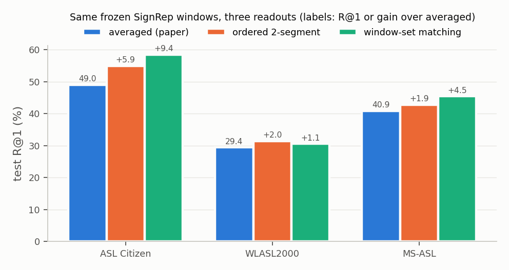

# Averaging Hides What a Frozen Sign Encoder Knows: Readout Matters for Frozen SignRep Retrieval

*Draft v0.5 (2026-10-06), revised after internal review R002 (`reviews/R002.md`); previous version `draft_v0.4.md`. Every number traces to an artifact in `research/EXPERIMENT_LEDGER.md` / `research/CLAIM_LEDGER.md`; test-set tables are regenerated by `method/p4_signssl/scripts/make_paper_tables.py` (→ `tables.md`) and statistics by `scripts/paper_stats.py` (→ `runtime/eval/paper_stats.json`). Section 5 reports the label-free set-distilled embedding (EX12).*

## Abstract

SignRep is the label-free RGB sign encoder that reports frozen dictionary retrieval; it embeds a clip by averaging 16-frame window embeddings weighted by predicted hand activity. Keeping the released encoder and its window embeddings fixed, we ask how much of the measured retrieval quality is a property of that averaging. Our re-implementation reproduces SignRep's ASL Citizen result (R@1 49.0 vs 49.95 reported). Under a protocol locked before a single test access, a training-free two-segment readout (one 1536-d vector) raises ASL Citizen test R@1 to 54.9 (+5.9, 95% CI [3.9, 7.5]; 10 of 11 test signers improve; exact sign-flip p = 0.001) and window-set matching raises it to 58.4 (+9.4 [8.2, 10.6]; 11/11; p = 0.0005). The direction replicates on WLASL2000 (+2.0 / +1.1) and MS-ASL (+1.9 / +4.5) with smaller effects. Validation diagnostics show that window embeddings carry motion-direction information that averaging removes: time-reversing the queries costs 3 R@1 points under the averaged readout but 26–32 points under the non-averaging readouts. A supervised attentive aggregator trained on the same frozen windows reaches 80.6 R@1 on validation, so the frozen windows support far more than their mean exposes. Encoder-side objectives we tried did not improve on the released encoder under matched controls, but a small aggregator trained without labels to reproduce window-set similarities yields a single vector with 57.3 test R@1 (+8.3 over SignRep's readout, +2.4 over the best training-free single vector). Frozen comparisons of sign encoders should report non-averaging readouts alongside the averaged one.

## 1. Introduction

- Frozen evaluation isolates a representation from downstream training, but sign encoders produce sequences (windows or frames) that must be reduced to one vector before retrieval. In general video SSL, frozen conclusions depend strongly on this readout (V-JEPA: 56.7 vs 73.7 on K400 for average pooling vs an attentive probe).
- SignRep [Wong et al., ICCV 2025] evaluates frozen dictionary retrieval after an activity-weighted average of 16-frame window embeddings; SignSeek [arXiv 2609.03695] uses the same frozen protocol with a gloss-supervised pose encoder and attentive pooling. Most label-free sign SSL papers (SHuBERT, SignDino, SSL-SLR) instead report trained heads.
- Questions: (Q1) does the averaged readout under-state what the released SignRep windows encode; (Q2) what does averaging discard; (Q3) do encoder-side objectives help once the readout is fixed?

## 2. Related work

- **Multi-vector video similarity.** Comparing videos by sets of frame- or segment-level descriptors rather than one pooled vector is established for near-duplicate video retrieval: with identical frozen descriptors, TCA reports that frame-level chamfer similarity outperforms video-level cosine by a large margin (FIVR-5K DSVR 0.844 vs 0.609) [Shao et al., WACV 2021].
- **Temporal information in frozen video features.** Average pooling of frozen per-frame features discards temporal direction while time-ordered concatenation retains it, even for native video encoders such as VideoMAE and V-JEPA [Bagad & Zisserman, LiFT]; LiFT learns a compact time-aware vector without labels but evaluates with per-pair linear probes rather than retrieval. SCALE trains a set-level transformer on frozen clip features without labels and improves k-NN accuracy [arXiv 2211.17042]. Alignment-based matching (DTW, Drop-DTW [NeurIPS 2021]) enforces temporal order.
- **Sign retrieval aggregation.** SignMatch aggregates sliding windows of a SignRep-initialised backbone with an LSTM and improves ASL Citizen dictionary retrieval substantially, but with gloss and pseudo-label supervision, a fine-tuned backbone, and without isolating the aggregator [arXiv 2609.01886]. We isolate the readout on the released, frozen SignRep windows without any training, and give a supervised aggregator on the same frozen windows only as a reference point.
- **Order sensitivity in sign SSL.** SSL-SLR probes frame permutation of a pose transformer under linear evaluation; we are not aware of a reversal or readout analysis of a frozen RGB sign retrieval embedding (searches A–E, 2026-10-06; forward citations of SignRep not exhaustively enumerated).

## 3. Setup

- **Encoder.** Released SignRep checkpoint (Hiera-B), vendored commit 06f40b5d; our inference path matches the vendor path (min window cosine ≥ 0.99996 in bf16). SignRep is self-supervised with respect to sign labels but trained with pose-teacher targets; its activity head (used below to locate the signing span) is likewise pose-supervised.
- **Windows.** 16 consecutive native frames, stride 2; window embedding = SignRep `features` (z^avg); activity γ = clip(max(P_LH, P_RH), 0, 1).
- **Retrieval.** Gallery = official train split; queries = validation (development) or test; class score = max cosine over the class's gallery clips; ties count against the query; DCG, MRR, R@k as in ASL Citizen.
- **Readouts on the same windows.** R0 — SignRep's activity-weighted mean (whole clip). R1 — *two-segment*: restrict to the active span (γ ≥ 0.5), split it into two halves by window index, activity-weighted mean per half, concatenate the L2-normalised halves (1536-d). R2 — *window-set matching*: rerank the 20 best classes of the active-span mean by symmetric chamfer similarity of the L2-normalised active-span windows (≤ 48 per clip).
- **Data.** ASL Citizen (signer-disjoint: 35/6/11 signers; 2,731 glosses); WLASL2000 (local pre-trimmed clips, all present; 99.9% of test signers also appear in the train gallery); MS-ASL (local cut clips: 12,711 train / 2,847 test, 944 test classes; overlap with YouTube-ASL makes absolute numbers contamination-prone).
- **Statistics.** Paired bootstrap (10,000) clustered by signer (ASL Citizen; WLASL with the official WLASL_v0.3 signer IDs) or by class (MS-ASL, no signer mapping for the cut clips); exact one-sided sign-flip test over the 11 ASL Citizen test signers; class-macro R@1 with the bootstrap recomputed per resample; Holm over the two primary comparisons. CIs are unadjusted percentile intervals.
- **Test hygiene.** Readouts, thresholds and decision rules were locked before test extraction (EX05 for ASL Citizen and WLASL, EX07 for MS-ASL). The ASL Citizen chamfer step was re-run once after a CUDA OOM; the same runs also scored non-locked variants, all disclosed in Appendix B. Unrelated projects in the same repository had earlier touched the ASL Citizen and MS-ASL test splits; none of their results were used. WLASL validation results were seen before the EX05 lock.

## 4. Results

### 4.1 Reproduction

R0 on ASL Citizen test: DCG 70.4 / R@1 49.0 / R@5 79.3 (SignRep v1 Table 4: 71.21 / 49.95 / 80.09). WLASL2000: 30.4 (val), 29.4 (test) vs 29.92 reported.

### 4.2 Readout gap (confirmatory)

*Figure 1. Test R@1 of the same frozen SignRep window embeddings under three readouts; labels give R@1 for the averaged readout and the gain over it for the others. Exact values: `tables.md`.*

| Test set | R0 (SignRep readout) | R1 two-segment | R2 window-set |
| --- | --- | --- | --- |
| ASL Citizen R@1 | 49.0 | 54.9 (+5.9 [3.9, 7.5]) | 58.4 (+9.4 [8.2, 10.6]) |
| ASL Citizen class-macro R@1 | 49.0 | +5.9 [3.8, 7.5] | +9.4 [8.2, 10.6] |
| WLASL2000 R@1 (signer-clustered CI) | 29.4 | 31.4 (+2.0 [0.8, 3.3]) | 30.6 (+1.1 [−1.1, 4.1]) |
| MS-ASL R@1 (class-clustered CI) | 40.9 | 42.8 (+1.9 [0.8, 2.9]) | 45.5 (+4.5 [2.9, 6.1]) |

Per ASL Citizen test signer, R1 improves for 10/11 signers (+3.8 to +9.2); signer P15 drops by 2.4 under R1 but gains 6.9 under R2. Storage per gallery clip: R0 768 floats, R1 1,536, R2 ≈ 20,000 (25 active windows on average) — R2 is a multi-vector method.

### 4.3 What the gain is made of (validation, exploratory)

| Readout on the same windows (ASL Citizen val, official gallery) | R@1 |
| --- | --- |
| R0 SignRep readout | 59.16 |
| plain mean (whole clip) | 47.53 |
| active-span weighted mean (normalised windows) | 59.49 |
| max / GeM pooling of the span | 59.98 / 56.04 |
| [mean ; std] (1536-d, order-free) | 63.63 |
| [mean ; max] (1536-d, order-free) | 62.36 |
| 2-means clusters, matched order-invariantly | 54.73 |
| R1 two-segment | 64.91 |
| R1 matched order-invariantly (best of the two half alignments) | 64.91 |
| R1 with the query's halves swapped | 26.09 |
| R2 window-set matching | 68.40 |

- An order-free 1536-d statistic ([mean; std]) recovers about three quarters of R1's gain, so much of it is information beyond the first moment; the rest comes from temporal segmentation. The two halves of a sign are distinct enough that order-invariant matching selects the in-order alignment.
- **Time direction.** On a 2,000-query subset, reversing the query clips lowers R@1 from 59.3 to 56.2 under R0, but from 64.0 to 38.2 under R1 and from 67.5 to 35.8 under R2: individual windows encode the direction of movement, and averaging removes most of that sensitivity.
- **Set-matching variants** (3,000 queries): one-directional query→gallery chamfer 68.7, symmetric 68.3, best half of the query windows 63.6, gallery→query 62.1, averaged 58.9. DTW alignment was worse than chamfer in a leave-one-signer-out pilot (51.6 vs 56.7, 2,000 queries).
- **Gallery size** (exploratory): with 3/7/15 exemplars per class, the window-set gain stays at +7.9/+9.5/+9.6.
- **Dataset dependence** is not explained by sign duration, gallery size or signer overlap in our checks (a signer-disjoint WLASL gallery gives +1.7/+2.8).

### 4.4 How much does the frozen encoder support? (supervised reference)

A two-layer transformer with attention pooling, trained with ASL Citizen *train* gloss labels on the same frozen windows, reaches 80.6 R@1 in validation retrieval (classifier top-1 82.4); a linear cosine classifier on the frozen weighted mean reaches 66.1. These use labels and are not comparable to the label-free readouts; they bound what the frozen windows can support.

### 4.5 Encoder-side objectives (negative results, validation, 1 seed)

- *Cross-window latent prediction continuation* (each masked window predicts the frozen teacher's embedding 8 frames earlier/later): +0.51 R@1 over the released model; matched same-window control +0.44; anchor-only +0.39 — the prediction target adds +0.07 [−0.12, 0.38].
- *32-frame continuation* (one window must linearly contain its two 16-frame halves in order): 41.8 vs 49.5 for the original, below an order-free control (43.7); without an anchor to the original space, longer-window continuation degraded retrieval.
- *Conditional cross-articulator forecasting* (premise test only; no objective was trained): adding another articulator's history never reduced held-out forecast error by ≥ 5% (0/36 gates on ASL Citizen, on 8,000 continuous How2Sign sentences, and on 1,197 How2Sign sentences with DINO crop appearance + 3-D hand landmarks).
- *Label-free post-hoc whitening* of the single-vector readout helped on ASL Citizen validation but lowered MS-ASL test R@1 by 2.4 points; *mined unlabelled positives* were mostly same-signer pairs (82% among the most confident) and were not used.
- Under the two-segment readout the ranking of the continuation checkpoints did not change, and their differences stayed within noise (1 seed).

## 5. Label-free set-distilled embedding (H008, confirmatory EX12)

**Method.** A small transformer aggregator (2 layers, d = 512, 4 attention-pooling queries, ≈ 7.6 M parameters; input LayerNorm on the frozen SignRep windows) maps the active-span windows of a clip to one 1024-d vector. It is trained **without labels** on the dataset's unlabelled train clips: for each anchor clip, the 64 nearest train clips under the active-span mean plus 8 in-batch clips form a candidate list; the teacher distribution is a softmax (τ = 0.03) over one-directional query→candidate chamfer similarities of the frozen windows; the student distribution is a softmax over cosine similarities of the aggregated vectors; the loss is their KL divergence. Three configurations were compared on ASL Citizen validation (val R@1 66.6 / 67.5 / 67.3) and the best was locked before any test access (EX12).

**Controls (validation, ASL Citizen).** The same aggregator trained with a mean-similarity teacher reaches 58.8 and with instance discrimination 64.7, so the gain requires the set-matching teacher.

**Test results (EX12, locked; ASL Citizen replicated over 3 training seeds in EX12b).**

| Test set | SignRep readout | two-segment (training-free) | window-set (multi-vector) | **set-distilled (one vector)** |
| --- | --- | --- | --- | --- |
| ASL Citizen | 49.0 | 54.9 | 58.4 | **57.3 ± 0.0** (3 seeds: 57.28 / 57.31 / 57.31; +8.3 [6.9, 9.6] vs SignRep readout; +2.4 [1.3, 3.4] vs two-segment, 10/11 signers, sign-flip p = 0.002; seed 0 CIs shown) |
| WLASL2000 | 29.4 | 31.4 | 30.6 | **32.6** (+3.1 [1.6, 5.2]; +1.1 [−0.1, 2.8]) |
| MS-ASL | 40.9 | 42.8 | 45.5 | **43.1** (+2.2 [0.7, 3.8]; +0.4 [−1.3, 2.0]) |

The set-distilled vector recovers most of the window-set gain at single-vector cost on ASL Citizen (88%), exceeds window-set matching on WLASL, and improves on the SignRep readout on all three datasets; its advantage over the training-free two-segment vector is significant only on ASL Citizen. All test splits had been used before for readout evaluation (Section 3), never for developing this model. Across three training seeds (EX12b, locked before training) the ASL Citizen result is stable: H8 − two-segment = +2.36 / +2.38 / +2.38; the seeds disagree on the top-1 outcome of ≈ 2,870 of 32,941 test queries, so the agreement of the aggregate is not a seeding artefact. A training-free moment vector (temporal mean and standard deviation of the windows and of their lag-4 differences, 3,072-d) reaches 65.3 on validation against 67.5 for the distilled vector (+2.2 [1.3, 3.5], exploratory), so a substantial part of the gain over the averaged readout is reachable with second-order temporal statistics; this baseline has not been evaluated on test.

## 6. Discussion

- The released SignRep windows carry substantially more retrievable information than the averaged readout exposes; a supervised aggregator on the same frozen windows reaches 80.6 vs 59.2 on validation.
- Frozen comparisons of sign encoders should report a non-averaging readout (two-segment, or window-set when storage permits) alongside the averaged one. Same-length continuation objectives moved R@1 by less than one point; the readout moved it by 6–9 points on ASL Citizen.

## 7. Limitations

One encoder for all confirmatory claims; three ASL datasets with different effect sizes and an unexplained difference; WLASL is not signer-independent and SignRep selected its checkpoint on WLASL validation; MS-ASL test overlaps YouTube-ASL; validation CIs rest on 5 effective signer clusters (one val signer has 2 clips); the confusion statistics in Appendix A rely on ASL-LEX codes of initial morphemes without orientation, and no Deaf signer or linguist reviewed them; method pilots used one seed and short budgets; the conditional-forecasting premise tests used local teachers rather than YouTube-SL-25-scale data and a generic DINOv3 teacher.

## Appendix A. Confusion statistics (validation, exploratory)

Among rank-1 errors of R0, the retrieved sign shares the true sign's handshape 44% of the time (chance 5%), location 46% (16%), path movement 27% (17%); lifts are not comparable across features with different cardinality. Discrimination of ASL-LEX-coded minimal pairs is high for all three parameters (handshape 98.3%, location 94.0%, movement 95.6%). These are confusion statistics, not evidence of what is encoded.

## Appendix B. All readout variants scored on test (disclosure)

ASL Citizen test R@1: active-span weighted mean 49.44; bins2 54.93; bins3 55.03; bins4 54.71; bins2+mean 53.80; bins3+mean 54.45; bins4+mean 54.86; chamfer 58.42; chamfer+mean 57.77. WLASL test: active-span mean 29.32; bins2 31.43; bins3 29.63; bins4 28.93 (below R0); bins2+mean 31.23; bins3+mean 30.84; bins4+mean 30.64; chamfer 30.57; chamfer+mean 32.58. None of these was used for any decision.

## Appendix C. Reference check with SHuBERT (validation only, not part of the claims)

Using the residual-stream output of SHuBERT's last layer, leave-one-signer-out validation R@1 is 10.3 with a mean over tracked frames and 13.9 / 14.3 with two-segment / window-set readouts; the per-layer outputs returned by the authors' feature script are near chance for frozen kNN.

## Reproducibility

`research/reproducibility_checklist.md`; code `method/p4_signssl/`.
