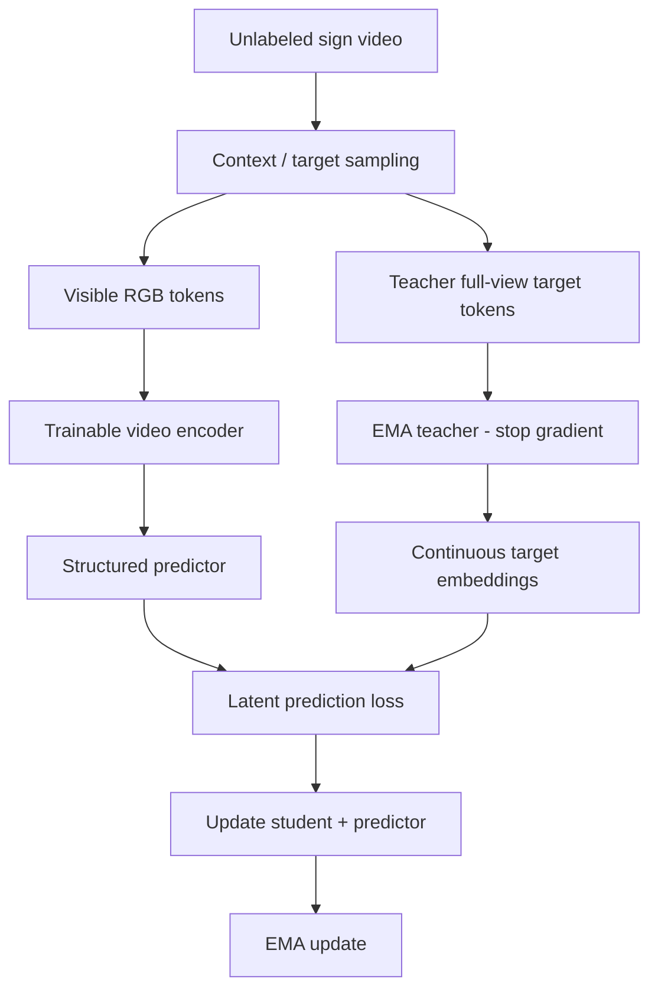
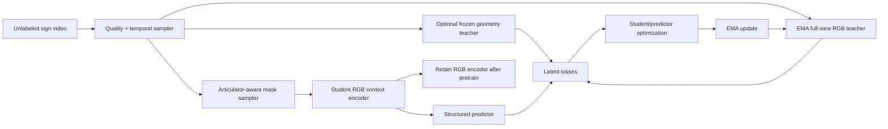

# JEPA for Self-Supervised Sign Language Representation Learning

**Deep Research · Literature Review · Method Design · End-to-End Implementation & Evaluation Blueprint**  
**Ngôn ngữ:** Tiếng Việt (giữ thuật ngữ khoa học tiếng Anh khi cần)  
**Ngày tổng hợp:** 09/10/2026  
**Phạm vi:** I-JEPA / V-JEPA / V-JEPA 2 / V-JEPA 2.1 / skeleton JEPA; self-supervised sign language; thiết kế và kiểm nghiệm một *research proposal*, **không phải kết quả của mô hình đã được huấn luyện**.  
**Tên proposal tạm thời:** **LS-SJEPA — Linguistically Structured Sign-JEPA**.

> **Quy ước mức độ bằng chứng**
>
> - **[LIT]**: nhận định có cơ sở từ bài báo/nguồn gốc được dẫn ở cuối tài liệu.
> - **[HYP]**: giả thuyết nghiên cứu chưa được kiểm chứng trong proposal này.
> - **[DESIGN]**: lựa chọn thiết kế hoặc thông số đề xuất để khởi chạy thực nghiệm, không được diễn giải là kết quả tối ưu.
> - **[VERIFY]**: vấn đề phải xác minh theo phiên bản dataset, checkpoint, license hoặc protocol trước khi công bố.

**Lưu ý:** Đây là bản định hướng nghiên cứu và engineering design có dẫn nguồn, không phải systematic review theo PRISMA, không khẳng định tìm được mọi công trình xuất bản đến thời điểm ghi trên. Các số liệu đã công bố (nếu nêu) thuộc các nguồn gốc; tài liệu này **không báo cáo kết quả mới**.

---

## Mục lục

1. [Tóm tắt điều hành](#1-tóm-tắt-điều-hành)
2. [Định nghĩa bài toán và câu hỏi khoa học](#2-định-nghĩa-bài-toán-và-câu-hỏi-khoa-học)
3. [Toàn cảnh Self-Supervised Learning](#3-toàn-cảnh-self-supervised-learning)
4. [JEPA từ nguyên lý đến toán học](#4-jepa-từ-nguyên-lý-đến-toán-học)
5. [Literature review: JEPA và training techniques](#5-literature-review-jepa-và-training-techniques)
6. [Literature review: Sign Language SSL](#6-literature-review-sign-language-ssl)
7. [Đặc điểm ngôn ngữ và failure modes](#7-đặc-điểm-ngôn-ngữ-và-failure-modes)
8. [Research gaps, novelty, hypotheses](#8-research-gaps-novelty-hypotheses)
9. [Ba thiết kế kiến trúc](#9-ba-thiết-kế-kiến-trúc)
10. [Thiết kế chi tiết LS-SJEPA](#10-thiết-kế-chi-tiết-ls-sjepa)
11. [Input, geometry, canonicalization và features](#11-input-geometry-canonicalization-và-features)
12. [Tokenization, attention và shape contract](#12-tokenization-attention-và-shape-contract)
13. [Masking strategies](#13-masking-strategies)
14. [Self-supervised targets và teacher priors](#14-self-supervised-targets-và-teacher-priors)
15. [Loss functions và tránh collapse](#15-loss-functions-và-tránh-collapse)
16. [Augmentations và curriculum](#16-augmentations-và-curriculum)
17. [Datasets, licenses và data governance](#17-datasets-licenses-và-data-governance)
18. [End-to-end training pipeline](#18-end-to-end-training-pipeline)
19. [Tham số và kế hoạch tuning](#19-tham-số-và-kế-hoạch-tuning)
20. [Đánh giá downstream và linguistic sensitivity](#20-đánh-giá-downstream-và-linguistic-sensitivity)
21. [Baselines và fairness protocol](#21-baselines-và-fairness-protocol)
22. [Ablation matrix và statistical rigor](#22-ablation-matrix-và-statistical-rigor)
23. [Implementation blueprint, pseudocode, config](#23-implementation-blueprint-pseudocode-config)
24. [Debugging và failure analysis](#24-debugging-và-failure-analysis)
25. [Compute/data scalability](#25-computedata-scalability)
26. [Roadmap và decision gates](#26-roadmap-và-decision-gates)
27. [Định vị paper A*/Q1](#27-định-vị-paper-aq1)
28. [Hạn chế, đạo đức, reproducibility](#28-hạn-chế-đạo-đức-reproducibility)
29. [Checklist end-to-end](#29-checklist-end-to-end)
30. [Tài liệu tham khảo và official code](#30-tài-liệu-tham-khảo-và-official-code)

---

# 1. Tóm tắt điều hành

## 1.1 Kết luận nghiên cứu

**[LIT]** JEPA (Joint-Embedding Predictive Architecture) học representation bằng cách dự đoán **biểu diễn latent** của phần thông tin bị ẩn từ context quan sát được, thay vì bắt buộc tái tạo pixels hoặc joints gốc. I-JEPA nhấn mạnh thiết kế target blocks và informative context; V-JEPA mở rộng dự đoán latent sang video; V-JEPA 2.1 bổ sung dense predictive loss và deep supervision [R01–R04].

**[LIT]** Self-supervised sign language representation learning đã có nhiều công trình chuyên biệt: SignBERT, SignBERT+, MASA, SignRep, SHuBERT, MS-MAE [R08–R13]. S-JEPA đã dùng latent prediction trên skeleton action recognition [R07]. AHA-JEPA (2026) có một frozen Sign-JEPA carrier trong pipeline *sign pose generation* [R14]. Vì vậy **không được claim “lần đầu dùng JEPA cho sign language/skeleton”**.

**[HYP]** Cơ hội nghiên cứu thực chất: thiết kế **context-target prediction có cấu trúc theo articulators** để representation học được handshape, orientation, movement, location, bilateral coordination và non-manual cues, đồng thời tránh học quá nhiều signer identity/background/camera.

## 1.2 Khuyến nghị chính

Đề xuất bắt đầu từ **RGB-centric LS-SJEPA**:

- **Student inference:** một RGB video encoder; không phụ thuộc pose estimator khi triển khai nếu teacher geometry chỉ dùng trong training.
- **Pretraining core:** EMA video teacher + masked latent prediction.
- **Masking:** temporal blocks, hand-region và cross-articulator prediction; không chỉ random video tubes.
- **Optional frozen teacher:** 2D/3D landmarks, handshape/motion/relational embeddings, dùng confidence-aware weights.
- **Core evaluation:** frozen probing, signer-independent ISLR, retrieval, few-shot, và fine-grained linguistic sensitivity.
- **Core scientific comparison:** cùng data/compute/backbone, kiểm tra liệu đổi **mask/target mechanism** có vượt standard sign-domain V-JEPA, MAE/SignRep, cluster prediction/SHuBERT hay không.

Không bắt đầu bằng một tổng loss rất nhiều thành phần. Dùng ba mốc: **(A) generic JEPA**, **(B) sign-domain standard JEPA**, **(C) structured Sign-JEPA**; chỉ thêm geometry khi (C) đã có tín hiệu tiến bộ.

## 1.3 Điều gì đủ làm contribution?

Một paper mạnh cần chứng minh ít nhất một câu hỏi có giá trị khoa học, ví dụ:

1. Structured context-target prediction giữ **linguistic minimal distinctions** tốt hơn generic video masking?
2. Continuous **articulator relation latents** có tốt hơn reconstruction của joint coordinates và discrete cluster pseudo-labels?
3. Kết hợp palm-local **intrinsic handshape** với body-relative **location/orientation** có đạt robust transfer mà không xóa linguistic contrast?
4. Các cải thiện tồn tại trong frozen/low-shot/cross-signer evaluation và không đến từ dùng thêm data hoặc external teacher?

---

# 2. Định nghĩa bài toán và câu hỏi khoa học

## 2.1 Bài toán nền

Cho tập video chưa gán gloss labels:

\[
\mathcal D_u=\{V_i\}_{i=1}^{N},\quad V_i\in\mathbb R^{T_i\times 3\times H\times W}.
\]

Mục tiêu là học encoder \(f_\theta\) tạo biểu diễn:

\[
Z_i=f_\theta(V_i),\quad Z_i=\{z_{i,t,s}\}_{t,s},
\]

trong đó \(t\) chỉ thời gian và \(s\) chỉ vùng/patch/articulator. Có thể tạo thêm pooled clip representation:

\[
z_i^{\mathrm{clip}}=\mathrm{Pool}_\psi(Z_i).
\]

Yêu cầu:

- **Local fidelity:** phân biệt handshape, finger articulation, orientation, contact.
- **Temporal fidelity:** phân biệt hướng di chuyển, lặp lại, tốc độ và duration khi mang nghĩa.
- **Spatial fidelity:** giữ vị trí bàn tay trong signing space so với face/body.
- **Contextual compositionality:** nắm dependencies giữa left/right hands, body, face và thời gian.
- **Robustness:** ít bị chi phối bởi identity/background/camera, **nhưng không xóa** facial grammar hoặc handedness khi chúng có ý nghĩa.
- **Transfer:** ít labels vẫn dùng tốt cho classification/retrieval/continuous recognition/translation.

## 2.2 Phân biệt các nhiệm vụ downstream

| Task | Dữ liệu | Output | Vai trò của pretrained representation |
|---|---|---|---|
| Isolated Sign Language Recognition (ISLR) | clip tương ứng một sign | class/gloss | clip/global và local detail |
| Continuous Sign Language Recognition (CSLR) | câu/chuỗi sign | gloss sequence | frame/segment-aligned features + temporal head/CTC |
| Sign Language Translation (SLT) | câu signed | natural-language text | contextual video features + text decoder |
| Dictionary retrieval | query/clip | xếp hạng sign clips | embedding geometry và discriminability |
| Fingerspelling recognition/detection | hand dynamics | letters/spans | high-frequency articulation cues |
| Cross-signer transfer | signer ngoài train | robustness metrics | nuisance-robust representation |
| Sign pose generation | text/gloss → pose | trajectory | bài toán **khác** representation learning, nhưng có liên hệ với learned latent carrier |

Không nên báo cáo một pooled clip encoder là giải pháp trực tiếp cho CSLR/SLT nếu chưa bổ sung temporal modeling và downstream supervision.

## 2.3 Research questions (RQs)

- **RQ1:** Generic V-JEPA 2.1 có giữ fine-grained signing information tốt hơn general video MAE không?
- **RQ2:** Structured masking tạo lợi ích khi đã kiểm soát effective masking rate và data augmentation?
- **RQ3:** Cross-articulator latent targets có tốt hơn per-stream latent targets?
- **RQ4:** Frozen geometry teacher đóng góp thêm gì so với chỉ RGB EMA teacher?
- **RQ5:** Palm-local vs body-relative geometric spaces bổ sung nhau thế nào?
- **RQ6:** Cải thiện có tồn tại trong signer-independent, low-label và cross-language transfer?
- **RQ7:** Chi phí tăng thêm có được bù bằng improvements trong dense/global representation quality?

---

# 3. Toàn cảnh Self-Supervised Learning

## 3.1 Taxonomy

| Paradigm | Pretext task | Target | Ví dụ | Ưu/nhược với sign language |
|---|---|---|---|---|
| Contrastive | phân biệt views/instances | positive/negative pairs | InfoNCE, MoCo-like | tốt retrieval; false negatives nếu signs giống/biến thể |
| Bootstrap/distillation | student khớp teacher view | continuous embeddings | BYOL/DINO/data2vec | không cần negatives; phải monitor collapse |
| Masked reconstruction | khôi phục phần bị che | pixels/joints/motion | MAE, SignBERT, MASA | giữ chi tiết; có thể học noise/appearance |
| Masked discrete prediction | dự đoán quantized pseudo-label | cluster IDs | HuBERT, SHuBERT | khai thác ngữ cảnh; phụ thuộc cluster quality |
| Joint-embedding prediction | dự đoán latent target từ context | continuous target embeddings | I-JEPA, V-JEPA, S-JEPA | hướng trừu tượng; có thể oversmooth fine articulation |
| Hybrid predictive SSL | nhiều targets/losses | latent + structured priors | proposal LS-SJEPA | linh hoạt nhưng khó attribution và tuning |

**Không đánh đồng** không sử dụng *gloss labels* với không sử dụng bất kỳ supervised model nào: nếu tạo pseudo-label bằng hand pose estimator hoặc DINOv2 pretrained teacher, phải khai báo nguồn dữ liệu và supervision của các pretrained components.

## 3.2 Contrastive: khi nào vẫn hữu ích?

Dùng positives là những augmentations **giữ nguyên linguistic content** của cùng clip. Không thể tùy ý coi two temporally disjoint subclips là positive: chúng có thể chứa hai signs khác nhau. Với retrieval, contrastive auxiliary có thể giúp, nhưng cần đánh giá against latent-prediction-only, đặc biệt khi positives/negatives không có linguistic alignment.

## 3.3 Reconstruction vs latent target

Coordinate reconstruction:

\[
\mathcal L_{\mathrm{joint}}=\sum_{(t,j)\in M}\|\hat p_{t,j}-p_{t,j}\|_1.
\]

JEPA latent regression:

\[
\mathcal L_{\mathrm{latent}}=\sum_{k\in M}\|\hat z_k-\operatorname{sg}(z_k)\|_1.
\]

Khác biệt thực nghiệm cần kiểm chứng: latent target có loại được jitter/noise mà vẫn giữ handshape-critical differences không? Chỉ dùng training loss không trả lời được câu hỏi này.

---

# 4. JEPA từ nguyên lý đến toán học

## 4.1 Các thành phần

Một video được chia thành 3D tubelets \(x_k\), với index \(k=(t,h,w)\). Chọn context index set \(C\), target index set \(M\), và bảo đảm \(C\cap M=\varnothing\) trong student token visibility.

- **Student/context encoder** \(f_\theta\): nhìn **chỉ visible context tokens**.
- **EMA target teacher** \(f_\xi\): nhìn video/target view đủ thông tin, không nhận gradient.
- **Predictor** \(g_\phi\): nhận context features và target position queries, dự đoán target latent.
- **Loss:** đối chiếu student predictions với stop-gradient teacher targets.

\[
Z_C=f_\theta(V;C),\quad
Z_M^*=\operatorname{sg}(f_\xi(V)_M),
\]

\[
\hat Z_M=g_\phi(Z_C, E_{\mathrm{pos}}(M)),
\]

\[
\boxed{\mathcal L_{\rm JEPA}=\frac{1}{|M|}\sum_{k\in M}D(\hat z_k,z_k^*)}.
\]

Trong thực tế target features có thể được chuẩn hóa (LayerNorm/teacher normalization tùy implementation) trước khi tính \(D\). L1 là lựa chọn xuất phát tốt, Huber/cosine là ablations.

**EMA update** (sau optimizer step):

\[
\xi\gets\tau\xi+(1-\tau)\theta,\quad \tau\in(0,1).
\]

Cần đảm bảo index ordering của masked patches và target teacher **trùng khớp**; lỗi index sẽ khiến loss học các tín hiệu sai mà không nhất thiết crash.

## 4.2 Điều JEPA không bảo đảm

- Không tự động hiểu lexical semantics nếu chưa thấy đủ dữ liệu và không có task-aligned evidence.
- Không tự động bảo toàn finger-level distinctions nếu teacher không biểu diễn được.
- Không tự động tránh collapse hoàn toàn chỉ nhờ EMA.
- Không tự động giúp causal prediction: masked bidirectional prediction có thể sử dụng frames sau target.
- Không tự động là một world model có năng lực lập kế hoạch; sign representation learning và world modeling là hai mục tiêu khác nhau.

## 4.3 Context-target predictability trade-off

Nếu target quá dễ (gần-duplicate frames, camera/background), model có shortcut; nếu target quá khó (ẩn cả hai tay, mặt và motion), conditional distribution là đa nghiệm và point-estimation loss tạo *mean target/oversmoothing*.

**[DESIGN]** Các mask phải cân bằng thông tin context và độ khó của target. Ngoài mask ratio, ghi log:

1. tỷ lệ target thuộc vùng hand/face/body/background;
2. % thời gian có ít nhất một hand visible;
3. % video bị che toàn bộ linguistic articulators;
4. tỉ lệ cross-view student target leakage;
5. per-mask-type loss và downstream performance.

## 4.4 Flow tổng quát



---

# 5. Literature review: JEPA và training techniques

## 5.1 Cốt lõi JEPA

| Công trình | Năm/nguồn | Đóng góp được kiểm chứng | Bài học cho LS-SJEPA |
|---|---|---|---|
| I-JEPA [R01] | CVPR 2023 | large target blocks + informative spatially distributed context | đừng dùng uniform patch prediction vô điều kiện |
| data2vec [R15] | ICML 2022 | teacher-based contextual representation prediction | temporal feature distillation, alternative teacher design |
| MC-JEPA [R05] | 2023 | học content và optical-flow/motion objectives trong shared representation | explicit motion signal có thể bổ sung cho latent prediction |
| V-JEPA [R02] | TMLR 2024 | pure video feature prediction; không pixel reconstruction/negatives/text | baseline video latent SSL |
| V-JEPA 2 [R03] | 2025 | video understanding, anticipation và action-conditioned post-training | pretrained encoder, long-range motion priors |
| V-JEPA 2.1 [R04] | 2026 | dense predictive loss, deep supervision, image-video training/scaling | giảm rủi ro local detail bị bỏ quên; test trade-offs |
| S-JEPA [R07] | ECCV 2024 | partial skeleton → missing joint latent; centering | geometry-JEPA không phải mới hoàn toàn |
| LeJEPA [R06] | 2025 preprint | SIGReg, một alternative regularized JEPA objective | ablate regularizer riêng, không trộn tùy tiện |
| DSeq-JEPA [R16] | 2025 preprint | prediction theo vùng discriminative có thứ tự | nghiên cứu salient articulator/temporal curriculum |
| VL-JEPA [R17] | ICLR 2026 | vision → target-text continuous embedding prediction | optional text-latent alignment, đòi hỏi video-text pairs |

## 5.2 Masking: từ I-JEPA đến video và sign

**I-JEPA [R01]:** target blocks đủ lớn để không đơn giản dựa vào pixel-level correlations; context phải informative. Đây là lý do part-aware masking có thể thú vị.

**V-JEPA [R02]:** dùng spatial-temporal masking, trong đó target blocks có cấu trúc theo thời gian. Những tỉ lệ masking cao trên general videos không phải mặc định tối ưu cho signing.

**V-JEPA 2.1 [R04]:** dense loss có supervision trên cả masked targets và visible context, cùng deep supervision trên intermediate features. Đối với hands, dense features có thể quan trọng, nhưng cần đánh giá global probing vì trade-off có thể xảy ra.

**DSeq-JEPA [R16]:** học ưu tiên vùng dự đoán có tính discriminative. Với signed languages, discriminative regions có thể là static handshapes, subtle palm orientation, mouth movements chứ không đồng nhất high motion magnitude.

## 5.3 Target space là trục thiết kế quan trọng

| Target type | Ưu | Rủi ro | Thí nghiệm bắt buộc |
|---|---|---|---|
| Final-layer global video features | tiết kiệm implementation | bỏ fine detail | local probing |
| Dense patch teacher latents | spatially grounded | patch appearance noise | hand/face sensitivity |
| Intermediate multi-layer latents | chi tiết đa mức | tăng memory/loss scale | frozen transfer vs cost |
| Pose/hand geometry latents | topology inductive prior | estimator bias | teacher-matched baselines |
| Motion latents | dynamics | noise do differencing | speed/acceleration robustness |
| Relational latents | bilateral/hand-body structure | phụ thuộc registration | relation-aware ablations |
| Text latents | semantic supervision | yêu cầu paired supervision | separate cross-modal phase |

## 5.4 Anti-collapse và teacher design

Các lựa chọn tương đối độc lập:

- **EMA + stop-gradient:** công thức chuẩn JEPA; kiểm tra momentum schedules.
- **Teacher feature centering/normalization:** S-JEPA nhấn mạnh centering; normalization có thể cải thiện stability nhưng cần đánh giá.
- **Variance–covariance constraints (VICReg-style):** tránh latent dims hằng số/phụ thuộc tuyến tính; chi phí thêm.
- **SIGReg (LeJEPA):** alternative có cơ sở khác; không giả định cùng lúc EMA + SIGReg sẽ tốt hơn.
- **Projection head bottleneck:** có thể giúp cân bằng low-level/detail nhưng cũng làm mất thông tin; cần kiểm tra dimensionality.

**Diagnostics:** variance từng chiều, feature norm histogram, covariance off-diagonal, effective rank, singular value spectrum, teacher-student cosine và nearest-neighbor qualitative examples. Downstream probe mới là phép đo quyết định.

---

# 6. Literature review: Sign Language SSL

## 6.1 Những phương pháp cần so sánh

| Công trình | Bài toán/input | Self-supervised target/objective | Điểm kế thừa và giới hạn so với proposal |
|---|---|---|---|
| SignBERT [R08], ICCV 2021 | hand pose tokens | masked hand-token reconstruction + hand model prior | hand-specific masking đã có từ sớm |
| SignBERT+ [R09], 2023 | hand pose sequence | joint/frame/clip mask + hand-aware pretraining | multi-level masking không mới nếu chỉ đổi tên |
| MASA [R10], 2024 | sign pose/motion | motion-aware MAE, reconstruct motion residual, semantic alignment | motion-aware objective/mask phải so sánh với MASA |
| SignRep [R11], ICCV 2025 | RGB video với skeleton-derived priors ở pretraining | masked autoencoding + regularization/style-agnostic training | RGB-only inference với geometry prior đã được làm |
| SHuBERT [R12], ACL 2025 | left/right hands, face và body | masked multi-stream cluster pseudo-label prediction | cross-stream and multi-articulator learning đã tồn tại |
| MS-MAE [R13], 2025 | skeleton-based sign streams | multi-stream masked autoencoding | quan trọng cho skeleton + cross-language transfer |
| S-JEPA [R07], ECCV 2024 | human skeleton actions (không sign-specific) | missing-joint latent prediction | JEPA-skeleton đã có, nhưng task/linguistic target khác |
| AHA-JEPA [R14], 2026 | gloss-conditioned sign-pose generation | frozen Sign-JEPA carrier trong generative pipeline | không phải direct representation benchmark; **cấm first-use claim** |

## 6.2 Phân tích đối thủ trực tiếp: SignRep

**[LIT]** SignRep (ICCV 2025) dùng inductive sign priors dựa trên skeletons trong RGB masked-autoencoder pretraining, feature regularization và adversarial style-agnostic loss; mô hình cuối không cần skeletal keypoints ở inference [R11].

**Hàm ý:** “RGB student + geometry teacher / pose-aware training + RGB-only inference” **không đủ novelty**. LS-SJEPA cần chứng minh lợi ích của **prediction formulation**, structured masks, continuous relational latent targets, hoặc một cơ chế mới có ablation.

## 6.3 Phân tích đối thủ trực tiếp: SHuBERT

**[LIT]** SHuBERT (ACL 2025) tạo bốn streams từ hands/face/body (bao gồm features trích từ pretrained visual networks), thực hiện masked cluster prediction từ video ASL quy mô lớn [R12].

**Hàm ý:** “multi-stream hands+face+body” và “pseudo labels từ dữ liệu chưa gán nhãn” **đều không mới**. Cần đối chiếu continuous latent regression với discrete cluster prediction dưới setup được kiểm soát.

## 6.4 Phân tích đối thủ trực tiếp: S-JEPA và AHA-JEPA

**[LIT]** S-JEPA dự đoán latent missing-joint embeddings thay reconstruction [R07]. AHA-JEPA có frozen Sign-JEPA carrier cho sign pose generation [R14].

**Research positioning phù hợp:** tập trung vào *representation quality and linguistic articulation sensitivity*, **không phải công bố “Sign-JEPA đầu tiên”**.

## 6.5 Khoảng trống phải xác minh kỹ trước submission

- So sánh **structured target selection** với reconstruction/cluster prediction trong cùng pretraining data và architecture.
- Kiểm tra **handshape + global location/orientation** đồng thời, không bất biến hóa quá mức.
- Một **linguistically controlled evaluation** tránh chỉ báo cáo global accuracy.
- Kiểm tra **data leakage / teacher input leakage / test video overlap** và impact của external priors.
- Đảm bảo contribution vượt việc cộng nhiều losses đã phổ biến.

---

# 7. Đặc điểm ngôn ngữ và failure modes

Sign language là ngôn ngữ tự nhiên; signed articulations không thể xem đơn giản như generic human actions. Những trục thông tin quan trọng gồm:

1. **Handshape:** cấu hình các ngón, ngón cái, finger contacts; static hold cũng quan trọng.
2. **Location:** tay ở mặt/ngực/vai/signing space và vị trí tương đối body.
3. **Movement:** path, direction, repetition, duration, movement manner.
4. **Orientation:** hướng palm/fingers, hand rotation trong global/body frame.
5. **Bilateral relations:** hai tay cùng tham gia, dominant/non-dominant relationships, contact.
6. **Non-manual markers:** eyebrows, gaze, head posture, mouth movements, biểu cảm có vai trò ngôn ngữ.
7. **Coarticulation and temporal context:** movements qua ranh giới signs, transitions, variation giữa signers.

| Failure mode | Cơ chế | Dấu hiệu | Giải pháp nghiên cứu |
|---|---|---|---|
| Hand-detail collapse | global pooling / patch quá lớn | minimal-pair thất bại | high-resolution hand sampling; local losses |
| Temporal oversmoothing | regression-to-mean | representation ít nhạy với motion | multi-scale/motion targets |
| Background shortcut | camera/áo/background correlate labels | accuracy giảm khi crop/đổi background | controlled augmentation + signer split |
| Identity leakage | face/appearance features dominate | nhận diện signer dễ hơn lexical cues | selective style invariance |
| Linguistic cue erasure | horizontal flip, spatial centering quá mức | mất handedness/location | contrast-aware augmentations |
| Teacher geometry noise | occlusion, hand pose jitter, incorrect depth | unstable targets | confidence-aware weighting/filtering |
| Cross-modal mask leakage | target hidden trên RGB nhưng vẫn visible ở pose | loss rất thấp bất thường | synchronized visibility contracts |
| Missingness shortcut | model đoán confidence pattern | tốt train, kém test | quality balancing, mask indicator controls |
| Domain mismatch | khác sign language/camera | low transfer | cross-language adaptation + stratified evaluations |

**Nguyên tắc:** chỉ học invariance với yếu tố nuisance; không ép invariance cho các biến có thể làm đổi nghĩa.

---

# 8. Research gaps, novelty, hypotheses

## 8.1 Hypotheses có thể falsify

| ID | Hypothesis [HYP] | Dự đoán quan sát | Falsification test |
|---|---|---|---|
| H1 | hand-region latent prediction giúp articulation detail | cải thiện minimal-pair retrieval | không hơn random JEPA khi matching masks |
| H2 | cross-articulator targets học structure | cải thiện signer-independent/top-k retrieval | không hơn independent part targets |
| H3 | dual coordinate spaces giữ shape + location | tăng location/orientation sensitivity | body-relative-only tương đương hoặc hơn |
| H4 | confidence-aware geometry targets giảm noise | robustness dưới occlusion tăng | không hơn unweighted teacher loss |
| H5 | multi-scale targets tốt hơn single-scale | cải thiện CSLR và frame probing | không hơn same-compute single-scale |
| H6 | domain-specific JEPA giúp low-label transfer | few-shot vượt generic V-JEPA | performance gap biến mất dưới controls |

## 8.2 Nguyên tắc novelty

**Giữ:** một cơ chế rõ (ví dụ *articulator-conditioned latent target prediction*) và một ứng dụng mới/đánh giá mới chứng minh cơ chế.

**Không sử dụng làm contribution duy nhất:** thêm MediaPipe, chia hands/face/body, dùng V-JEPA pretrained, EMA teacher, feature regularizer, pose-aware masks, hoặc random-to-motion masking đơn thuần.

**Khả năng đóng góp phụ:** benchmark linguistic sensitivity mới được gắn annotation đủ tin cậy hoặc protocol chống leakage công khai.

## 8.3 Ba directions

- **D1 — Linguistic Structure-Aware Latent Prediction:** trọng tâm đầu tiên; RGB-centric, articulated masks, relational targets.
- **D2 — Geometry-Canonical Multi-Space JEPA:** hand-local/body-relative/global, phù hợp khi sở hữu pipeline 3D tốt; cần chứng minh không xóa meaning.
- **D3 — Hierarchical Sign Dynamics JEPA:** multi-scale prediction từ fine finger tới sentence; nghiên cứu dài hạn compute cao.

---

# 9. Ba thiết kế kiến trúc

## A. RGB-centric Sign-JEPA (ưu tiên)

```
Sign RGB video
  ├─ pretraining student: visible RGB tubelets → Video Transformer → Predictor
  ├─ EMA video teacher (train-only) → continuous patch/segment targets
  └─ optional offline pose/hand/face teacher (train-only) → structural targets
             ↓ losses for student
    Retain RGB encoder for inference
             ↓
    ISLR / retrieval / CSLR / SLT adapters
```

**Ưu:** deployment RGB-only, scale dễ hơn geometry-required inference, thuận lợi so sánh V-JEPA.  
**Nhược:** handshape rất nhỏ so với tubelet; cần high-resolution/region-aware supervision.

**Bẫy kiến trúc:** nếu cho student **explicit hand crops được tạo từ pose detector ở inference**, pipeline **không còn RGB-only/no-detector inference**. Để giữ claim RGB-only, chỉ dùng pose để chỉ định loss target/mask trong training; inference lấy video patches/attention từ RGB thuần, hoặc khai báo rõ detector vẫn chạy.

## B. Geometry-centric Sign-JEPA

```
Video → 2D/3D pose offline / online
     → spatio-temporal graph tokens
     → skeleton Transformer → masked joint/part latent predictor
     → pose motion representation
```

**Ưu:** dễ kiểm soát topology, ít pixel compute, triển khai hình học multi-space.  
**Nhược:** sai lệch pose estimator, mất texture/mouth subtle movements, inference yêu cầu pose extractor.  
**Baseline bắt buộc:** S-JEPA; SignBERT+; MASA; MS-MAE.

## C. RGB + Geometry Cross-Modal JEPA

```
RGB stream ── RGB encoder ─┐
                          ├─ fusion / cross-attention ─→ multi-head latent predictor
Pose stream ─ Pose encoder ┘
```

**Ưu:** complementary signals.  
**Nhược:** compute, alignment, shortcut, teacher quality.  
**Kiểm soát:** đồng bộ masks across modalities và phân biệt (i) RGB-only inference, (ii) RGB+pose inference.

**Khuyến nghị:** chạy A làm primary, B làm independent geometry baseline, chỉ thử C khi A/B đã có giá trị.

---

# 10. Thiết kế chi tiết LS-SJEPA

## 10.1 Core modules

**M1. Video tokenizer.** RGB video tubelets kích thước \((t_p,p,p)\), linear/conv projection tới \(d_v\), thêm temporal/spatial positional embeddings.

**M2. Context video encoder.** Pretrained V-JEPA 2.1 ViT-B/16; keep token outputs thay vì chỉ pooled CLS. Official repo phát hành V-JEPA 2.1 ViT-B/16 pretrained ở resolution 384 [R04, R18]. Nếu muốn dùng resolution khác, phải kiểm tra positional interpolation và hiệu quả thực nghiệm.

**M3. Part-aware target generator.** Teacher body/hand/face detector/encoder tạo dense priors và region maps. Các tensors này chỉ nằm training branch ở Architecture A.

**M4. Mask sampler.** Sampler định nghĩa \(M\), \(C\) và structural mask task (hand/face/temporal/relation), bảo đảm visible inputs theo đúng contract.

**M5. Structured predictor.** Small Transformer nhận encoded context, masked query tokens với type embeddings và positional encodings, trả về latent teacher targets.

**M6. EMA teacher.** Exponential moving average encoder; frozen/stop-gradient trong forward.

**M7. Optional geometry teacher(s).** Pose/keypoint latent encoders; chọn frozen pretrained teacher đủ chất lượng hoặc pretrain riêng (không để unregularized trainable target projection tự thu nhỏ loss).

**M8. Evaluation heads.** Attentive/classification probe; retrieval; temporal head+CTC; translation decoder.

## 10.2 Luồng dữ liệu



## 10.3 Thiết kế factorized representations

\[
Z=\{Z^{\rm local},Z^{\rm bodyrel},Z^{\rm temporal},Z^{\rm global}\}.
\]

- **Local:** landmarks tại palm-local frame, tương đối cổ tay, hình dạng tay.
- **Body-relative:** tay theo torso/shoulder, palm orientation so với body.
- **Temporal:** velocity/acceleration và time-aggregated joint relations.
- **Global:** toàn clip hoặc window summary cho semantic retrieval.

Các factorized targets không có nghĩa mô hình chắc chắn học semantic disentanglement; cần probe các spaces độc lập và kết hợp.

---

# 11. Input, geometry, canonicalization và features

## 11.1 Bảng nguồn và vai trò

| Input | Tensor gợi ý | Chức năng | Train/inference ở A |
|---|---|---|---|
| RGB | `B,T,3,H,W` | global + local visual signal | cả hai |
| Hand crops | `B,T,2,3,h,w` | detailed shape reference | *training priors*; inference nếu dùng phải khai báo |
| Face crop | `B,T,3,hf,wf` | non-manual signals | training teacher hoặc RGB patch stream |
| 2D landmarks | `B,T,J,3` (x,y,confidence) | location and topology | teacher train-only |
| 3D joints | `B,T,J,4` (x,y,z,confidence) | depth/spatial relation | optional teacher |
| Joint rotations | `B,T,Jr,6` (6D) | articulated orientation | optional teacher |
| Velocity/acceleration | `B,T,J,D` | motion signal | derived targets |
| Pairwise edges | `B,T,E,D_e` | hand–hand/body/face relation | target geometry teacher |

Những tensor shapes là **interfaces đề xuất**, không phải đầu ra cố định của một dataset.

## 11.2 Body-centered coordinates

Cho root/torso point \(c_t\), torso scale \(s_t\), body frame \(R_t^b\):

\[
\tilde p^{\rm body}_{t,j}=\frac{(R_t^b)^\top(p_{t,j}-c_t)}{s_t}.
\]

Nên giữ cả absolute/camera-normalized wrist positions, body-relative positions và biến đổi frame; không loại bỏ location.

## 11.3 Palm-canonical coordinates

Cho \(R^h_t\), wrist \(w_t\), hand scale \(s^h_t\):

\[
\tilde p^h_{t,j}=\frac{(R^h_t)^\top(p^h_{t,j}-w_t)}{s^h_t}.
\]

**Song song giữ:** \(w_t^{\rm body}\), \((R^b_t)^\top R^h_t\), hand handedness và confidence. Palm-local coordinates chỉ mô tả intrinsic geometry; global location/orientation có thể đổi lexical meaning.

**Guardrails:** nếu palm axes đảo do occlusion, orientation targets bị discontinuity; kiểm tra determinant \(\det(R)\approx1\), orthogonality, left/right handedness convention, temporal angular jumps và frame consistency. Nếu chỉ có 2D landmarks, không giả tạo độ sâu chính xác.

## 11.4 Motion derivatives

\[
\Delta p_{t,j}=\frac{p_{t,j}-p_{t-1,j}}{\Delta t},\quad
\Delta^2p_{t,j}=\frac{\Delta p_{t,j}-\Delta p_{t-1,j}}{\Delta t}.
\]

Sử dụng timestamps/fps chính xác; smoothing cần kiểm tra vì giảm noise cũng có thể xóa rapid finger transitions. Cho missing joints nên mask derivatives hoặc áp confidence.

## 11.5 Pairwise relational features

Ví dụ:

\[
r_t^{LR}=p_t^{LH}-p_t^{RH},\quad
r_t^{HF}=p_t^{LH}-p_t^{face},
\]

\[
\rho_t^{hand-face}=\|p_t^{hand}-p_t^{face}\|_2,
\]

\[
\omega_t^{LR}=\operatorname{Log}((R_t^{LH})^\top R_t^{RH}).
\]

Có thể dùng graph edges hoặc attention bias cho wrist–wrist, wrist–head, wrist–torso, hand–face; không giả định mọi cạnh có significance cố định.

## 11.6 2D vs 3D recommendation

**[DESIGN]** Bắt đầu từ 2D confidence+motion (ổn định, rẻ), rồi thử 3D as additional teacher. Với monocular video, 3D reconstruction có thể thay đổi body shape và wrist articulation qua frames, tạo noise trong targets. Evaluation phải so sánh: RGB only / RGB+2D teacher / RGB+3D teacher / high-confidence-only 3D.

---

# 12. Tokenization, attention và shape contract

## 12.1 RGB tubelet grid

Với video \(T\times H\times W\), tubelet temporal \(t_p\), spatial patch \(p\), số tokens xấp xỉ:

\[
N_v=\frac{T}{t_p}\frac{H}{p}\frac{W}{p}
\]

(khi chia hết; nếu không dùng padding/cropping phù hợp).

Ví dụ **[DESIGN]** \(T=32,H=W=384,t_p=2,p=16\) thì \(N_v=16\cdot24\cdot24=9216\) tokens. Với full attention, cost tăng theo \(O(N_v^2)\), nên **không** coi 32×384 là thiết lập rẻ một cách mặc định. Đây là lý do cần pretraining strategy dựa trên sparse student masking, token downsampling, shorter clips, memory accounting hoặc tối ưu attention. Các cấu hình thực tế phải theo official checkpoint/model implementation.

## 12.2 Pose tokens

\[
e_{t,j}=W_xx_{t,j}+e_t^{time}+e_j^{joint}+e_{r(j)}^{region}.
\]

Có thể group by left hand/right hand/face/arm/torso và sử dụng spatial then temporal factorized Transformer.

## 12.3 Alignment contract

Định nghĩa `token_index=(t_bin, h_bin, w_bin)` và projection từ landmark \((x,y,t)\) đến patch/token bins. Với vùng nhỏ, map mỗi joint đến nhiều patches bằng bounding-box overlap/gaussian prior; không ép nearest-one-patch duy nhất nếu độ phân giải thấp.

**Unit tests cần có:**

- `mask_context ∩ mask_target = ∅` cho student RGB patch tokens;
- teacher target indices được sắp thứ tự như predicted query indices;
- predicted feature dimension = teacher projection dimension;
- spatial crops/masks biến đổi nhất quán sau resize/crop;
- temporal indices đúng sau sub-sampling;
- left/right hand không bị hoán đổi ngoài chủ đích;
- padding positions không đi vào loss.

---

# 13. Masking strategies

## 13.1 Masking là biến thiết kế cốt lõi

Với JEPA, mask không chỉ là regularization: nó định nghĩa câu hỏi mô hình buộc phải giải quyết. Uniform random masking có thể che background nhiều hơn tay và khiến model giải những targets không liên quan đến signing. Ngược lại mask toàn bộ vùng có nghĩa có thể tạo một bài toán underdetermined: nhiều signs cùng phù hợp với visible body context.

**[DESIGN]** Viết mask sampler như một policy có điều kiện:

\[
P(M\mid V,P,q)=\sum_{k=1}^{K}\pi_k(q)P_k(M\mid V,P),
\]

trong đó \(P\) là landmarks/regions và \(q\) là quality/confidence metadata. \(\pi_k\) là xác suất chọn *mask task*, không phải masked-token ratio.

## 13.2 Taxonomy và purpose

| Mask | Visible context | Hidden target | Mục đích khoa học | Nguy cơ |
|---|---|---|---|---|
| Random video tubes | toàn video trừ random tubes | RGB latent của tubes | JEPA baseline | background shortcut |
| Spatial hand-region | body, face, tay còn lại, hand spans ngoài mask | hand-region latent | cross-articulator dependency | target không suy được từ context |
| Fine finger group (pose) | joints còn lại trong bàn tay | finger-group latent | intrinsic shape | quá dễ do kinematic interpolation |
| Whole-hand temporal span | pre/post hand states, other articulators | hand motion latent đoạn giữa | coarticulation | oversmoothing |
| Cross-hand | tay trái+body | right-hand target và đảo lại | bilateral coordination | asymmetric/dominant-handed signs |
| Face/non-manual | hands+body context + face ngoài vùng mask | face temporal latent | multimodal correlations | face grammar không suy từ tay |
| Body-relative location | local hand shape + visible body | wrist body-relative target | relational location | chuẩn hóa sai xóa information |
| Palm orientation | visible motion/context | teacher orientation embedding | pose trajectory/orientation | ambiguity cao |
| Motion-guided spans | low/high-motion mixture context | latent ở informative dynamics | focus motion | bỏ quên static holds |
| Long temporal blocks | trước/sau span | middle clip embedding | longer-range structure | temporal leakage/semantic ambiguity |
| Uniform temporal frame spans | frames ngoài span | target frames/latent | historical SSL control | không tập trung articulator |
| Hierarchical masks | mix short/medium/long spans | multi-scale targets | temporal hierarchy | complexity và ablation khó |

## 13.3 Tỷ lệ mask policy khởi đầu

Một ví dụ **[DESIGN]** cho *tỷ lệ chọn task*, cần tune:

| Task family | Sampling probability |
|---|---:|
| Hand/finger regions | 30% |
| Temporal spans | 20% |
| Cross-hand/relational | 20% |
| Face/body region | 10% |
| Motion-guided | 10% |
| Standard random multi-block | 10% |

**Cảnh báo:** Đây **không phải** 30% hand tokens bị mask hoặc total mask ratio 100%; các xác suất chỉ chọn cách sinh mask. Mỗi task có một `target_token_fraction` độc lập, cần matching khi làm ablation.

## 13.4 Spatial-temporal mask construction

**Step A:** lấy region bounding boxes cho hands/face/body từ detector; nới box theo `margin` và dùng confidence filter.

**Step B:** map bounding boxes và frame spans sang video patch indices; với tubelet chứa nhiều frames, region mask lấy union/coverage threshold có thể khác nhau — phải ghi rõ.

**Step C:** random sample một hay nhiều temporal intervals \([t_0,t_1]\); tránh chỉ lấy static periods hoặc chỉ high-motion periods.

**Step D:** xây target set \(M\), context set \(C\), đồng thời kiểm soát:

\[
\rho = \frac{|M|}{N_v},\qquad
\rho_h=\frac{|M\cap\mathcal H|}{|\mathcal H|},
\]

với \(\mathcal H\) là hand-region patches.

**Step E:** enforce minimum visible context (`min_visible_hand_tokens`, `min_visible_temporal_bins`), trừ khi đang thử explicit impossible prediction setting.

**Step F:** log mask statistics theo clips/signer/video source.

## 13.5 Motion-guided masking

Có thể dùng movement score:

\[
m_t=\frac{\sum_j c_{t,j}\|p_{t,j}-p_{t-1,j}\|_2}{\sum_j c_{t,j}+\epsilon}.
\]

Chia sampling thành `uniform` và `motion-quantile`; ví dụ 50% spans từ uniform và 50% từ middle/high motion quantiles. **Không dùng toàn high-motion**, bởi handshape holds và contacts có thể có nghĩa.

**Kiểm soát:** nếu confidence thấp, large optical motion có thể do jitter chứ không phải motion thực. Lọc/smoothing có confidence và so sánh motion score giữa 2D vs video optical flow.

## 13.6 Uncertainty/quality-aware masking

Gọi \(q_{t,j}\in[0,1]\) là detector confidence sau calibration. Có hai cách riêng:

1. **Target sampling:** tránh chọn target mà teacher vô cùng không đáng tin.
2. **Loss weighting:** giữ training đa dạng nhưng downweight noisy geometry targets.

Không tự động loại hết occluded hands khỏi training: như vậy model không học robust occlusion. Có thể dùng một nhánh *robustness masking* không đòi geometry ground truth.

## 13.7 Mask alignment khi có pose

Với **RGB-only student** và **pose teacher target**, không có pose input của student nên ít cross-modal leakage hơn. Nếu student **có pose stream** thì target articulator pose phải được ẩn đồng thời ở pose branch và RGB branch theo đúng nhiệm vụ muốn học.

Việc che RGB hand nhưng vẫn cho model nhìn full skeleton hand là một shortcut rất mạnh. Nếu muốn chủ đích cross-modal imputation, hãy định nghĩa task riêng và **không diễn giải** kết quả như pure RGB-context prediction.

## 13.8 Mask curriculum

Đề xuất ba chế độ thử, không khẳng định curriculum luôn tốt:

- **Static mixture:** sampling fixed throughout pretraining.
- **Easy → hard:** bắt đầu moderate target fractions, tăng mask difficulty, giữ một tỷ lệ easy tasks.
- **Teacher-confidence adaptive:** target difficulty dựa trên confidence/uncertainty proxy, nhưng không được tạo sampling bias khiến mô hình bỏ rare signs.

**Ablation:** static vs curriculum; compare equal number of seen clips/optimizer steps; report per-mask type losses, không chỉ final accuracy.

---

# 14. Self-supervised targets và teacher priors

## 14.1 Target A — EMA video latent (primary)

\[
z_k^{\rm RGB}=\mathrm{sg}(f_\xi(V)_k),\qquad
\hat z_k^{\rm RGB}=g_\phi(f_\theta(V_C),q_k).
\]

\[
\mathcal L_{\rm RGB}=\frac1{|M|}\sum_{k\in M}D(\hat z_k^{\rm RGB},z_k^{\rm RGB}).
\]

Teacher có thể nhận full view (không student mask). Dùng exact same source video với geometric-aligned augmentations. Đừng lấy targets từ một video crop khác mà không lưu mapping frame/patch indices.

**Ưu:** thuần video predictive SSL, không cần gloss. **Nhược:** teacher có thể thiếu sensitivity với finger-level changes.

## 14.2 Target B — Hand geometry latent

Đầu vào geometry teacher:

\[
X_h=[\tilde P_h^{\rm palm},\;w_h^{\rm body},\;R_h^{\rm body},\;\Delta P_h,\;c_h].
\]

\[
z^{\rm hand}=\mathrm{sg}(G_h(X_h)),\quad
\hat z^{\rm hand}=g_h(Z_C,q_h).
\]

Một **frozen** pretrained teacher hoặc independently pretrained pose SSL teacher là ưu tiên, để tránh học target chiếu về vector hằng số.

Tách targets thành:

- intrinsic handshape;
- location relative to body;
- palm orientation (relative to torso/camera);
- dynamics/shape transitions.

Không ép tất cả theo cùng invariance objective.

## 14.3 Target C — Motion latents

\[
z^{\rm motion}_t=G_m(P_{t-k:t+k},\Delta P,\Delta^2P).
\]

**Sự khác nhau cần thử:** raw velocity reconstruction (MASA-like) so với frozen motion-latent prediction. Nếu teacher chưa pretrain trên motion, target continuous latents chưa chắc tốt hơn raw signals.

## 14.4 Target D — Relational latents

\[
\mathcal R_t=\{p_t^{LH}-p_t^{RH},\;p_t^{LH}-p_t^{face},\;p_t^{RH}-p_t^{torso},\;R_t^{LH},R_t^{RH}\}.
\]

\[
z_t^{\rm rel}=G_r(\mathcal R_{t-k:t+k});\quad
\mathcal L_{\rm rel}=D(\hat z_t^{\rm rel},\mathrm{sg}(z_t^{\rm rel})).
\]

Một relational target muốn được gọi là **linguistically structured** nên có probe về interaction/location, không chỉ multi-stream concatenation.

## 14.5 Target E — Discrete pseudo-label baseline

SHuBERT-style teacher cluster labels:

\[
y^{(a)}_t=\mathrm{kmeans}_a(G_a(V)_t),\quad a\in\{LH,RH,Face,Body\}.
\]

Model dự đoán \(P(y^{(a)}_t\mid V_C)\) với cross-entropy trên masked timestamps.

Đây là **baseline** cần có. So sánh same teacher features continuous regression vs per-stream k-means labels để cô lập influence của target quantization.

## 14.6 Target F — Text embeddings (optional, separate supervision regime)

Nếu dữ liệu có subtitle/caption tương ứng (không nhất thiết gloss):

\[
z_y=\mathrm{TextEncoder}(y),\quad \hat z_y=g(f_\theta(V)).
\]

Có thể khai thác hướng VL-JEPA [R17], nhưng đây đã là **video-text paired training**, không phải thuần unlabeled self-supervised sign pretraining. Subtitle có thể lỏng alignment, không nên tự động gắn timestamp sentence/word thành gloss.

## 14.7 Teacher reliability và labels taxonomy

| Target | Human sign labels? | External teacher? | Potential bias | Deployment |
|---|---|---|---|---|
| RGB EMA | không | tự sinh EMA | teacher invariance/appearance | bỏ teacher |
| 2D/3D pose latents | không cần gloss | có, estimator + geometry encoder | viewpoint/occlusion/body-shape | bỏ nếu A |
| Hand crops / DINO latent | không cần gloss | pretrained vision model | appearance/style | bỏ teacher |
| Motion latent | không cần gloss | geometry/video motion encoder | jitter/timebase | bỏ teacher |
| Cluster IDs | không cần gloss | cluster pipeline/feature extractor | codebook collapse/style bias | bỏ teacher |
| Text embedding | video-text pairs | text encoder | subtitle alignment | fine-tune separate |
| Gloss labels | có | không bắt buộc | annotation biases | supervised downstream |

**Kết luận:** nên gọi rõ “self-supervised pretraining without gloss annotations”, không gọi “without any supervised information” nếu dùng external trained detectors/paired videos.

---

# 15. Loss functions và tránh collapse

## 15.1 Core JEPA loss

\[
\mathcal L_{pred}=\frac{1}{\sum_{k\in M}w_k+\epsilon}
\sum_{k\in M}w_k\operatorname{Huber}(\hat z_k,\mathrm{sg}(z_k)).
\]

Trước khi dùng Huber, implement official-style normalized L1 baseline để đảm bảo so sánh hợp lý với V-JEPA. Những weights \(w_k\) phải không phụ thuộc downstream ground truth.

## 15.2 Deep supervision

\[
\mathcal L_{deep}=\sum_{l\in \mathcal S}\alpha_l D(\hat Z_M^{(l)},\mathrm{sg}(Z_M^{(l)})).
\]

Chọn vài intermediate layers, kiểm tra dimension projection/norm. Không giả định early layers = handshape và late layers = semantics nếu chưa probing.

## 15.3 Dense context loss

\[
\mathcal L_{ctx}=\frac{1}{|C|}\sum_{k\in C}w_k^{ctx}D(\hat z_k,z_k).
\]

V-JEPA 2.1 đưa thêm visible context tokens vào predictive training [R04]. Có thể thử distance-to-mask weighting, hand-neighborhood weighting hoặc uniform; đánh giá trade-off dense vs global.

## 15.4 Auxiliary geometry/motion loss

\[
\mathcal L_{geo}=\frac{\sum_{k\in M_g}q_k D(\hat z_k^g,z_k^g)}{\sum_{k\in M_g}q_k+\epsilon},
\]

\[
\mathcal L_{motion}=\frac1{|M_m|}\sum_{k\in M_m}D(\hat z_k^m,z_k^m).
\]

Hạn chế gradient mismatch nếu teacher features có norms khác nhau: dùng per-head normalization và monitor gradient norm trên shared student layers.

## 15.5 Variance/covariance regularization

Một phiên bản VICReg-style trên batch embeddings \(Z\in\mathbb R^{B\times d}\):

\[
\mathcal L_{var}=\frac1d\sum_{j=1}^d\max(0,\gamma-\sqrt{\operatorname{Var}(Z_{:,j})+\epsilon}),
\]

\[
\mathcal L_{cov}=\frac1d\sum_{i\neq j}C_{ij}^2.
\]

Khi batch nhỏ, covariance estimate nhiễu; có thể aggregate across devices. Bắt đầu trên clip embeddings và so sánh không regularizer; LeJEPA/SIGReg là **alternative** có thể thử ở phase sau [R06].

## 15.6 Contrastive/view consistency optional

\[
\mathcal L_{cons}=D(h(f(A_1(V))),h(f(A_2(V)))).
\]

Chỉ valid khi \(A_1,A_2\) giữ linguistic meaning và temporal support align. Nếu hai views chứa signs khác nhau thì invariance loss phá representation.

## 15.7 Tổng objective theo stages

**Stage C0 (bắt buộc):**

\[
\boxed{\mathcal L^{C0}=\mathcal L_{pred}}.
\]

**Stage C1 (core proposal):**

\[
\boxed{\mathcal L^{C1}=\mathcal L_{pred}+\lambda_{rel}\mathcal L_{rel}}.
\]

**Stage C2 (geometry-enhanced):**

\[
\mathcal L^{C2}=\mathcal L_{pred}+\lambda_{rel}\mathcal L_{rel}+\lambda_{geo}\mathcal L_{geo}.
\]

**Stage C3 (optional extensions):**

\[
\mathcal L^{C3}=\mathcal L^{C2}+\lambda_{deep}\mathcal L_{deep}+\lambda_{ctx}\mathcal L_{ctx}+\lambda_{reg}\mathcal L_{var/cov}.
\]

**Rule:** không claim C3 tốt hơn trước khi chạy. Complexity phải trả giá bằng gain có ý nghĩa và không tăng chi phí inference không được khai báo.

## 15.8 Weight calibration

Trước sweep \(\lambda\):

1. precompute statistics của mỗi raw loss;
2. so sánh gradient norms đi về shared backbone;
3. chọn weights để auxiliary không làm biến mất \(\nabla\mathcal L_{pred}\);
4. lưu Pareto curves giữa metrics vs compute;
5. báo cáo choices từ validation, không tune trên test.

**Guardrail:** teacher target *stop-gradient* ở geometry branch, trừ khi đang huấn luyện geometry teacher qua một objective riêng có anti-collapse tốt.

---

# 16. Augmentations và curriculum

## 16.1 Phân loại augmentation theo rủi ro

| Augmentation | Khuyến nghị | Lý do/điều kiện |
|---|---|---|
| Mild color jitter/brightness | thường an toàn nếu không mất visual features | giảm lighting nuisance |
| Background perturbation | hữu ích nếu tách signer mask ổn | chống background shortcut |
| Spatial resize/translate mild | dùng có kiểm soát | location cues tính relative body phải giữ được |
| Horizontal flip | **không mặc định** | đổi handedness, asymmetric hand location, spatial grammar |
| Aggressive random crop | rủi ro cao | cắt hand/face targets |
| Speed perturbation | rất cẩn thận | tempo/repetition có thể mang lexical contrast |
| Frame dropping | moderate, report FPS | có thể mất rapid finger motions |
| Temporal reversal | nhìn chung tránh | đảo movement direction/meaning |
| Gaussian blur mạnh | không nên cho hands | xóa finger boundaries |
| 3D rotation augmentation | chỉ khi kinematics/frame semantics tương thích | có thể đổi meaningful orientation |
| Pose jitter | dùng robust training mức nhỏ | khác với genuine motion |
| Face blur | đánh đổi privacy/non-manual signal | cần kiểm tra tác động tới linguistic cues |

## 16.2 View generation strategy

Định nghĩa một **master geometric transform** cho toàn clip. Nếu crop/resize, cập nhật landmarks và region mask trên cùng transform. Geometry teacher có thể chạy trên raw video hoặc transformed video, nhưng alignment must be exact.

### Curriculum gợi ý

- **Phase A:** random video masks, moderate lengths, stabilize EMA/predictor.
- **Phase B:** mix hand/temporal/relational masks, vẫn giữ random controls.
- **Phase C:** motion/geometry priors nếu base representation đủ tốt.
- **Phase D:** longer clip/context and higher-resolution validation.

Chạy ablation static-mixture vs phased curriculum để tránh overclaim curriculum benefit.

---

# 17. Datasets, licenses và data governance

## 17.1 Data catalogue

| Dataset | Quy mô/đặc tính gốc | Languages/tasks | Proposed use | Link |
|---|---|---|---|---|
| YouTube-ASL | 11,093 videos, 984h, 610,193 English captions [R19] | ASL | unlabeled video pretrain (bỏ captions ở pure SSL) | [Official](https://github.com/google-research/google-research/tree/master/youtube_asl) |
| YouTube-SL-25 | >3,000h, >25 signed languages [R20] | multilingual | multilingual SSL extension | [Paper](https://arxiv.org/abs/2407.11144) |
| BOBSL | ~1,400h BSL interpreted TV footage [R21] | BSL | pretrain/transfer, subject to access | [Official](https://www.robots.ox.ac.uk/~vgg/data/bobsl/) |
| How2Sign | >80h ASL multi-modal, multi-view subset [R22] | ASL | SLT + geometry benchmarking | [Official](https://how2sign.github.io/) |
| ASL Citizen | v1.0: 83,399 videos, 2,731 signs, 52 signers [R23] | ASL isolated | signer-independent evaluation | [Official](https://www.microsoft.com/en-us/research/project/asl-citizen/dataset-description/) |
| WLASL | word-level ASL; subsets tới 2,000 classes [R24] | ASL isolated | ISLR/probing/retrieval | [Official](https://dxli94.github.io/WLASL/) |
| PHOENIX-2014T | continuous DGS gloss/text | DGS | CSLR/SLT | [Official](https://www-i6.informatik.rwth-aachen.de/~koller/RWTH-PHOENIX-2014-T/) |
| CSL-Daily | continuous Chinese Sign Language | CSL | CSLR/SLT/cross-language | [Official](https://ustc-slr.github.io/datasets/2021_csl_daily/) |
| ASL STEM Wiki | sign interpretation dataset | ASL | data addition subject to permissions | [Microsoft](https://www.microsoft.com/en-us/research/project/asl-stem-wiki/dataset-description/) |

**[VERIFY]** YouTube-ASL/YouTube-SL-25 data may be distributed as IDs, and videos can disappear or be unavailable geographically. Do not assume reproducible exact subset without saving legal manifests. ASL Citizen versions have had small updates; report exact dataset version [R23].

## 17.2 Data manifest schema

Dùng một row/clip:

```json
{
  "clip_id": "unique_id",
  "source_dataset": "youtube_asl",
  "source_video_id": "opaque_source_id",
  "file_uri": "relative/storage/path.mp4",
  "start_sec": 20.2,
  "end_sec": 22.9,
  "fps_original": 29.97,
  "fps_processed": 12,
  "sign_language": "ase",
  "signer_id": null,
  "channel_id": null,
  "pose_uri": "relative/pose/path.npz",
  "quality_flags": ["hands_visible"],
  "split": "ssl_train",
  "license_record": "reviewed_record_id"
}
```

`signer_id` có thể là metadata không khả dụng; **không** tạo pseudo-signer IDs từ facial recognition mà không xem xét privacy/legal.

## 17.3 Data cleaning pipeline

1. **Rights and ethics audit**: license/terms, consent, storage, redistribution restrictions.
2. **Manifest generation**: IDs, time range, FPS, duration, language, source.
3. **Decode QC**: corrupted files, black frames, audio-video alignment nếu dùng text task.
4. **Signing activity detection**: detect whether signing appears; tránh train trên quá nhiều non-signing footage.
5. **Frame-rate normalization**: chọn uniform sampling theo timestamp, không blindly truncate.
6. **Region visibility QC**: fraction of hands/face visible, out-of-frame, tracking switches.
7. **Pose/teacher extraction**: version checkpoints, confidence, skeleton topology, hand identity tracking.
8. **Leakage audit**: check exact video IDs, source/channel IDs, temporal overlap, near duplicates (perceptual hashes).
9. **Split freeze**: publish dataset manifests and hashes nếu licenses cho phép.
10. **Monitor**: distributions by signer/language/domain/quality, tránh skew quá lớn.

## 17.4 Pretraining và benchmark overlap

Nếu pretrain trên YouTube-ASL hoặc YouTube-SL-25 rồi test WLASL/ASL Citizen, cần xử lý những trường hợp benchmark video cũng xuất hiện trong pretraining. Cấm train model trên validation/test annotations, nhưng có thể có debate về transductive SSL; protocol paper phải nói rõ. Để claim **strict held-out transfer**, loại video IDs/near-duplicates thuộc toàn bộ downstream val/test khỏi pretraining, kể cả temporal segments khác từ cùng video khi cần.

**Ablation:** report held-out strict protocol và broader public-pretraining protocol riêng nếu cần — không trộn kết quả.

---

# 18. End-to-end training pipeline

## Stage 0 — Reproducible data preparation

**Input:** approved raw videos / accessible IDs.  
**Output:** signed-off `manifest`, frame samplers, region mapping cache, optional teacher/pose caches.  
**Pass criteria:** sample visualizations đối chiếu RGB–pose–hand ROI ở nhiều clips; no split leakage.

## Stage 1 — Generic pretrained encoder profiling

Lấy official V-JEPA 2.1 ViT-B/16 model + exact official preprocessing [R18]. Extract **dense tokens** và clip embeddings. Test frozen probing/retrieval trên WLASL, ASL Citizen. Phân tích nearest neighbors, signer leakage, hand region saliency.

**Output:** B0 performance; biết pretraining generic đã giữ/bỏ thông tin nào.

## Stage 2 — Sign-domain JEPA baseline

Tiếp tục self-supervised pretraining trên sign corpus với standard V-JEPA mask and loss. Không dùng pose priors, không structured mask. Cần giữ optimizer budget/data/augmentation nhất quán cho các biến thể.

**Output:** B1; tách tác động của sign-domain adaptation khỏi method proposed.

## Stage 3 — Structured masking

Thay masking sampler bằng các policies ở §13. Chưa thêm external teachers; giữ cùng EMA teacher và predictor capacity. Mask difficulty phải được matching.

**Output:** xác định hand/temporal/relational masks nào có tín hiệu cải thiện; loại những components không giúp.

## Stage 4 — Optional geometry-guided latent targets

Tạo frozen geometry teacher hoặc sử dụng pretrained pose encoder có provenance rõ. Lần lượt thêm:

1. intrinsic handshape latent;
2. body-relative location + palm orientation latent;
3. cross-hand/body relational latent;
4. motion latent (nếu có gain độc lập).

Mỗi objective phải có teacher-matched control: teacher features dưới MAE reconstruction/linear distillation để phân biệt “thêm teacher” và “đổi JEPA loss”.

## Stage 5 — Scaling

Tăng clip duration, resolution, data scale, backbone từ ViT-B lên L khi đã được xác nhận hiệu quả. Fixed-budget comparisons nên báo cáo cùng number of updates, **và** total GPU-hours/seen tokens.

## Stage 6 — Downstream adaptation

- **Frozen linear:** frozen encoder + mean/attentive pool + linear classifier.
- **Frozen attentive:** train small temporal attention probe trên frozen features.
- **Full fine-tune:** all video encoder weights updated, protocol cố định.
- **Few-shot:** train shots/class với nhiều seeds và confidence intervals.
- **Retrieval:** freeze embeddings và cosine/learned metric (phân biệt rõ).
- **CSLR:** dense aligned features → temporal modeling + CTC; gloss annotations dùng tại downstream.
- **SLT:** video encoder → text decoder; sử dụng paired data supervised downstream.

## Stage 7 — Controlled analysis and release

Ablations, linguistic sensitivity, robustness, failure cases, confidence intervals, compute budget, dataset manifest hashes, model cards, license statements, release code/config nếu được phép.

---

# 19. Tham số và kế hoạch tuning

**Tất cả bảng dưới đây là [DESIGN] starting ranges, không phải optimum đã được chứng minh.**

| Thành phần | Pilot value | Sweep / ghi chú |
|---|---|---|
| Backbone | official V-JEPA 2.1 ViT-B/16 | ViT-L chỉ sau pilot; pretrained ViT-B official dùng 384px |
| Input resolution | 384 phù hợp pretrained checkpoint | nếu 256/224 phải validate resizing/positional interpolation |
| Frames/window | 16/32 | 64 cho temporal modeling; trade-off token cost |
| FPS | 8–12 | 6/12/16 tùy dataset; fingerspelling cần xem sensitivity |
| Tubelet | theo pretrained model config | không tự ý thay patch shape không reinitialize |
| Predictor | 4–6 Transformer blocks | 2/4/6, 256/384/512 dim tùy projections |
| Effective batch | 64–256 clips | memory dependent, gradient accumulation |
| Optimizer | AdamW | adapt official repo recipe trước |
| LR backbone | thử \(10^{-5}\)–\(10^{-4}\) | pretrained adaptation vs full reinit khác nhau |
| LR new predictor | thử \(10^{-4}\)–\(10^{-3}\) | monitor student/teacher gradient dynamics |
| Weight decay | 0.01–0.1 | optimizer-specific sweep |
| LR schedule | warmup + cosine | warmup 5–10% as initial hypothesis |
| EMA momentum | thử 0.996–0.999; optional schedule | follow baseline official configs first |
| Pred loss | normalized L1 | Huber/cosine as ablation |
| Mask target fraction | match standard V-JEPA effective fraction | sweep controlled values; don't copy 90% blindly |
| Mixed precision | BF16 when supported | stability check on targets |
| Gradient clipping | value e.g. 1.0 | compare baseline, log clipped fraction |
| Freeze policy | full encoder vs adapters/partial | resource-dependent controls |

### Hyperparameter search thứ tự

1. Fix all other settings; sweep learning rate và EMA momentum cho baseline stability.
2. Sweep mask ratio/temporal span length.
3. So sánh random vs structured policy at matched effective target fraction.
4. Sweep geometry loss weight sau khi target quality được kiểm định.
5. Sweep longer clips/high-res only when causal benefit is clear.

Không dùng downstream **test** để chọn hyperparameters; freeze protocol trên validation.

---

# 20. Đánh giá downstream và linguistic sensitivity

## 20.1 Tại sao frozen evaluation là primary?

Fine-tuning toàn encoder với nhiều labels có thể che khuất chất lượng representation SSL. Để đo transfer thực sự, báo cáo ít nhất:

- **Frozen linear probing**;
- **Frozen attentive probing**;
- **Fine-tuning**;
- **Few-shot**;
- **Retrieval**;
- **Signer-independent**;
- **Fine-grained linguistic sensitivity**.

## 20.2 Evaluation matrix

| Eval | Dataset | Metrics | Expected insights |
|---|---|---|---|
| Isolated frozen linear | WLASL, ASL Citizen | Top-1/Top-5, per-class accuracy | global discriminability |
| Frozen attentive probe | WLASL, ASL Citizen | Top-1/Top-5 | temporal representation quality |
| Full fine-tune | WLASL, ASL Citizen | Top-1/Top-5, per-class | downstream upper-range performance |
| Dictionary retrieval | ASL Citizen/WLASL | Recall@1/5/10, mAP | embedding structure |
| Few-shot | WLASL, ASL Citizen | mean accuracy over sampled episodes | label efficiency |
| Signer-independent | ASL Citizen official | Top-1/Top-5, R@K | generalization across signers |
| CSLR | PHOENIX 2014, CSL-Daily | WER (gloss) | time-aligned sequence features |
| SLT | How2Sign, PHOENIX-2014T, CSL-Daily | BLEU-4, chrF, ROUGE | task adaptation, translation |
| Cross-language/domain | BSL/DGS/CSL target | same metric as task | multilingual transfer |
| Fine-grained contrasts | expert-curated subset | pair discrimination, accuracy/mAP | linguistic sensitivity |
| Robustness | controlled perturbations | clean–shift delta | invariance to nuisance |

**Mỗi dataset cần đúng official split/protocol**, consistent preprocessing và ghi rõ liệu training includes external unlabeled videos.

## 20.3 Linguistic minimal-pair / contrast benchmark

Mục tiêu đo embedding có phân biệt những signs khác chủ yếu ở **handshape, palm orientation, movement, location, non-manual cue** hay không.

**Cần có metadata xác thực:** lexical identity; signer; relevant contrast dimension; confidence/linguistic annotation; camera/view conditions.

Một pairwise protocol:

- Positive: cùng sign, khác signer/instance, đảm bảo semantics aligned.
- Challenging negative: lexical sign khác, chỉ khác rõ một contrast thuộc nhóm nghiên cứu.
- Distance: cosine, calibrated similarity hoặc metric fixed on validation.
- Metrics: pairwise accuracy, ROC-AUC (nếu valid), Recall@K; per-contrast macro averages.
- Stratification: signer, language, camera, dominance, motion/handshape complexity.

\[
\Delta_{pair}=D(z_a,z_{neg})-D(z_a,z_{pos}).
\]

Một \(\Delta_{pair}>0\) chỉ có ý nghĩa nếu positives/negatives được lựa chọn valid; **visual nearest neighbors không tự động là linguistic minimal pairs**. Nên có người am hiểu signed language tham gia thiết kế benchmark.

## 20.4 Signer leakage probe

Train probe dự đoán `signer_id` từ frozen embeddings trên tập có identity labels được phép dùng. Nếu signer accuracy cao, chưa chắc representation xấu tuyệt đối; phải so với sign task utility và nuisance controls. Tránh tuyên bố face-invariant khi xóa luôn non-manual grammar.

## 20.5 Low-shot protocol

Ở \(k\in\{1,5,10\}\) examples/class:

- sample multiple fixed episodes/seeds;
- không cho same source video gần trùng trong train/test;
- cùng classifier regularization, validation tuning;
- báo cáo macro metric + confidence interval;
- tách transductive unlabeled target-domain adaptation (nếu có).

## 20.6 Statistical rigor

- >=3 random seeds nếu compute cho phép;
- paired evaluation trên same test examples/splits;
- bootstrap confidence intervals hoặc statistical tests phù hợp;
- báo cáo primary metric định trước, không chọn metric sau khi thấy kết quả;
- kiểm tra practical effect size, không chỉ p-values;
- lưu exact checkpoints/run logs/configs.

---

# 21. Baselines và fairness protocol

## 21.1 Baseline hierarchy

| Baseline | Mục tiêu |
|---|---|
| B0. Generic pretrained V-JEPA 2.1 | reference transfer trước domain adaptation |
| B1. Domain-adapted standard V-JEPA | tác động unlabeled sign domain pretraining |
| B2. MAE/reconstruction trên same video backbone | latent vs pixels/coordinates |
| B3. SignRep [R11] | strongest RGB sign SSL reference |
| B4. SHuBERT [R12] | masked multi-stream clusters |
| B5. SignBERT+ [R09] | hand model masked sign SSL |
| B6. MASA [R10] | motion-aware pose SSL |
| B7. MS-MAE [R13] | multi-stream skeleton MAE |
| B8. S-JEPA [R07] | skeleton latent prediction |
| B9. Same teacher + simple feature distillation | có ích do external teacher hay new predictor? |
| B10. Same masks + alternative losses | novelty objective vs mask design |

Không phải model nào cũng có cùng modality/inference dependency. Cần **nhóm fairness**:

- RGB-only inference and same training budget;
- pose-required inference;
- RGB-only inference but geometry teacher at pretraining;
- multi-modal RGB+pose inference.

## 21.2 Các yếu tố cần matching

| Factor | Requirement |
|---|---|
| Pretrain video hours | giống hoặc report chênh lệch |
| Unique clips/sources | overlap audit |
| Seen tokens/update budget | cố định khi so sánh method |
| Backbone initialization | same checkpoint cho causal mask/loss ablations |
| Input resolution/FPS | same nếu feasible |
| External teacher | teacher-matched baseline |
| Downstream split/probe | identical |
| Augmentation | identical trừ biến đang nghiên cứu |
| Hyperparameter search | comparable tuning budgets |
| Inference modalities | ghi rõ RGB, RGB+detector, pose |
| Total GPU-hours | report efficiency |

## 21.3 Novelty test tối thiểu

Nếu `B1` gần bằng `B3` và proposal `B7` chỉ nhỉnh hơn ở full fine-tune nhưng không cải thiện frozen/low-shot/contrast evaluation, **chưa nên claim strong representation breakthrough**. Nếu `B7` tốt hơn nhưng dùng external pose teacher và B9 (simple distillation same teacher) đạt tương đương, novelty JEPA-specific rất yếu.

---

# 22. Ablation matrix và statistical rigor

| ID | Thay đổi duy nhất dự kiến | Câu hỏi | Primary readout |
|---|---|---|---|
| A00 | generic frozen checkpoint | foundation baseline | Top-1 frozen, R@K |
| A01 | sign-domain JEPA pretrain | benefit từ domain | frozen probe |
| A02 | same pretrain + random standard masks | replicate control | frozen probe |
| A03 | hand spatial masking | hand awareness | handshape pair accuracy |
| A04 | temporal span masking | temporal dependence | motion contrast |
| A05 | cross-hand masking | bilateral structure | relational contrast |
| A06 | face/body masking | non-manual/body context | non-manual probing |
| A07 | motion-guided masking | informative motion | movement contrast |
| A08 | mixed structured masks | complementarity | macro transfer |
| A09 | A08 + hand geometry teacher | geometry benefit | handshape robustness |
| A10 | A09 + relational latent targets | interaction benefit | location/bilateral retrieval |
| A11 | A10 + motion target | dynamics benefit | CSLR/temporal tasks |
| A12 | A10 + deep supervision | dense/local support | frozen local probe |
| A13 | A10 + context loss | density vs globals | retrieval/classification |
| A14 | A10 + variance/covariance reg | collapse/style | effective rank & downstream |
| A15 | 2D vs 3D geometry target | dimensionality | occlusion/signer shift |
| A16 | one coordinate space vs local+global | canonicalization trade-off | handshape/location contrasts |
| A17 | teacher-matched simple distillation | JEPA novelty vs teacher | same downstream |
| A18 | C1 at 10/25/50/100% data | scaling | learning curve |
| A19 | C1 ViT-B vs ViT-L | model scaling | performance vs GPU-hours |

**Không cần chạy toàn bộ A00–A19 ngay.** Core paper nên chọn `A00, A01, A03, A05, A08, A09, A10, A16, A17` sau pilot nếu budget có hạn.

### Ablation reporting template

| Experiment ID | Same backbone? | Same pretrain tokens? | Teacher used? | Top-1 ↑ | R@5 ↑ | Fine-grained ↑ | GPU-h ↓ |
|---|---|---|---|---|---|---|---|
| A01 | Yes | Yes | None | TBD | TBD | TBD | TBD |
| A03 | Yes | Yes | None | TBD | TBD | TBD | TBD |
| A08 | Yes | Yes | None | TBD | TBD | TBD | TBD |
| A10 | Yes | Yes | Geometry | TBD | TBD | TBD | TBD |
| A17 | Yes | Yes | Same geometry | TBD | TBD | TBD | TBD |

Không điền số liệu dự đoán như kết quả thật.

---

# 23. Implementation blueprint, pseudocode, config

## 23.1 Repository organization đề xuất

```text
ls-sjepa/
├── README.md
├── LICENSE
├── pyproject.toml
├── configs/
│   ├── data/{youtube_asl,wlasl,asl_citizen}.yaml
│   ├── pretrain/{standard_jepa,structured_jepa,geo_jepa}.yaml
│   ├── eval/{linear,attentive,retrieval,cslr,slt}.yaml
│   └── sweeps/{masking,teacher,loss}.yaml
├── data/
│   ├── manifests/                 # identifiers and split manifests, not raw private data
│   ├── build_manifest.py
│   ├── audit_leakage.py
│   ├── decode.py
│   ├── sample_windows.py
│   ├── extract_pose.py
│   ├── extract_teacher_features.py
│   └── quality_checks.py
├── ls_sjepa/
│   ├── models/
│   │   ├── video_encoder.py
│   │   ├── ema_teacher.py
│   │   ├── structured_predictor.py
│   │   ├── pose_encoder.py
│   │   ├── geometry_teacher.py
│   │   └── downstream_heads.py
│   ├── features/
│   │   ├── palm_coordinates.py
│   │   ├── body_coordinates.py
│   │   ├── motion.py
│   │   └── relational.py
│   ├── masks/
│   │   ├── base.py
│   │   ├── random_tube.py
│   │   ├── hand_region.py
│   │   ├── temporal_span.py
│   │   ├── cross_articulator.py
│   │   ├── motion_guided.py
│   │   └── validation.py
│   ├── losses/
│   │   ├── latent.py
│   │   ├── geometry.py
│   │   ├── regularizers.py
│   │   └── diagnostics.py
│   ├── datasets/
│   ├── train/
│   │   ├── pretrain.py
│   │   ├── optimizer.py
│   │   ├── distributed.py
│   │   └── checkpoint.py
│   └── eval/
│       ├── extract_embeddings.py
│       ├── probe.py
│       ├── retrieval.py
│       ├── linguistic_pairs.py
│       └── robustness.py
├── scripts/
│   ├── 00_audit_data.sh
│   ├── 01_prepare.sh
│   ├── 02_profile_pretrained.sh
│   ├── 03_pretrain_baseline.sh
│   ├── 04_pretrain_structured.sh
│   ├── 05_eval.sh
│   └── 06_generate_tables.sh
├── tests/
│   ├── test_pose_alignment.py
│   ├── test_mask_contract.py
│   ├── test_student_visibility.py
│   ├── test_teacher_stop_grad.py
│   ├── test_ema.py
│   ├── test_loss_mask_normalization.py
│   ├── test_split_leakage.py
│   └── test_checkpoint_resume.py
└── reports/
    ├── literature_matrix.csv
    ├── experiments.csv
    ├── ablations.md
    └── reproducibility_checklist.md
```

## 23.2 Pretrain YAML mẫu (giả định interface do nhóm tự xây)

```yaml
experiment:
  name: ls_sjepa_structured_rgb_pilot
  seed: 42
  mode: pretrain
  provenance: "proposal - not an official V-JEPA config"

data:
  manifest: data/manifests/ssl_train.jsonl
  fps: 12
  num_frames: 32
  resolution: 384              # matches V-JEPA 2.1 ViT-B official checkpoint
  num_workers: 8
  include_pose_priors: true
  allow_test_overlap: false
  require_license_audit: true

model:
  encoder: vjepa2_1_vit_base_384
  pretrained: true
  inference_modalities: [rgb]
  student_receives_pose: false
  predictor:
    depth: 4
    width: 384
    attention_heads: 6
  teacher:
    type: ema
    stop_gradient: true
    momentum_start: 0.996
    momentum_end: 0.9999
  geometry_teacher:
    enabled: false
    frozen: true
    source: null

masking:
  policy: structured_mixture
  # sampling probabilities; do NOT interpret as token-mask percentages
  probabilities:
    hand_region: 0.30
    temporal_span: 0.20
    cross_articulator: 0.20
    face_body: 0.10
    motion_guided: 0.10
    random_tube: 0.10
  target_fraction: null          # resolve from matched baseline config
  require_visible_context: true
  forbid_target_leakage: true

loss:
  latent: normalized_l1
  lambda_latent: 1.0
  lambda_geometry: 0.0
  lambda_relation: 0.0
  lambda_deep: 0.0
  lambda_context: 0.0
  lambda_regularization: 0.0

optim:
  name: adamw
  base_lr: 0.00005
  predictor_lr: 0.0003
  weight_decay: 0.05
  warmup_fraction: 0.05
  scheduler: cosine
  grad_clip_norm: 1.0
  precision: bf16
  effective_batch_size: 64
  max_steps: 10000                # pilot; not paper-scale setting

logging:
  log_every_n_steps: 25
  save_every_n_steps: 1000
  mask_stats: true
  embedding_rank_stats: true
  teacher_student_similarity: true
  visual_alignment_examples: true
```

**Quan trọng:** YAML chỉ minh họa *desired experiment interface*. Không thể áp trực tiếp vào original V-JEPA repo nếu chưa viết adapter/config parser phù hợp. Official implementation, masking shapes và checkpoint loading phải được kiểm thử theo [R18].

## 23.3 Training loop pseudocode

```python
# Algorithmic sketch, NOT a ready-to-run implementation.
# Precondition: validated manifests, visible token IDs, teacher IDs and pose alignment.

for batch in train_loader:
    rgb = batch["rgb"]                   # [B, T, 3, H, W]
    metadata = batch["metadata"]
    pose = batch.get("pose")
    confidence = batch.get("confidence")

    mask = mask_sampler.sample(
        rgb_shape=rgb.shape,
        pose=pose,
        confidence=confidence,
        valid_frames=batch["valid_frames"],
    )
    assert no_student_target_visibility(mask)
    assert mask_ids_are_valid(mask)

    # Visible input only; training encoder receives NO full target RGB tokens.
    student_features = student_encoder(
        rgb,
        visible_token_indices=mask.context_indices,
    )

    target_queries = build_queries(
        target_positions=mask.target_indices,
        target_types=mask.target_types,
    )
    predicted_rgb = predictor(student_features, target_queries)

    with torch.no_grad():
        full_teacher_features = ema_teacher(rgb)
        rgb_targets = gather_aligned(
            full_teacher_features, mask.target_indices
        )
        rgb_targets = normalize_teacher_targets(rgb_targets)

    loss_pred = normalized_latent_loss(
        predicted_rgb,
        rgb_targets,
        mask.valid_target_mask,
    )
    loss = loss_pred

    if cfg.geometry_teacher.enabled:
        with torch.no_grad():
            geometry_targets = geometry_teacher(
                pose, confidence=confidence
            )
            geometry_targets = align_pose_targets_to_rgb_queries(
                geometry_targets, mask
            )
        predicted_geometry = geometry_predictor(
            student_features, target_queries
        )
        loss_geo = confidence_weighted_latent_loss(
            predicted_geometry,
            geometry_targets,
            confidence=confidence,
            valid_targets=mask.geometry_target_validity,
        )
        loss = loss + cfg.loss.lambda_geometry * loss_geo

    if cfg.loss.lambda_relation > 0:
        with torch.no_grad():
            relational_targets = relational_teacher(pose)
        prediction_rel = relational_predictor(
            student_features, mask.relation_queries
        )
        loss_rel = relation_latent_loss(
            prediction_rel, relational_targets, mask.relation_target_validity
        )
        loss = loss + cfg.loss.lambda_relation * loss_rel

    optimizer.zero_grad(set_to_none=True)
    loss.backward()
    clip_grad_norm_(trainable_parameters, cfg.optim.grad_clip_norm)
    optimizer.step()
    scheduler.step()
    ema_update_(student_encoder, ema_teacher, momentum=current_tau())

    log_losses_and_mask_diagnostics(loss, mask, student_features)
```

**Implementation requirements bổ sung:** distributed sync, mixed precision GradScaler nếu FP16, optimizer accumulation, updating EMA **sau** optimizer step, skipping invalid geometry batches, multi-optimizer warmup, gradient norm logging, teacher in eval-mode where appropriate, register BN buffers rules, deterministic reloading and checkpoint RNG state.

## 23.4 Masking sampler pseudocode

```python
def sample_structured_mask(video_grid, parts, motion, quality, rng, config):
    task = rng.choice(config.task_names, p=config.task_probs)

    if task == "hand_region":
        region = choose_hand_region(parts, quality, rng)
        temporal_range = sample_nontrivial_span(video_grid.time, rng)
        targets = map_region_span_to_patch_tokens(region, temporal_range)
    elif task == "cross_articulator":
        relation_task = sample_relation_query(parts, rng)
        targets = relation_task.target_indices
    elif task == "motion_guided":
        temporal_range = sample_mixture_motion_span(motion, rng)
        targets = map_span_to_tokens(temporal_range)
    elif task == "temporal_span":
        targets = map_span_to_tokens(sample_nontrivial_span(video_grid.time, rng))
    else:
        targets = default_tube_mask(video_grid, config, rng)

    targets = enforce_valid_token_coverage(targets, video_grid)
    context = complement_valid_tokens(targets, video_grid)
    context, targets = reject_or_resample_if_trivial(context, targets, parts)

    assert set(context).isdisjoint(set(targets))
    return StructuredMask(task, context, targets)
```

## 23.5 Checkpoint và reproducibility metadata

Mỗi checkpoint nên lưu:

- student/predictor/EMA teacher states;
- optimizer/scheduler/scaler states;
- effective global step, epoch, tokens/clips seen;
- RNG states (Python/NumPy/PyTorch/CUDA/data sampler);
- exact config file, git SHA, requirements/environment versions;
- dataset manifest hash, teacher checkpoint hashes, processed FPS/resolution;
- code version for masking/feature mapping;
- training rights/consent audit status (metadata, không chứa dữ liệu cá nhân).

## 23.6 Evaluation command interface (đề xuất, chưa chạy)

```bash
# Example planned CLI (requires implementation)
python -m ls_sjepa.eval.extract_embeddings \
  --config configs/eval/linear.yaml \
  --checkpoint checkpoints/ls_sjepa_best.pt

python -m ls_sjepa.eval.probe \
  --dataset asl_citizen --split official \
  --features results/features/asl_citizen/

python -m ls_sjepa.eval.retrieval \
  --features results/features/asl_citizen/ \
  --metrics recall1,recall5,map
```

---

# 24. Debugging và failure analysis

## 24.1 Trước khi chạy >1 GPU: 10 smoke tests

1. Decode 8 clips và show synchronized RGB+pose+ROI.
2. Mask visualize: check target patches thực sự bị ẩn ở student.
3. Compare context and teacher token positions, verify exact match.
4. `teacher.requires_grad == False`; EMA changes only after step.
5. One-batch overfit sanity test (loss can decrease).
6. Random labels/targets control: training should not show inexplicable superior transfer.
7. Check embeddings are non-constant: feature std and effective rank.
8. Test missing pose frames: loss finite và skip invalids.
9. Check test video IDs do not leak through `ssl_train` source.
10. Save/resume run reproduces same next few updates within numerical tolerance.

## 24.2 Chẩn đoán theo triệu chứng

| Triệu chứng | Khả năng nguyên nhân | Diagnostic/action |
|---|---|---|
| Loss rất nhỏ ngay từ đầu | target leakage hoặc teacher/student same visible tokens | verify masks, cross-modal visibility |
| Loss không giảm | EMA schedule, token index mismatch, LR | inspect per-token matches and grad norms |
| Effective rank thấp | embedding collapse | feature variance, change teacher normalization/regularizer |
| Frozen probing kém nhưng fine-tune tốt | representation không linearly separable / probing setup | compare attentive probe; avoid unsupported claims |
| Global classification tốt, handshape pairs kém | feature oversmoothing/patch resolution | local hand probes and higher-res experiments |
| 3D teacher làm giảm accuracy | pose noise/frame mismatch | 2D teacher control, quality weighting |
| Motion target quá dễ | adjacent-frame leakage | longer target spans or temporal masking |
| Signer transfer giảm | appearance identity shortcut | domain balanced sampling, harmless style augmentations |
| Face masking kém | non-manual signals non-predictable from hands | separate face context/target difficulty |
| Inference đòi detector ngoài dự kiến | ROI crop generation dependency | choose pure RGB patches or disclose modality cost |

## 24.3 Counterfactual probes

- Thay background nhưng giữ sign ROI; lý tưởng prediction không đổi lớn nếu background không liên quan.
- Giữ body trajectories nhưng đổi handshape chính xác (dưới realistic constraints); nên có embedding shift.
- Thay palm orientation nhưng giữ center trajectory; kiểm tra contrast sensitivity.
- Thay temporal order hoặc reverse a motion segment (chỉ dùng diagnostic, không gọi semantic-valid augmentation).
- Thêm pose jitter hoặc hide confidence; xem student có học detector artifacts không.

Dùng interventions hợp lệ về kinematics và annotation; counterfactual không realistic có thể làm evaluation misleading.

---

# 25. Compute/data scalability

## 25.1 Compute planning, không bịa GPU-hours

Không thể cho số GPU-hours đáng tin nếu chưa biết GPU model, sequence length, batch size, sparse token implementation, I/O throughput, activation checkpointing, EMA teacher overhead và target branches. Dùng pilot đo thực tế:

\[
\mathrm{GPUh}\approx N_{steps}\cdot\frac{t_{step}\;N_{GPU}}{3600}
\]

với \(t_{step}\) là **wall-clock seconds per global optimizer step** ở cấu hình đã profiling. Công thức này dùng để estimate planning, không phải số liệu benchmark.

## 25.2 Các yếu tố ảnh hưởng lớn nhất

- Video token count \(\propto(T/t_p)(H/p)(W/p)\).
- Attention cost gần \(O(N^2)\) với dense full attention; implementation có optimizations và token masking nên profile thực tế.
- EMA teacher thêm forward pass, thường không phải backprop; memory/compute tăng.
- Frozen geometry teacher chạy **offline caching** có thể tiết kiệm GPU-time tại pretraining nhưng tốn storage và upfront extraction.
- Higher FPS có lợi cho fingerspelling nhưng tăng token count và decode cost.
- Multi-clip/video windows tăng data repetition; cần stratify by source và monitor effective data diversity.

## 25.3 Ba ngân sách triển khai

| Regime | Mục tiêu | Nên làm | Chưa nên làm |
|---|---|---|---|
| Limited compute | proof-of-concept | pretrained frozen/partial ViT-B, 16/32 frames, 2D priors, small controlled subsets | pretrain foundation ViT-L from scratch |
| Medium | core method validity | ViT-B domain pretrain, structured mask ablations, ASL Citizen/WLASL | quá nhiều objectives đồng thời |
| Large | scale + journal/conf paper | longer clips, high-res, multilingual, ViT-L, cross-task transfer | scale trước khi có method evidence |

**Điều kiện chuyển budget:** stage trước phải có repeatable gain over fair controls. Không nên dùng scaling để che weak underlying novelty.

---

# 26. Roadmap và decision gates

## 26.1 Kế hoạch nghiên cứu mẫu 10–12 tuần

Các mốc là **kế hoạch công việc**, không phải thời gian bảo đảm; phụ thuộc phần cứng, dữ liệu và quyền truy cập.

| Giai đoạn | Việc làm | Deliverable | Gate |
|---|---|---|---|
| W1 | literature matrix, rights/data audit, task definitions | review & protocol v1 | nguồn dữ liệu dùng được |
| W2 | manifests, preprocessing, pose alignment QA | data pipeline + tests | no leakage/alignment bugs |
| W3 | load V-JEPA 2.1; frozen probes | B0 baseline | reproducible evaluation |
| W4 | standard sign-domain JEPA | B1 baseline | stable SSL, no collapse |
| W5 | part/temporal masks | A03/A04 | at least clear research signal |
| W6 | cross-hand/relational masks | A05/A08 | gain vs same-budget baseline |
| W7 | frozen geometry teacher & controls | A09/A17 | teacher-specific contribution isolated |
| W8 | multi-space relational targets | A10/A16 | language contrast improvement |
| W9 | low-shot/retrieval/robustness | quantitative evaluation | consistent across seeds |
| W10 | continuous task adapter and stats | CSLR/SLT where feasible | support transfer claims |
| W11 | full ablations and failure examples | camera-ready tables/demos | strongest claim survives |
| W12 | paper draft, reviewer simulation | reproducible submission package | novelty/ethics checks |

## 26.2 Decision gates

**Gate 0 — Data validity**: nếu source videos không đủ, chi phí/license bất khả thi hoặc benchmark overlap khó kiểm soát: thu hẹp scope để giữ scientific validity.

**Gate 1 — Reproduction**: không tạo method mới trước khi B0/B1 và evaluation scripts ổn định.

**Gate 2 — Core method**: structured mask cần cải thiện một primary metric rõ ràng hoặc cung cấp cơ chế giải thích có evidence; nếu không, không mặc định thêm losses sẽ cứu được.

**Gate 3 — Teacher attribution**: geometry-enhanced improvement phải vượt teacher-matched distillation baseline; nếu không, đóng góp nên chuyển sang teacher quality hoặc geometry representation analysis.

**Gate 4 — Paper readiness**: frozen, signer-independent, fine-grained, fairness, stats, resource reporting và limitations phải đủ để bảo vệ claim.

## 26.3 Nếu core hypothesis không thành công

| Quan sát | Pivot đề xuất |
|---|---|
| Part-aware masking không hơn random | tập trung thiết kế **target embeddings** hoặc quality rather than mask |
| 3D teacher không giúp | 2D+RGB-only hoặc temporal hand crop teacher, cải thiện 3D confidence gating |
| Fine-grained sensitivity yếu | higher-res hand feature supervision, less global pooling, locality-aware probe |
| CSLR không cải thiện | train with longer windows/context, investigate temporal aggregation not just SSL |
| Signer transfer yếu | study appearance/style invariance có điều kiện, not blanket face suppression |
| Teacher-matched control mạnh tương đương | đóng góp novel objective chưa đủ, nên viết analysis paper hoặc nghiên cứu teacher method mới |

---

# 27. Định vị paper A*/Q1

## 27.1 Tentative paper titles

- **Learning Articulation-Sensitive Sign Language Representations via Structured Latent Prediction**
- **Beyond Uniform Masking: Articulator-Conditioned Predictive Learning for Sign Language Video**
- **Preserving Handshape and Spatial Relations in Self-Supervised Sign Language Representations**

Những tiêu đề này là **working titles**, chưa claim methods/results.

## 27.2 Storyline Introduction

1. **Importance:** signed languages dùng fine-grained manual/non-manual articulations; annotated sign data khan hiếm.
2. **State of art:** generic video SSL và specialized sign SSL có tiến bộ, nhưng không phải mọi objectives đều target linguistic contrasts.
3. **Gap:** chưa đủ controlled evidence rằng structured latent prediction học tốt articulation/relations so với uniform masked video feature prediction và sign-specific reconstruction/cluster prediction.
4. **Method:** proposed JEPA with (a) articulator-conditioned targets, (b) cross-articulator latent prediction, (c) optional multi-space geometry priors.
5. **Evidence:** frozen probing, retrieval, contrast-set, low-shot, signer-independent, data/compute-matched comparisons.
6. **Contributions:** chỉ điền claims đã được bảo vệ bởi thí nghiệm.

## 27.3 Contribution statements *sau khi có kết quả*

Ví dụ **mẫu cần điều kiện**:

- We introduce an articulator-conditioned masked latent prediction framework for sign video representation learning.
- We propose structured cross-articulator targets that jointly preserve hand-local shape and body-relative relations.
- We demonstrate their contribution through controlled frozen-transfer, linguistic-contrast and signer-independent evaluations.

Nếu không có lợi ích cụ thể của ý thứ hai thì bỏ claim thứ hai, không diễn giải việc có thêm nhánh là contribution.

## 27.4 Related Work organization

1. Video self-supervised learning / JEPA and latent predictive objectives.
2. Self-supervised skeletal/action representations (S-JEPA, masked motion modeling).
3. Sign-specific SSL (SignBERT/+, MASA, SignRep, SHuBERT, MS-MAE).
4. Fine-grained sign articulation and non-manual representation.
5. Datasets/evaluation and fairness.

**Không** viết literature review dạng liệt kê paper không có comparison; mỗi đoạn phải trả lời rõ prior methods làm gì, còn limitation nào mà **ta kiểm chứng**, không chỉ suy đoán.

## 27.5 Những reviewer objections mạnh

| Objection | Phản hồi cần bằng chứng |
|---|---|
| “Masking theo hand đã cũ.” | isolate contribution của JEPA latent target selection, compare SignBERT/SignRep |
| “Cross-stream prediction đã có SHuBERT.” | continuous relation-aware targets vs k-means per-stream, controlled comparison |
| “S-JEPA đã làm latent joint prediction.” | sign-specific structure, RGB-only transfer, linguistic contrast evidence |
| “Improvement nhờ pretrained V-JEPA 2.1.” | same-backbone JEPA domain adaptation control |
| “Improvement nhờ geometry teacher.” | teacher-matched simple distillation and MAE controls |
| “Không thật self-supervised.” | rõ nguồn pseudo-label teachers và paired text stage |
| “Không có linguistic validation.” | expert-curated contrast set + per-parameter evaluation |
| “Không reproducible.” | code/config/split hashes, seed and compute reporting |
| “Too many ad-hoc losses.” | parsimonious core method và leave-one-out ablations |

---

# 28. Hạn chế, đạo đức, reproducibility

## 28.1 Scientific limitations

- JEPA latent loss là proxy; loss thấp không chứng minh ngôn ngữ được hiểu.
- 3D single-view pose estimates có bias do occlusion, view, body shape, hand articulation.
- Video captions không phải gloss labels; alignment có thể lỏng và text có thể không tương ứng word-by-word.
- Sign languages khác nhau; multilingual pretraining có thể giúp general motion features nhưng không tự động transfer lexicon/grammar.
- Benchmark selection bias: interpreted TV videos khác signed spontaneous conversation.
- Min-pair contrast sets cần linguistically validated annotations, và có thể nhỏ; báo cáo mức đại diện và inter-annotator agreement nếu có.

## 28.2 Ethics and language-community participation

- Thực hiện theo dataset terms, consent và quyền sử dụng bản ghi có khuôn mặt.
- Tham vấn Deaf/signing community cho thiết kế benchmarks, interpretation và use cases.
- Không giả định automated sign translation đạt đủ độ tin cậy cho medical/legal/accessibility settings nếu chưa được đánh giá thích hợp.
- Ưu tiên consented corpora khi có thể; web access/public visibility không tương đương research redistribution rights.
- Cẩn thận khi dùng face-related representations: facial signals có thể mang nghĩa, nhưng identity inference có rủi ro quyền riêng tư.

## 28.3 Reproducibility checklist cho release

- [ ] Code commit hash, training/evaluation config, environment lock.
- [ ] Exact dataset versions + split manifests + no-overlap audit.
- [ ] External teacher checkpoints, source/license, extraction version.
- [ ] Mask policy and target fraction statistics.
- [ ] Architecture params, optimizer, schedule, EMA momentum.
- [ ] Seen clips/tokens/GPU-hours, batch size, resolution, FPS.
- [ ] Frozen/full-fine-tune settings and preprocessing.
- [ ] Seeds, confidence intervals, failed trials/limitations.
- [ ] Privacy/license model card and usage restrictions.
- [ ] No test tuning or hidden evaluator-based selection.

---

# 29. Checklist end-to-end

## Phase A: Chốt research question

- [ ] Xác nhận target là sign **representation**, không sign generation.
- [ ] Chọn Architecture A/B/C; ghi rõ inference modality.
- [ ] Chọn một primary RQ và ít nhất một falsifiable hypothesis.
- [ ] Định nghĩa baseline và primary metrics **trước** experiments.
- [ ] Kiểm tra novelty so với SignRep, SHuBERT, S-JEPA, AHA-JEPA.

## Phase B: Data preparation

- [ ] Confirm license/consent/access for each dataset.
- [ ] Build source manifest and strict train/test deduplication.
- [ ] Visual QA of hands/face/body and pose alignment.
- [ ] Version pose estimator and save confidences.
- [ ] Define augmentation policy preserving linguistic meaning.

## Phase C: Baseline implementation

- [ ] Load official V-JEPA 2.1 pretrained weights.
- [ ] Reproduce one frozen-probe baseline.
- [ ] Implement exact standard JEPA pretrain control.
- [ ] Confirm stable EMA, no collapse and correct masking.
- [ ] Record data scale and compute.

## Phase D: New method

- [ ] Structured masking with effective target fraction matched.
- [ ] Hand/temporal/cross-articulator masks evaluated separately.
- [ ] Correct teacher token alignment, no input leakage.
- [ ] One auxiliary target at a time.
- [ ] Geometry teacher-matched baseline implemented.
- [ ] Local/global canonicalization tested separately.

## Phase E: Evaluation

- [ ] Frozen linear + attentive probing.
- [ ] Retrieval and low-label experiments.
- [ ] Signer-independent evaluation.
- [ ] Linguistic contrast tests with reliable labels.
- [ ] CSLR/SLT transfer if claiming general-purpose transfer.
- [ ] Cross-language claims only with explicit transfer tests.

## Phase F: Publication

- [ ] Strongest alternative explanation ruled out.
- [ ] Ablation table supports central claim.
- [ ] 3+ seeds or justified statistical protocol.
- [ ] Compute and inference requirements disclosed.
- [ ] Limitations and ethics included.
- [ ] Abstract claims exactly match reported results.

---

# 30. Tài liệu tham khảo và official code

Các mã `[Rxx]` trong tài liệu trỏ tới các nguồn dưới đây. Ưu tiên bản nhà xuất bản, official lab page, official dataset/repository hoặc arXiv gốc. Phần **Ứng dụng** ghi cách dùng công trình trong proposal; không nên coi là kết quả đã được thử nghiệm của LS-SJEPA.

## 30.1 JEPA, video representation và predictive SSL

**[R01]** Assran et al., **Self-Supervised Learning from Images with a Joint-Embedding Predictive Architecture** (I-JEPA), CVPR 2023.  
Paper: https://arxiv.org/abs/2301.08243  
**Ứng dụng:** large semantic targets, informative context, teacher–predictor formulation.

**[R02]** Bardes et al., **Revisiting Feature Prediction for Learning Visual Representations from Video** (V-JEPA), TMLR 2024.  
Paper: https://arxiv.org/abs/2404.08471  
Official code: https://github.com/facebookresearch/jepa  
**Ứng dụng:** video masked latent prediction và downstream frozen probing.

**[R03]** Assran et al., **V-JEPA 2: Self-Supervised Video Models Enable Understanding, Prediction and Planning** (2025).  
Paper: https://arxiv.org/abs/2506.09985  
Official code: https://github.com/facebookresearch/vjepa2  
**Ứng dụng:** pretrained video encoder, scaling và temporal representation.

**[R04]** Mur-Labadia et al., **V-JEPA 2.1: Unlocking Dense Features in Video Self-Supervised Learning** (2026).  
Paper: https://arxiv.org/abs/2603.14482  
Official code/checkpoints: https://github.com/facebookresearch/vjepa2  
**Ứng dụng:** dense context loss, multi-layer deep supervision, available pretrained ViT-B/16 at 384 resolution.

**[R05]** Bardes, Ponce & LeCun, **MC-JEPA: A Joint-Embedding Predictive Architecture for Self-Supervised Learning of Motion and Content Features** (2023).  
Paper: https://arxiv.org/abs/2307.12698  
**Ứng dụng:** explicit motion-learning objectives.

**[R06]** Balestriero & LeCun, **LeJEPA: Provable and Scalable Self-Supervised Learning Without the Heuristics** (2025 preprint).  
Paper: https://arxiv.org/abs/2511.08544  
**Ứng dụng:** SIGReg alternative to conventional anti-collapse recipes.

**[R07]** Abdelfattah & Alahi, **S-JEPA: A Joint Embedding Predictive Architecture for Skeletal Action Recognition**, ECCV 2024.  
Paper: https://www.ecva.net/papers/eccv_2024/papers_ECCV/html/4755_ECCV_2024_paper.php  
Project: https://sjepa.github.io/  
**Ứng dụng:** skeleton JEPA and missing-joint latent representation baseline.

**[R15]** Baevski et al., **data2vec: A General Framework for Self-supervised Learning in Speech, Vision and Language**, ICML 2022.  
Paper: https://proceedings.mlr.press/v162/baevski22a.html  
**Ứng dụng:** general contextual teacher representation prediction.

**[R16]** He et al., **DSeq-JEPA: Discriminative Sequential Joint-Embedding Predictive Architecture** (2025 preprint).  
Paper: https://arxiv.org/abs/2511.17354  
**Ứng dụng:** saliency/discriminative sequential prediction curriculum (exploratory).

**[R17]** Chen et al., **VL-JEPA: Joint Embedding Predictive Architecture for Vision-Language**, ICLR 2026.  
Paper: https://arxiv.org/abs/2512.10942  
Proceedings record: https://mlanthology.org/iclr/2026/chen2026iclr-vljepa/  
**Ứng dụng:** continuous text embedding targets, optional paired video-text stage.

**[R18]** Meta FAIR, **Official V-JEPA 2 / 2.1 PyTorch repository and pretrained checkpoints**.  
Code: https://github.com/facebookresearch/vjepa2  
**Ứng dụng:** actual model loading, checkpoint architectures, training scripts/configs, evaluation probes.

## 30.2 Sign language representation pretraining

**[R08]** Hu et al., **SignBERT: Pre-Training of Hand-Model-Aware Representation for Sign Language Recognition**, ICCV 2021.  
Paper: https://openaccess.thecvf.com/content/ICCV2021/html/Hu_SignBERT_Pre-Training_of_Hand-Model-Aware_Representation_for_Sign_Language_Recognition_ICCV_2021_paper.html  
**Ứng dụng:** hand visual tokens, hand model prior, masked reconstruction.

**[R09]** Hu et al., **SignBERT+: Hand-model-aware Self-supervised Pre-training for Sign Language Understanding** (2023).  
Paper: https://arxiv.org/abs/2305.04868  
**Ứng dụng:** joint/frame/clip-level masking.

**[R10]** Zhao et al., **MASA: Motion-aware Masked Autoencoder with Semantic Alignment for Sign Language Recognition** (2024).  
Paper: https://arxiv.org/abs/2405.20666  
**Ứng dụng:** motion-aware masking, residual reconstruction, semantic alignment.

**[R11]** Wong, Camgoz & Bowden, **SignRep: Enhancing Self-Supervised Sign Representations**, ICCV 2025.  
Paper: https://openaccess.thecvf.com/content/ICCV2025/html/Wong_SignRep_Enhancing_Self-Supervised_Sign_Representations_ICCV_2025_paper.html  
Code: https://github.com/ryanwongsa/SignRep  
**Ứng dụng:** RGB-only inference + skeleton pretraining priors, sign-specific SSL comparison.

**[R12]** Gueuwou et al., **SHuBERT: Self-Supervised Sign Language Representation Learning via Multi-Stream Cluster Prediction**, ACL 2025.  
Paper: https://aclanthology.org/2025.acl-long.1397/  
Project: https://shubert.pals.ttic.edu/  
**Ứng dụng:** four-stream clustered self-supervision, hands/face/body and temporal context.

**[R13]** Mo, Vo & Nakayama, **Improving Sign Language Understanding with a Multi-Stream Masked Autoencoder Trained on ASL Videos** (MS-MAE), IJCNLP–AACL 2025.  
Paper: https://aclanthology.org/2025.ijcnlp-long.66/  
**Ứng dụng:** skeleton pretraining and cross-language transfer.

**[R14]** Kumwilaisak, **AHA-JEPA: Articulated Hand-Aware JEPA for Leak-Free Gloss-Conditioned Sign Pose Generation**, IEEE Access (2026).  
DOI: https://doi.org/10.1109/ACCESS.2026.3716809  
**Ứng dụng:** pre-existing frozen Sign-JEPA carrier; primarily sign-pose *generation*, not direct recognition SSL comparison. Source inspection at an author-manuscript version should be checked against final publication metadata.

## 30.3 Datasets và tooling

**[R19]** Uthus et al., **YouTube-ASL: A Large-Scale, Open-Domain American Sign Language-English Parallel Corpus**.  
Official dataset: https://github.com/google-research/google-research/tree/master/youtube_asl  
Paper: https://arxiv.org/abs/2306.15162

**[R20]** Tanzer & Zhang, **YouTube-SL-25: A Large-Scale, Open-Domain Multilingual Sign Language Parallel Corpus** (ICLR 2025).  
Paper: https://arxiv.org/abs/2407.11144

**[R21]** **BOBSL: BBC-Oxford British Sign Language Dataset**.  
Official: https://www.robots.ox.ac.uk/~vgg/data/bobsl/

**[R22]** **How2Sign: A Large-Scale Multimodal Dataset for Continuous American Sign Language**.  
Official: https://how2sign.github.io/

**[R23]** **ASL Citizen**, Microsoft Research (exact dataset version matters).  
Official: https://www.microsoft.com/en-us/research/project/asl-citizen/dataset-description/

**[R24]** **WLASL: Word-Level American Sign Language Dataset**.  
Project: https://dxli94.github.io/WLASL/

**[R25]** **RWTH-PHOENIX-Weather 2014T**.  
Official: https://www-i6.informatik.rwth-aachen.de/~koller/RWTH-PHOENIX-2014-T/

**[R26]** **CSL-Daily**.  
Official: https://ustc-slr.github.io/datasets/2021_csl_daily/

**[R27]** Yin et al., **ASL STEM Wiki: Dataset and Benchmark for Interpreting STEM Articles**, EMNLP 2024.  
Official: https://www.microsoft.com/en-us/research/project/asl-stem-wiki/dataset-description/  
Paper: https://aclanthology.org/2024.emnlp-main.801/

**[R28]** Oquab et al., **DINOv2: Learning Robust Visual Features without Supervision** (2023).  
Paper: https://arxiv.org/abs/2304.07193  
**Ứng dụng:** frozen image semantic teacher/hand/face crop features; still need temporal model.

**[R29]** Bardes, Ponce & LeCun, **VICReg: Variance-Invariance-Covariance Regularization for Self-Supervised Learning** (2022).  
Code: https://github.com/facebookresearch/vicreg  
**Ứng dụng:** anti-collapse regularization baseline.

---

## Final recommendation — quyết định nghiên cứu ưu tiên

**Đề xuất core paper tối giản:**

1. Bắt đầu từ **official V-JEPA 2.1 ViT-B pretrained** và đánh giá sign transfer *trước* adaptation.
2. Domain-adapt bằng standard masked latent prediction để có fair baseline.
3. Thử **structured articulator-aware masking** trên RGB, giữ same backbone/compute.
4. Thêm **một** novel relational latent objective với frozen geometry teacher, kèm teacher-matched simple distillation controls.
5. Đánh giá **frozen + low-shot + signer-independent + linguistic contrast**, rồi mới mở rộng CSLR/SLT.
6. Chỉ thêm 3D multi-space canonicalization/multi-level losses nếu ablations cho thấy chúng xử lý một failure mode thực sự.

**Tiêu chí nghiên cứu thành công:** giá trị khoa học phải đến từ evidence cho một *predictive learning mechanism* cụ thể, **không chỉ** từ dùng JEPA backbone, nhiều auxiliary losses, hoặc nhiều unlabeled videos hơn đối thủ.

**Trạng thái tại ngày 09/10/2026:** Tài liệu là research proposal và implementation blueprint. **Chưa có checkpoint LS-SJEPA, chưa chạy training/benchmarks, và chưa có thực nghiệm chứng minh LS-SJEPA tốt hơn prior work.**
