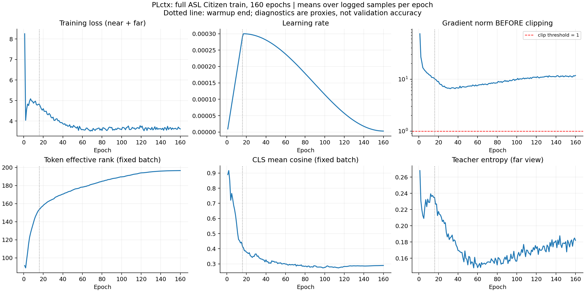

# Rà soát PLctx full ASL Citizen, 160 epoch

## Material Passport

- Origin Skill: academic-research-suite / experiment-agent.
- Origin Mode: validate; diễn giải theo yêu cầu của người dùng.
- Origin Date: 2026-10-12.
- Verification Status: ANALYZED. Đã đọc log, kiểm tra checkpoint và tính lại metrics từ rank có sẵn; không train lại để xác minh tái lập.
- Version Label: PLctx_full160_audit_v1.
- Phạm vi: mã nguồn, manifest, log train, checkpoint, kết quả pilot-compatible và frozen dictionary có sẵn. Không thay đổi method hoặc trọng số.
- Script phân tích: [analyze.py](analyze.py); thống kê và hash nguồn: [audit.json](audit.json).

## Nhận định chính

PLctx full160 là một lần train hoàn tất, ổn định về số học và có học được đặc trưng hữu ích. So với pilot 16k, điểm LOSO và linear probe tăng, nhưng retrieval ASLC300 giảm nhẹ. Frozen dictionary trên test đầy đủ và WLASL còn yếu. Vì vậy, bằng chứng hiện tại ủng hộ tính khả thi và một phần chất lượng representation của method; chưa cho thấy chỉ tăng epoch/dữ liệu là đủ để tạo embedding tốt cho cosine retrieval.

Không có chuỗi validation trong lúc train và checkpoint trung gian bị ghi đè. Do đó, chưa xác định được epoch tốt nhất, mức cải thiện retrieval ở nửa sau, hay có overfitting hay không.

## Method thực tế được chạy

| Thành phần | Cấu hình xác minh |
|---|---|
| Dữ liệu | 40.154 clip train chuẩn, 2.731 lớp, 35 người ký |
| Quy mô video | 3.462.848 frame; khoảng 32,17 giờ theo metadata video |
| Độ dài clip | Trung vị 2,533 giây; 25–75%: 2,000–3,242 giây |
| Chia tập | Train/val/test không trùng video ID hoặc participant ID |
| Đầu vào | Skeleton COCO-WholeBody được chọn thành 103 joint; cửa sổ 64 frame ở min(fps,25) |
| Encoder | 256 chiều, 6 block Transformer, 4 attention head; 5.186.816 tham số |
| Token | 7 kênh × 32 bin thời gian; token tay và mặt |
| Predictor | 128 chiều, 4 block; 827.264 tham số |
| PL mask | Near: che block thời gian trên các kênh (R2); far: che một kênh tay trong một đoạn dài (R3) |
| Target | Contextual teacher token, trung bình LayerNorm của 4 layer cuối |
| Loss | Centered cross-entropy trên feature dimensions; tổng hai view near + far |
| Teacher | EMA student, momentum 0,996 → 0,9999 |
| Optimizer | AdamW, lr đỉnh 3e-4, wd 0,05, clip gradient norm 1,0, bf16 |
| Lịch học | Warmup 20.064 bước = 16 epoch; cosine đến lr 3e-6 |
| Ngân sách | 200.640 bước, batch 32, 160 epoch; 6.420.480 lượt lấy clip |
| Khởi tạo | Scratch, seed 0; không tiếp tục checkpoint pilot 16k |
| Readout chính | Teacher encoder; concat pooling theo nhóm tay trội, tay còn lại, mặt: 768 chiều |

Đây là PLctx: không dùng intrinsic-target loss, global CLS alignment, SIGReg, prototype loss hay curriculum. Các cờ này đều được ghi trong manifest. Nhãn gloss/signer không được đọc bởi dataset train. CLS vẫn có gradient gián tiếp qua encoder/predictor; không có mục tiêu trực tiếp buộc CLS của hai view khớp nhau.

Mask trung bình được log trên toàn grid 7×32 là khoảng 49,7% ở near và 11,4% ở far. Hai tỷ lệ khác nhau là chủ đích ngân sách mask trong code, không phải lỗi log. Chúng không phải tỷ lệ trên riêng các token hợp lệ/quan sát được.

## Kiểm tra hoàn tất và độ ổn định

- Train: 01:36:03–05:39:03 ngày 12/10/2026; 14.580,2 giây = 4 giờ 3 phút. Tốc độ toàn phiên khoảng 13,76 bước/s và 440,36 lượt clip/s, bao gồm thời gian trong vòng train; đây không phải throughput suy luận.
- 4.013 dòng JSON train, đúng mọi mốc log dự kiến: bước 1 và mỗi 50 bước. 803 mốc diagnostics: bước 1 và mỗi 250 bước.
- Dòng log cuối là bước 200.600; diagnostics cuối là 200.500. Checkpoint xác nhận đã chạy đủ 200.640 bước. Không có loss được ghi cho 40 bước cuối; không gán giá trị log cuối thành loss đúng bước cuối.
- Không có giá trị NaN/Inf trong các scalar đã log, không có thông báo skip non-finite gradient, traceback hoặc collapse alarm. Exit code train = 0.
- Tensor student, teacher, predictor và heads ở checkpoint đều hữu hạn. Đây là kiểm tra tensor model; không phải kiểm tra mọi tensor optimizer.
- 14/14 hash file nguồn được launcher ghi lại khớp mã hiện tại tại thời điểm rà soát.
- `ckpt.pt` và `final.pt` đều ở bước 200.640, tensor model giống hệt nhau. Bytes/hash hai file có thể khác do serialization; không phải hai epoch khác nhau.
- Hash final.pt: `8f8a10687f2df869fd0d7f4703edfeb467c59977d7baaacb2d567c15789e41f9`, khớp protocol của cả hai đánh giá frozen dictionary.

Drop-last bỏ 26 clip ngẫu nhiên mỗi epoch. Tổng lượt lấy mẫu tương đương 159,90 lần/clip, không phải bảo đảm mỗi clip xuất hiện đúng 160 lần. Pilot có 16.000×32/3.000 = 170,67 lượt/clip trung bình.

## Diễn biến train

Giá trị dưới đây là trung vị các batch được log trong từng giai đoạn. Log thưa mỗi 50 bước nên không đại diện cho mọi batch. `ctx` và `teacher_entropy` trong code bị view far ghi đè; `loss` mới là tổng near + far. Không diễn giải ctx là loss tổng hay trung bình của hai view.

| Giai đoạn epoch | Loss tổng | CTX far | Gradient norm trước clipping | Token rank trên fixed batch |
|---|---:|---:|---:|---:|
| 1–16 | 4,8411 | 2,6029 | 13,17 | 132,86 |
| 17–40 | 4,2359 | 2,1557 | 7,11 | 164,28 |
| 41–80 | 3,6487 | 1,8017 | 7,67 | 178,40 |
| 81–120 | 3,6388 | 1,7970 | 9,78 | 189,70 |
| 121–144 | 3,6330 | 1,7634 | 11,07 | 195,46 |
| 145–160 | 3,6508 | 1,7676 | 11,32 | 196,52 |

- Loss bước đầu = 34,553, là transient lúc khởi tạo. Không dùng riêng mức giảm từ batch đầu để đánh giá hội tụ.
- Từ khoảng epoch 60–80, loss gần như plateau quanh 3,6. Trung bình loss epoch 41–80 là 3,6561, còn epoch 145–160 là 3,6379, chênh khoảng 0,50%. Điều này cho thấy lợi ích về training objective ở phần cuối nhỏ; không chứng minh validation đã đạt đỉnh.
- Token effective rank trên fixed batch tăng từ 94,58 lên 196,64; token std tăng 0,804 → 1,004. Đây là bằng chứng chống lại tình trạng tất cả token trở thành một vector giống nhau trên batch được theo dõi. Không suy ra representation tối ưu hay bất biến theo người ký chỉ từ rank.
- CLS mean cosine trên fixed batch giảm 0,810 → 0,289; không vượt ngưỡng cảnh báo 0,99 sau warmup. Detector hiện chỉ dựa vào CLS và một batch cố định nên không bao quát mọi dạng suy giảm representation.
- 100% trong 4.013 mốc log có norm >1 trước clipping. Trung vị toàn phiên 9,58, min 5,16; batch đầu 424,10. Clipping hoạt động thường xuyên. Chưa có ablation để biết ngưỡng 1,0 có hạn chế chất lượng; không kết luận đây là nguyên nhân điểm thấp.
- Teacher entropy far trung bình cuối 10% là 0,1785 nat, so với 0,2621 của pilot. Target rất sắc ở nhiệt độ thấp. Token rank vẫn tăng nên entropy nhỏ không đủ để kết luận collapse; log chưa có thống kê sử dụng các feature dimension để kiểm tra mất cân bằng target chi tiết.

## Kết quả trên cùng protocol với pilot 16k

DCG dùng thang 0–1; Rec là phần trăm.

| Đánh giá | 16k | Full160 | Chênh full − pilot |
|---|---:|---:|---:|
| LOSO white512 DCG | 0,4789 | 0,5132 | +0,0343 |
| LOSO white512 Rec@1 | 25,38% | 29,54% | +4,16 điểm % |
| LOSO white512 Rec@5 | 49,12% | 53,73% | +4,61 điểm % |
| LOSO không whitening Rec@1 | 16,96% | 19,68% | +2,72 điểm % |
| ASLC300 white512 DCG | 0,6862 | 0,6712 | −0,0150 |
| ASLC300 white512 Rec@1 | 48,93% | 47,67% | −1,27 điểm % |
| ASLC300 white512 Rec@5 | 74,07% | 72,00% | −2,07 điểm % |
| ASLC300 không whitening Rec@1 | 44,20% | 40,67% | −3,53 điểm % |
| ASLC300 linear probe macro Top1 | 60,80% | 68,87% | +8,07 điểm % |

Paired signer-cluster bootstrap có sẵn, 10.000 resample, cho CI95% chênh Rec@1 LOSO [+1,91; +5,12] điểm %, ASLC300 [−3,01; +2,25] điểm %, linear probe [+4,06; +12,12] điểm %. Đây là CI theo dữ liệu/signer của một cặp model, không đo độ biến thiên qua seed. Có 6 signer ở LOSO nhưng một signer chỉ có 2 clip; ASLC300 chỉ có 5 signer. Các CI mang tính mô tả/thăm dò và không điều chỉnh cho nhiều phép so sánh.

Ở LOSO, full đúng thêm 1.322 query mà pilot sai, nhưng làm sai 893 query pilot đúng: lợi ròng 429/10.304. Rec@1 tăng ở 4/6 signer, giảm ở 1 signer và một signer giữ 0% trên 2 clip. Ở ASLC300: 174 query được sửa, 193 query mất, lợi ròng −19/1.500; chỉ 1/5 signer tăng retrieval. Linear probe tăng ở cả 5 signer ASLC300.

Pilot train đúng 3.000 clip thuộc 300 lớp của gallery ASLC300, không trùng query. Full train mở rộng tới 2.731 lớp. Sự chuyên biệt của pilot là một giả thuyết giải thích giảm ASLC300; loss, lịch EMA, lịch nhiệt độ và số optimizer update cũng thay đổi theo ngân sách nên chưa tách được tác động riêng của lượng dữ liệu.

LOSO white512 fit PCA trên cửa sổ của cả validation, không dùng nhãn: đây là thiết lập transductive theo phân phối input. ASLC300 fit whitening trên gallery train. Frozen dictionary bên dưới hoàn toàn không fit whitening. Ba thiết lập không được dùng thay thế cho nhau khi so điểm.

## Frozen dictionary: test đầy đủ và WLASL

Teacher frozen; readout `_grp` cố định trước đánh giá; pooling raw window mean rồi L2; cosine và rank theo lớp; không classifier, fine-tuning hoặc whitening. Native skeleton 64 frame, stride 2; không có activity head. Đây là protocol dictionary với thích nghi đầu vào, không phải toàn bộ pipeline RGB 16 frame của SignRep giống hệt.

| Dataset | Query / lớp | DCG | Rec@1 | Rec@5 | Rank trung vị |
|---|---:|---:|---:|---:|---:|
| ASL Citizen test | 32.941 / 2.731 | 0,3962 | 16,68% | 36,90% | 13 |
| WLASL2000 test | 2.879 / 2.000 | 0,3055 | 9,62% | 24,42% | 39 |

ASLC: đúng 5.494 query ở top1 và 12.154 ở top5. WLASL: 277 và 703. Đã tính lại ba metrics từ file ranks và khớp JSON. Không bỏ query. ASLC có 39 gallery và 8 query có embedding grp bằng 0 vẫn được giữ; WLASL không có. 8/32.941 query bằng 0 chỉ chiếm 0,0243%, không đủ giải thích mức điểm thấp tổng thể.

Class-macro Rec@1: ASLC 16,79%, WLASL 9,22%. ASLC gần instance score nên kết quả thấp không chỉ là do vài lớp đông chi phối. ASLC test có 11 signer, Rec@1 dao động 11,40%–27,34%; P48 thấp nhất và P47 cao nhất. Đây là chênh lệch quan sát, không chứng minh nhân tố gây chênh lệch.

| Readout | ASLC Rec@1 | WLASL Rec@1 |
|---|---:|---:|
| grp, chính | 16,68% | 9,62% |
| mean, phụ | 14,23% | 9,62% |
| CLS, phụ | 0,26% | 2,19% |

Group pooling hữu ích trên ASLC. CLS đặc biệt yếu trong retrieval, phù hợp với việc không có global CLS alignment trực tiếp, nhưng cần ablation để quy nguyên nhân. Không dùng kết quả test để đổi readout chính sau đánh giá.

Các mốc SignRep public đã đo cục bộ, dữ liệu pretrain/input khác: ASLC weighted Rec@1 49,02%; WLASL avg 26,50%, weighted 29,42%. Full160 còn cách xa cả avg và weighted WLASL. WLASL JH3D avg có Rec@1 8,37% nhưng DCG 0,3204 và Rec@5 25,49%: full160 hơn top1 nhưng thấp hơn DCG/Rec@5, nên không thể tuyên bố vượt JH3D toàn diện. Nguồn tham chiếu được phân biệt trong [comparison.csv](../PJ_PLctx_FULL_160ep_dictionary/comparison.csv).

## Đặc trưng đang mã hóa điều gì?

Probe trên validation, 2 outer fold tách signer; Ridge alpha chọn qua inner signer CV. Chỉ là khả năng giải mã tuyến tính các prior cụ thể, không phải toàn bộ thông tin ngôn ngữ trong embedding.

| Prior probe R² | Pilot16k | Full160 |
|---|---:|---:|
| Handshape | 0,2766 | 0,3246 |
| Location relations | 0,1242 | 0,1711 |
| Body | 0,0467 | 0,0320 |
| Movement | −0,0349 | −0,0295 |
| Non-manual | −0,2755 | −0,2599 |

Handshape và quan hệ vị trí tăng. Movement/non-manual vẫn R² âm theo probe này, nghĩa là tệ hơn baseline trung bình theo định nghĩa R² được dùng; không suy ra model hoàn toàn không có thông tin chuyển động/mặt.

Signer probe accuracy tăng từ 90,27% lên 93,73% trên 6 signer validation, với train/test probe tách nhóm gloss. Điều này chứng minh danh tính người ký còn dễ giải mã tuyến tính. Đây là tín hiệu cần chú ý nếu mục tiêu là generalization sang người ký mới, nhưng không tự chứng minh danh tính là nguyên nhân retrieval sai.

Mean cosine giữa embedding clip validation không whitening tăng 0,3565 → 0,4397, trong khi effective rank tăng 423,21 → 481,79. Đặc trưng vẫn đa dạng nhưng có thành phần chung mạnh; whitening mang lại lợi ích LOSO +9,86 điểm % và ASLC300 +7,00 điểm %. Hai chỉ số geometry này không cùng tensor/batch với diagnostics token khi train.

## Nhận định và thứ tự kiểm chứng đề xuất

1. Giữ full160 làm baseline đã hoàn tất. Có lợi ích representation thực tế so với pilot, nhưng chưa là cấu hình mạnh cho frozen cosine retrieval và chuyển miền sang WLASL.
2. Ưu tiên lần train sau lưu checkpoint ở epoch 40/80/120/160 và đánh giá validation cùng protocol. Training loss plateau không đủ để chọn early stopping; hiện chỉ giữ state cuối nên không khôi phục được các epoch này từ log.
3. Chạy nhiều seed trên cấu hình đã cố định để đo độ ổn định. So sánh cùng data và cùng ngân sách mới giúp phân biệt biến thiên tối ưu với lợi ích method.
4. Nếu cải thiện method, ablation có kiểm soát về global alignment, representation chuyển động/non-manual, và khả năng bất biến theo signer có cơ sở hơn chỉ kéo dài train. Không bật nhiều thay đổi cùng lúc rồi quy toàn bộ lợi ích cho một thành phần.
5. Thử ngưỡng clipping/lịch teacher trong một đối chứng riêng sau khi có validation curve. 100% clipping và target sắc là dấu hiệu cần đo thêm, chưa là lỗi đã xác định.
6. Giữ test đầy đủ/WLASL làm báo cáo cố định; chọn hyperparameter và checkpoint trên validation, tránh tối ưu nhiều vòng trực tiếp vào test.

Lưu ý kỹ thuật kế thừa: canonical handedness dùng thông tin toàn clip để quyết định mirror trước mask; code đã chú thích đây là 1-bit content leak trong bài toán masked prediction. Đây không phải leakage nhãn hoặc train/test ID; nên khai báo khi mô tả method và có thể dùng random-handedness làm ablation riêng. File cache có thiếu keypoint/validity mask; zero embedding đã được giữ trong evaluation.

## Kiểm tra diễn giải thống kê: 11/11

| Kiểu sai lệch/suy luận | Kết quả rà soát |
|---|---|
| Simpson | Đã kiểm tra signer: LOSO tăng 4/6, ASLC300 retrieval tăng 1/5, probe tăng 5/5; không suy từ aggregate thành mọi signer đều tốt hơn |
| Ecological | Không gán thống kê nhóm thành đặc tính từng clip; công bố phân tầng signer |
| Berkson/selection | ASLC300 là tập 300 lớp chọn trước và trùng phạm vi lớp pilot; không suy ra chất lượng toàn bộ corpus |
| Collider | Không thực hiện mô hình causal hay điều chỉnh biến trung gian; không áp dụng trực tiếp |
| Base rate | Đã báo số lớp, query và class-macro; không áp dụng PPV/NPV |
| Regression to mean | Một seed, không loại trừ dao động tối ưu; không coi giảm nhẹ là hiệu ứng ổn định |
| Survivorship | Không loại query; công bố zero embedding và tie; train đã hoàn tất, không chỉ chọn các đoạn log tốt |
| Look-elsewhere | Công bố nhiều metric/readout, primary grp cố định; CI thăm dò, không multiplicity-adjusted |
| Forking paths | Khai báo protocol, whitening, readout, stride; không chọn test-optimal readout |
| Correlation/causation | Signer information, clipping, target entropy và scope dữ liệu chỉ là giả thuyết/diagnostic, không quy nguyên nhân |
| Reverse causality | Loss/geometry và score không chứng minh chiều causal; không áp dụng kết luận causal |

## Artifacts

- [audit.json](audit.json): thống kê đầy đủ, manifest, hash nguồn, checkpoint checks, ranks kiểm lại.
- [phases.csv](phases.csv): mean/median theo các giai đoạn ngân sách.
- [epochs.csv](epochs.csv): trung bình log theo epoch.
- [paired_signers.csv](paired_signers.csv): thay đổi retrieval theo signer giữa full và pilot.
- [aslc_test_signers.csv](aslc_test_signers.csv): DCG/Rec@1/Rec@5 theo 11 signer test.
- [training_curves.png](training_curves.png), [training_curves.svg](training_curves.svg): biểu đồ standalone.

Tái tạo phân tích bằng `.venv-signrep/bin/python method/phonojepa/runtime/eval/PJ_PLctx_FULL_160ep_audit/analyze.py` từ thư mục repo. Script chỉ đọc nguồn đã có và ghi vào thư mục audit này. Không có GPU train/eval mới trong lần rà soát.
