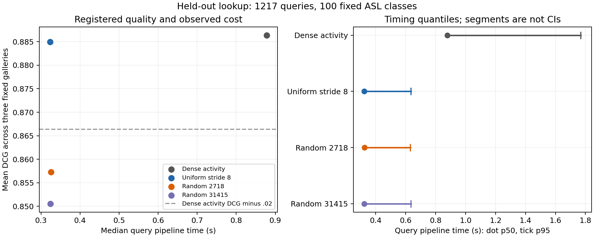
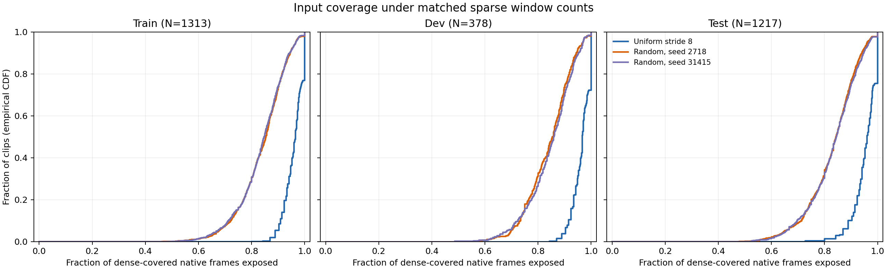

# H002 analysis dossier — registered held-out screen completed

Status: **draft, not PAPER_READY**. Updated2026-10-04 after CONFAN002, SYNTH002 and exploratory FACTOR001.
Main H/P: H002/P002_v1/P003_v1, auxiliary A001. Repo base
6da1e45894dbbc46faa73f8f1be64d841ed5dcd5; new namespaces untracked, per-run
source snapshots/hashes authoritative. No venue selected/policy check or submission.
Contribution candidate is a scoped cost/quality analysis, not a new sampler.

## 1. Problem and proposed contribution

Question: in fixed-checkpoint, eight-label-per-class ASL dictionary lookup, does
uniform native stride8 reduce actual query encoder calls by>=2× and measured
pipeline time by>=20%, while retaining DCG within the prospective.02margin
against dense stride2 activity pooling across three fixed train galleries?

The use case is offline RGB dictionary lookup with limited labeled gallery
examples and a bounded GPU allowance. Dataset/class labels support relevance
ranking; no user study, sign intelligibility or Deaf-usefulness evidence exists.
This use case and the margin are planning choices, not claims of deployment value.
Observed pilot tradeoff: C024/F020 and C025/F021, QUAL001/TIME001/REPORT001.
Existing stride8 config is acknowledged by C026/F022, so sampler novelty is false.
A reproducible cost boundary and conditional quality/coverage/error audit may be
useful as analysis; publishable contribution remains unproven pending full evidence.

## 2. Closest work and novelty boundary

| Source | Existing contribution/access | Relation to this study | Open comparison |
| --- | --- | --- | --- |
| [S03F SignRep CVF](https://openaccess.thecvf.com/content/ICCV2025/papers/Wong_SignRep_Enhancing_Self-Supervised_Sign_Representations_ICCV_2025_paper.pdf) §§6/7.2/Table5 | RGB window encoder, activity pooling, frozen lookup; main retrieval stride2 and WLASL ablation stride8 | same encoder/pooling family; uniform8 already exists | official CVF selected facts verified by LIT002; no full version/IEEE byte diff; matched-cost analysis gap unproven; no sampler novelty |
| [S10 ASL Citizen](https://papers.neurips.cc/paper_files/paper/2023/file/f29cf8f8b4996a4a453ef366cf496354-Paper-Datasets_and_Benchmarks.pdf) §3.3/§4 | participant-split RGB dictionary/recognition setting and ranked metrics | source task and exact labels; our100-class/eight-gallery budget is adapted | no official full2731-class or published-score equivalence |
| [L01 SignSeek](https://arxiv.org/html/2609.03695v1) §§3/4.1 | labeled multilingual pose pretraining and train-gallery/test-query class-max retrieval | class-max protocol comparator; different modality/supervision | released evaluator, exact ties/zero-vector details and full ablations unaudited; no numeric comparison |
| [L04 SignMatch](https://arxiv.org/html/2609.01886v1) §§3/4/5.1/5.4 | SignRep-initialized RGB backbone trained with sign prototypes and dictionary LSTM alignment, extra labeled/pseudo-labeled corpora; ASL Citizen retrieval | closest task/backbone and temporal dictionary aggregation already exist | different training/access/context/512D head; official project has release placeholder, no matched local numeric comparison |
| [S13 SignCLIP](https://aclanthology.org/2024.emnlp-main.518/) §6.1/Table5 | pose/text contrastive pretraining and limited-gallery KNN/probes | limited-gallery evaluation already exists | backbone, support count, labels, cohorts and rank procedure differ; scores incomparable |
| [S12 Temporal Lift Pooling](https://www.ecva.net/papers/eccv_2022/papers_ECCV/papers/136950506.pdf) §§3.1/3.2 | learned temporal downsampling inside CSLR | temporal reduction/pooling already established | downstream sequence cost boundary and labels differ; full compute/evaluator review pending |

Bounded literature matrix/source cards, latest [dated direction audit](../literature/NOVELTY_20261004_H002_r2.md)
2026-10-04. Official CVF main/supp selected sections acquired by LIT002; local
PDF page preflightUNAVAILABLE becausepypdfabsent, no trusted numericpage anchors.
Selected readings are not whole-paper/code or exhaustive-gap audits.
No venue-ready direction lock. Uniform/random differences can support an exposure
diagnostic; no causal representation, adaptive selection or linguistic mechanism claim.

## 3. Method and access specification

Implementation: [adapter](../../../../method/frozen_probe/signrep_adapter.py),
[policies](../../../../method/frozen_probe/window_budget.py),
[held-out contracts](../../../../method/frozen_probe/confirmatory.py),
[prediction runner](../../../../method/frozen_probe/scripts/predict_confirmatory.py).
Original scientific code/config SHA freeze and technical erratum linked below.

Input RGB native frames, full-frame resize224×224/ImageNet normalization, no crop,
flip, augmentation or FPS resampling. Complete16-frame windows, source stride2,
strict monotone native PTS, incomplete tail dropped. Frozen/eval published SignRep
checkpoint, strict tensor coverage, FP32/TF32off, batch2. Nativeforward computes
features768, latent768 and activity2; the probe uses features and activity. No
fine-tuning, new parameters, loss, teacher inference, text or linguistic labels.
Published pretraining/sign-prior provenance and initialization are recorded in
S03; exact downstream/source-level pretraining overlap is not independently known.

Dense encodes every window. Uniform8 encodes dense indices0,4,8,..., source starts
0,8,16,...; random8 controls choose the same rounded-up count without replacement,
sorted, source-SHA/registeredseed2718or31415 keyed; labels/activity never drive
selection. Weight=maximum of two regression outputs clamped[0,1]; pooled vector
is weighted mean or unweighted mean if totalweight<=1e-12, followed by per-clipL2.
Dense full_mean shares dense encoder outputs for quality only. No learned corpus
normalization/calibration/PCA/encoder adaptation or test fit.

Three fixed train galleries800clips each, eight/class, supportseeds1701/2/3;
unique union1313sources, same IDs for every method. Immutable verified CACHE005
native gallery features reused, fixed source-only selection/pooling; actual sparse
encoder/cache parity already TIME001. Gallery CPU setup and historical GPU cost
disclosed separately. Each query compares normalized768D vector to all gallery
instances, maximum per class, descending cosine/ascending class-ID ties.

Complexity: K actual16-frame encoder calls per source plus full-frame decode/
preprocessing for Fnativeframes, unchanged across policies; exact search over
three800×768 galleries. This is offline compression; access to the full clip and
native window context prohibits a causal/streaming latency claim. Every query/
recipe runs independent decode/preprocess/selected encoder/pool/search inside
timing. Model/gallery setup, source hashes, parity, full_mean secondary work and
persistence excluded from query timing but included in conservative GPU allocation
wall cost. One paired observation/query/recipe, cyclic seed1701 order, shared
eligible GPU/OS cache uncontrolled. Own short CPU reporting work also overlapped
parts of the run; timings describe that measured shared environment.

## 4. Evaluation and registered interpretation

[P003_v1](../protocols/P003_v1.md), [original pre-test freeze](../protocols/P003_v1_freeze.json),
[warmup erratum](../protocols/P003_v1_warmup_erratum.md),
[warmup technical gate](../protocols/P003_v1_warmup_gate.json),
[serialization erratum](../protocols/P003_v1_serialization_erratum.md),
[latest technical gate](../protocols/P003_v1_serialization_gate.json).
Selected test access follows original scientific freeze; technical warmup guard
corrected after metadata and before inference/scoring. Same fixed dev warmup
source retained; original train adjective wrong, all scientific configs unchanged.
No silent pristine-code-freeze claim. CONFTEST00250checks/no skips passed.
After terminal predictions and independent exact regeneration of all15rankings
(PREDVERIFY001), first CONFAN001 internally computed metrics but failed before
persisting/shown numeric outputs: NumPybool strict-JSON serialization. Retained
failed attempt and exact diff; only unchanged comparison converted to Pythonbool,
57regression/JSON checks passed (SERTEST001), same config retryCONFAN002 succeeded.
No changed scientific comparison, selection or GPU inference rerun.

COHORT001 exact100 train-selected classes, no test resampling. All1217 official
test rows matching those classes,11actual participants, complete pixel/PTS/source
audit PRETEST001,0exclusions. All official train/dev participant and filename
disjointness and exact selected-source byte-duplicate checks pass. Bounded
near screen653053eligible crosspairs has0candidates; not exhaustive uniqueness.
No session/pretraining disjointness guarantee. This is a signer-separated split
under available IDs, not unseen-pretraining/official full-dataset reproduction.

Pinned public rank scorer parity VAL001, commit17f0148b00ef87a5957ec103da8d10bd8eb1fa23;
complete100-class permutations and queryID joins required. DCG=1/log2(rank+1),
MRR=1/rank and Top1/5/10/20 fractions. Primary micro DCG mean across three fixed
support galleries. All15method/gallery ranks and individual metrics retained.
Quality screen: uniform8 mean difference>=-.02, every gallery loss<=.02 and
lower endpoint of paired participant percentile95% interval>=-.02;2000reps,
seed1701, per-query differences averaged across galleries, micro repeated-group
weighting. Conditional on fixed classes/checkpoint/galleries, fewgroups; no
population statistical equivalence. Cost screen exact>=2×query windows reduction
and median paired query pipeline ratio<=.8. Joint pass requires both.

Train-only length quartiles23/31/41nativewindows and effective-activity fraction
quartiles.687703690/.803404592/.880571477 frozen on all1313train sources. Report
actual slice/groupN, empty slices, per-gallery outcomes, all negative results.
Four qualitative Top1 categories in gallery1701, deterministic SHA seed1701order,
first5each or all if fewer; no sign-content interpretation without qualified humans.
A001 exposure analysis added after metadata but before quality feedback is
descriptive auxiliary, not another original confirmatory endpoint.

## 5. Registered held-out results

CONFIRM001 completed all1217queries,4868 independent query-recipe pipelines and
68295 actual encoder windows. Sparse/dense feature/activity/center parity passed
for all sources, tolerance1e-5/1e-4. PREDVERIFY001 independently regenerated all15
class-rank matrices exactly from verified pooled query vectors and train galleries.
CONFAN002 recomputed the registered primary metric/uncertainty and all diagnostics.

| Method | Mean DCG | Top1 (%) | Query encoder windows | Pipeline p50/p95 (s) |
| --- | ---: | ---: | ---: | ---: |
| Dense full_mean | 0.842867024 | 72.8294 | shares dense pass | no separate timing |
| Dense full_activity | 0.886378665 | 80.3889 | 38238 | 0.878318 / 1.769789 |
| Uniform8 | 0.884978943 | 80.1150 | 10019 | 0.323220 / 0.636664 |
| Random8 seed2718 | 0.857259423 | 74.4727 | 10019 | 0.325376 / 0.632040 |
| Random8 seed31415 | 0.850541570 | 73.1854 | 10019 | 0.324232 / 0.635374 |

All mean quality metrics average three fixed train support galleries. Primary
uniform-minus-dense DCG difference −0.001399723; conditional paired11participant
95% interval [−0.004337290,+0.000968716]. Per-gallery losses1701/1702/1703:
0.001791614/0.002752918/−0.000345364. Mean, every-gallery and interval floors pass
registered0.02margin. Window count reduction3.816548558×; median of paired query
pipeline ratios0.373602586 (62.6397% shorter), passing0.8floor. Joint prospective
screen passes [D010](../decisions/D010.md); no population equivalence claim.

Figure excludes full_mean from cost axes because it shares dense inference.
Timing segments are p50–p95 quantiles, not confidence intervals. The plotted
margin line alone does not represent the joint mean/gallery/uncertainty/cost test.
Full [metrics and uncertainty](CONFAN002_analysis.json), [registered table](CONFAN002_table.md),
[plot source data](SYNTH002_figure_data.csv) retained. Model/gallery setup, hashes,
parity, persistence and full_mean secondary pooling/search excluded from query
pipeline timers; all are included in allocated GPU wall cost as applicable.
One observation/query/recipe; fixed random order/cyclic rotations, uncontrolled
OS cache, shared-eligible GPU and some own CPU reporting overlap limit inference.

Negative H001 recipe result retained: ordered67.1958% versus activity-nearest
78.3951%, difference−11.1993pp, conditional five-group interval[−14.0257,−6.6321]pp.
H002 dev pilot remains exploratory (QUAL001/TIME001/REPORT001); no retroactive
confirmatory label. All6/6 original policy trials consumed; no test-driven tuning.
Both random8 controls test mean losses exceed0.02 despite satisfying dev mean floors.

## 6. Mechanism/error analysis and validity limits

Mandatory simpler alternatives full_mean/full_activity and matched-call random8
controls use identical encoder/features/dictionary/labels/dimension. Structural
COVER001: selected test mean frame coverage uniform8.953717 versus random8
.830741/.833046; median longest uncovered gap2versus8frames. Exposure denominator
is the dense complete-window domain, excludes its dropped tail, time end may be
estimated. This is consistent with more even input exposure; retrieval-quality
association, causal explanation and linguistic information preservation are not
established. Report random controls even if any beat uniform8 on a seed/slice.

Full source rows and figure data retained. Native frame regularity/PTS proxies
do not label sign complexity, compound boundaries or activity correctness. Registered slices and every predeclared case are exported in the
[diagnostic report](SYNTH002_diagnostics.md) and [case rank CSV](SYNTH002_cases.csv):
length quartiles N399/270/312/236, activity-proxy quartiles N305/321/159/432.
All slice denominators cover1217queries. Gallery1701 categories:966bothsuccess,
218bothfailure,19denseonly,14sparseonly; exactly5/category retained (20cases).
Exact gloss mapping is metadata, not a visual/content or linguistic review.
All participant deltas retained; P22/P42 point deltas−.00922615/−.00899453.
Slices/controls are descriptive, without multiplicity-adjusted inference.
Both query and gallery policy change, so original diagonal deficits cannot be
attributed solely to query exposure. A002 was registered after original outcomes,
before first mixed-outcome computation: all16query/gallery pairs×3supports,
all1217queries,48complete ranks; all12originalactivity-method diagonals exact.
[Complete factorial table](FACTOR001_table.md), [allseed/participant/Top1 contrasts](FACTOR001_summary.json).

| Sparse recipe | Query-only DCG delta | Gallery-only DCG delta | Joint delta | Interaction |
| --- | ---: | ---: | ---: | ---: |
| Uniform8 | −0.000605126 | −0.000431140 | −0.001399723 | −0.000363457 |
| Random8 seed2718 | −0.010711560 | −0.015065858 | −0.029119242 | −0.003341824 |
| Random8 seed31415 | −0.014147369 | −0.013045489 | −0.035837096 | −0.008644238 |

These are post-outcome exploratory descriptive contrasts. Both sides show random
recipe deficits, not sole query exposure. Inclusion-exclusion interaction is an
arithmetic ranking diagnostic, not a causal mechanism estimate. No mixed-pair
latency measured, new policy selection or change to original P003 conclusions.
No cherry-picked video narratives. Broad representation utility, second-language/domain generality,
real users and linguistic/grammar claims unsupported. A second independent setting
would be needed for broad claims; current question remains this fixed setting.

## 7. Reproduction and full cost

[Generated terminal/preparation index](REPRO004_reproduction.md) with JSON code/config/output hashes,
actual historical argv and source snapshots; raw ranks/manifests in ignored runtime,
large gallery payload in content-hashed /dev/shm. Never rerun into completed dirs.
THR001 historical stdin-driver gap closed by versioned THRREPRO001 command, exact
byte parity on both pre-test artifacts, no new thresholds/test fit. Rebuilding a
lost RAM cache costs a newly registered GPU run; metadata alone is not payload.

Checkpoint SHAf8be8ca44aec4d7066175dccc681338f376ec86de6ba72bc79223a6bbd3c766b;
cachemanifest SHA4b2217203fb25af9110226e06cb56f7171ae4b46b111b9bf77c049c33ab9e737.
Selected train/dev manifest and test CSV/source hashes in original gate/PRETEST001.
Python3.13.5/torch2.11.0+cu128/timm1.0.20/albumentations2.0.8/numpy2.5.3;
RTX5880Ada GPU0, 8GiBallocator cap, no installs/global changes. Raw CUDA visibility,
thread environment, package/source hashes recorded per run. Figures use installed
matplotlib, version/CSV/caption stored; no claimed bitwise render determinism.
At original P003 synthesis checkpoint (historical): terminal owned GPU4942.689396s (1.372969277h), no live owned attempts then.
H0012487.344571s, H0022455.344825s including2397.640770s main inference;
program remaining9457.310604s. Query latency is not this total program cost.
Program ceiling14400s; D009 allocationsH0011h/H0022h/H0031h, maxone ownedGPU job.
All failed/diagnostic attempts remain in budget ledger. No external data/feature upload.

## 8. Limitations and readiness review

Noncommercial research dataset terms REL001; original video sources/read-only
upstream unchanged. Existing checkpoint upstream provenance verified by published
asset size/SHA; pretraining video/session identities unresolved. Native feature
release not authorized, embeddings not assumed anonymous. Source identity/near
screen cannot establish full corpus/pretraining uniqueness. OfficialsuppA3
reports WLASLval checkpointselection: WLASL is not automatically a checkpoint-
selection-independent transfer domain, even with author-reported YT-SL video-ID
exclusions; ASL source overlap remains independently unknown. Root20%bulk reserve
fails; only lightweight records there, bounded tmpfs and hostRAM reserve checked.

Internal same-agent skeptical review: existing sampling config plus a small
adapted cohort may be insufficient conference contribution even if quality/cost
passes. One shared hardware environment and uncertain overlap limit scope.
Scorer fixture parity does not reproduce all official benchmark conventions.
Confirmatory metrics and numeric cases complete; contribution justification and any necessary expert content review remain open.
Selected official CVF facts now checked; no whole IEEE/version audit claim. No external-independent/human linguistic review.

Readiness: prospective held-out quality/cost screen, registered slice/group
denominators, twenty numeric/gloss cases, source-only coverage and replay outputs
complete. Final direction/contribution lock and scientific review remain open;
[D011](../decisions/D011.md) adds closest-work audit and attribution qualification. Existing stride8 is not a new method. No
PAPER_READY, venue/submission or acceptance claim. D012 continues scoped synthesis and P004 fixed-policy dev-first registration;
H001 tested recipe killed and H003 held. Any broader claim requires independent
settings and further prospective evidence.

## Historical replication planning (superseded by D013/D014)

COHORT002 fixes100fresh train-selected vocabulary classes excluding the original
100, seed1704,1labeledexample/class with supportseeds1701/2/3:278train/383dev sources.
VID003 completes all661nativepixel/PTS/hash audits/24001windows; SIZE003bounded
heuristic finds0cross-split candidates among33961eligiblepairs (not uniqueness).
No new selectedtestpixels/features/outcomes or newmodelquality measured. Global
testCSVmetadata and originalP003scores were known and are explicitly disclosed.

[DecisionD012](../decisions/D012.md) requires fulltrain/devnativecache and fixed
uniform8/dense/mean/twooriginalrandom8qualitypilot before any newtest. Original
HPO6/6exhausted; no newpolicyselection. Conditionalplanned1053.499447sfullcache+
3657.134034squeries=4710.633481s versus4744.655175sH002remaining, only34.02sestimate
headroom. This is a projection fromdev/knownoldtest ratios/rates, not a launchgate
or timing bound; exactpostfreezequery/costcheck and source/contracts stillrequired.
A newvocabulary/labelbudget in samecorpus is not independent signer/language/domain
generality or publication novelty. Current P003/A002 outcomes unchanged.

## Fixed one-example dev evidence and fresh-test applicability limit

[REPQUAL001](../experiments/REPQUAL001_quality.json) is prospective dev-only
replication:383queries/fiveparticipants/100freshclasses/threeone-example galleries.
Uniform8DCG.764911851704, denseactivity.766706135743, difference−.001794284039,
conditional95%participantCI[−.006716077204,.003824355141]; allgallerylosses<=.02.
Query14031dense/3654uniformwindows; cachedcounts only/no new latency measurement.
Originalmean andbothrandomcontrols retained, no selection or newHPO. Fullnative
661source cacheGPU703.502506s; programactual5646.191902s/14400. [D013](../decisions/D013.md).

[P004scientificfreeze](../protocols/P004_v1_test_freeze.json) precedes freshselected
test access04:48:58.460474UTC versus04:49:15.641858UTC. OriginalP003 remains
unchanged. All1203newtest sources/11groups are fullyaudited; exactlyoneSPEND
source has10nativeframes, so no full16frame window under unchangednative/no-pad
recipe. OfficialZIPmember bytes equal local, rejecting localcorruption explanation.
No sourceexclusion/padding/newtest prediction or performance denominator.
[D014](../decisions/D014.md) stops P004testscaling;
[fullcensus](../inventory/CONTRACT001_source_census.json),
[releaseequality](../inventory/SHORTREL001_release_equality.json). This is input/task
compatibility limitation, not measured representation/sampling inferiority.
P004devpositive cannot be presented as completedconfirmatory replication, and
P003valid adapted100class result cannot implyallcorpus/short-source coverage.

Latest [reproductionindex](REPRO005_reproduction.md) binds41completed standard
runs plus originalfailures/VID003flatlayout/newfailedtestattempt. H003inputaudit
is nextsafe work; novelty/contribution/scientificdirection lock remains open.
NoPAPER_READY/external linguistic review/venue/submission claim.

## Current contribution review — D022

The H002/P004 reproduction index above covers its historical scope. Current
program cost and queue are in STATE/SESSION_AUDIT_r14; effective GPU5723.708538375s
of14400, no live owned attempt. H003 annotation/score semantics audited without
creating manual correctness labels. New H004 CPU completion diagnostics do not
alter any original scientific result, prediction or frozen core.

[Contribution assessment](../literature/NOVELTY_20261004_H002_H004_r3.md) retains
H002's scoped utility while rejecting sampler novelty. H004 component/pair bounds
save only1.627349%/4.109947% simulated windows and both fail the registered practical
gate; [D022](../decisions/D022.md) stops their GPU scaling. Cached Top1/reference
agreement is not improved task quality/full-rank or formal FP32 certification.
S19 user-interface evidence concerns another task and cannot establish local
video lookup usability. No method is currently promoted, and the paper gate
remains open. Source cards document bounded partial reading, not full review.
